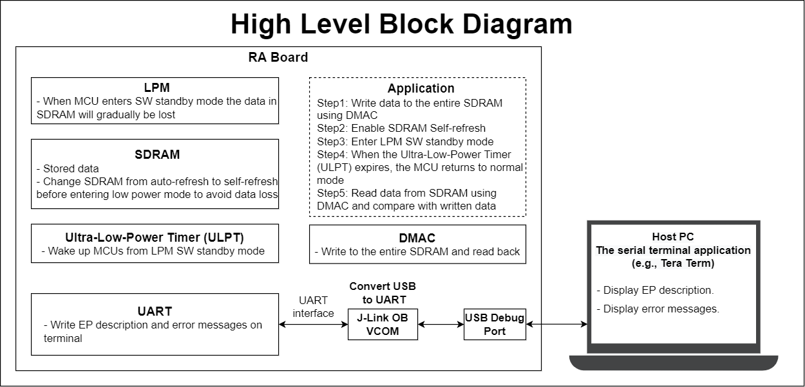
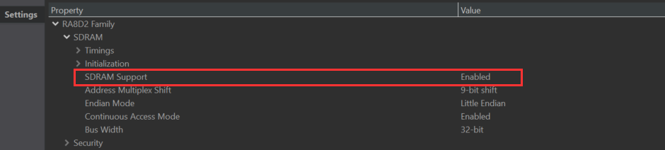
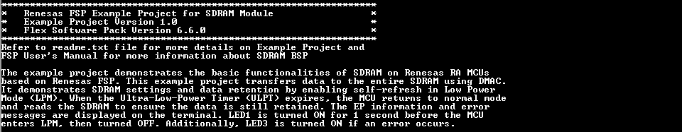

# Introduction #
The example project demonstrates the basic functionalities of SDRAM on Renesas RA MCUs based on Renesas FSP. This example project transfers data to the entire SDRAM using DMAC. It demonstrates SDRAM settings and data retention by enabling self-refresh in Low Power Mode (LPM). When the Ultra-Low-Power Timer (ULPT) expires, the MCU returns to normal mode and reads the SDRAM to ensure the data is still retained. The EP information and error messages are displayed on the terminal. LED1 is turned ON for 1 second before the MCU enters LPM, then turned OFF. Additionally, LED3 is turned ON if an error occurs.

Please refer to the [Example Project Usage Guide](https://github.com/renesas/ra-fsp-examples/blob/master/example_projects/Example%20Project%20Usage%20Guide.pdf) for general information on example projects and [readme.txt](./readme.txt) for specifics of operation.

## Required Resources ## 
The following resources are needed to build and run the SDRAM example project.

### Software ###
* Renesas Flexible Software Package (FSP): Version 6.6.0
* e2 studio: Version 2026-07
* LLVM Embedded Toolchain for ARM: Version 22.1.0
* Terminal Console Application: Tera Term or a similar application

Refer to the software required section in [Example Project Usage Guide](https://github.com/renesas/ra-fsp-examples/blob/master/example_projects/Example%20Project%20Usage%20Guide.pdf)

### Hardware ###
* Supported RA boards: EK-RA8D1, EK-RA8E2, EK-RA8P1, EK-RA8D2, EK-RA8T2.
  * 1 x Host PC.
  * 1 x Renesas RA board.
  * 1 x USB cable for programming and debugging (USB cable type varies by board model).

### Hardware Connections ###
* Connect the RA board USB debug port to the host PC using the appropriate USB cable for EP programming and debugging.

* For EK-RA8D1: Set the configuration switches (SW1) as below.

  | SW1-1 PMOD1 | SW1-2 TRACE | SW1-3 CAMERA | SW1-4 ETHA | SW1-5 ETHB | SW1-6 GLCD | SW1-7 SDRAM | SW1-8 I3C |
  |-------------|-------------|--------------|------------|------------|------------|-------------|-----------|
  | OFF | OFF | OFF | OFF | OFF | OFF | ON | OFF |

* For EK-RA8T2: The user must set the configuration switches (SW6 and SW4) as below to use the on-board debug functionality.

  | SW6-1 | SW6-2 | SW6-3 | SW6-4 | SW6-5 | SW6-6 | SW6-7 | SW6-8 | SW6-9 | SW6-10 |
	|:-----:|:-----:|:-----:|:-----:|:-----:|:-----:|:-----:|:-----:|:-----:|:------:|
	|  OFF  |  OFF  |  OFF  |  OFF  |  ON   |  OFF  |  ON   |  ON   |  ON   |  ON    |

	| SW4-1 | SW4-2 | SW4-3 | SW4-4 | SW4-5 | SW4-6 | SW4-7 | SW4-8 |
	|:-----:|:-----:|:-----:|:-----:|:-----:|:-----:|:-----:|:-----:|
	|  OFF  |  OFF  |  OFF  |  OFF  |  OFF  |  OFF  |  OFF  |  OFF  |

## Related Collateral References ##
The following documents can be referred to for enhancing your understanding of the operation of this example project:
* [FSP User Manual on GitHub](https://renesas.github.io/fsp/)
* [FSP Known Issues](https://github.com/renesas/fsp/issues)

# Project Notes #

## System Level Block Diagram ##
High level block diagram of the system is shown below:

## FSP Modules Used ##
List all the various modules that are used in this example project. Refer to the FSP User Manual for further details on each module listed below.

| Module Name | Usage | Searchable Keyword  |
|-------------|-----------------------------------------------|-----------------------------------------------|
| DMAC | DMAC is used to write data from SDRAM and read back to verification without CPU. | r_dmac |
| Low Power Modes | LPM is used to configure power cancellation, mode selection and return the MCU to low power mode to reduce power consumption. | r_lpm |
| Ultra-Low-Power Timer | ULPT is used to wake up CPU from Low Power Mode. | r_ulpt |
| I/O Port | I/O Port is used to control on-board LED. | r_ioport |

**Configuration Properties for SDRAM transfer (DMAC)**
|   Module Property Path and Identifier   |   Default Value   |   Used Value   |   Reason   |
|-----------------------------------------|-------------------|----------------|------------|
| configuration.xml > Stacks > g_sdram_transmission Transfer (r_dmac) No ELC Trigger > Properties > Settings > Property > Module g_sdram_transmission Transfer (r_dmac) No ELC Trigger > Channel | 0 | 0 | Select DMAC channel. |
| configuration.xml > Stacks > g_sdram_transmission Transfer (r_dmac) No ELC Trigger > Properties > Settings > Property > Module g_sdram_transmission Transfer (r_dmac) No ELC Trigger > Mode | Normal | Normal | Select the transfer mode. |
| configuration.xml > Stacks > g_sdram_transmission Transfer (r_dmac) No ELC Trigger > Properties > Settings > Property > Module g_sdram_transmission Transfer (r_dmac) No ELC Trigger > Transfer Size | 2 Bytes | 4 Bytes | Select the transfer size. |
| configuration.xml > Stacks > g_sdram_transmission Transfer (r_dmac) No ELC Trigger > Properties > Settings > Property > Module g_sdram_transmission Transfer (r_dmac) No ELC Trigger > Destination Address Mode | Fixed | Incremented | Select the address mode for the destination. |
| configuration.xml > Stacks > g_sdram_transmission Transfer (r_dmac) No ELC Trigger > Properties > Settings > Property > Module g_sdram_transmission Transfer (r_dmac) No ELC Trigger > Source Address Mode | Fixed | Incremented | Select the address mode for the source. |
| configuration.xml > Stacks > g_sdram_transmission Transfer (r_dmac) No ELC Trigger > Properties > Settings > Property > Module g_sdram_transmission Transfer (r_dmac) No ELC Trigger > Number of Transfers | 1 | 1024 | Select the number of transfers. |
| configuration.xml > Stacks > g_sdram_transmission Transfer (r_dmac) No ELC Trigger > Properties > Settings > Property > Module g_sdram_transmission Transfer (r_dmac) No ELC Trigger > Callback | NULL | transmission_sdram_callback | The callback function is called at the end of the transfer. |
| configuration.xml > Stacks > g_sdram_transmission Transfer (r_dmac) No ELC Trigger > Properties > Settings > Property > Module g_sdram_transmission Transfer (r_dmac) No ELC Trigger > Transfer End Interrupt Priority | Disable | Priority 2 | Select the transfer end interrupt priority. |
| configuration.xml > Stacks > g_sdram_transmission Transfer (r_dmac) No ELC Trigger > Properties > Settings > Property > Module g_sdram_transmission Transfer (r_dmac) No ELC Trigger > Interrupt Frequency | Interrupt after all transfers have completed | Interrupt after all transfers have completed | Select to have interrupt after each transfer or after last transfer. |

**Configuration Properties for SW standby mode LPM instance**
|   Module Property Path and Identifier   |   Default Value   |   Used Value   |   Reason   |
|-----------------------------------------|-------------------|----------------|------------|
| configuration.xml > Stacks > g_sw_standby Low Power Modes (r_lpm) > Properties > Settings > Property > Module g_sw_standby Low Power Modes (r_lpm) > General > Low Power Mode | Sleep mode | Software Standby mode | Select Software Standby mode for this LPM instance. |
| configuration.xml > Stacks > g_sw_standby Low Power Modes (r_lpm) > Properties > Settings > Property > Module g_sw_standby Low Power Modes (r_lpm) > General > Output port state in standby and deep standby | No change | No change | Retained state of the output pins after entering SW Standby mode. |
| configuration.xml > Stacks > g_sw_standby Low Power Modes (r_lpm) > Properties > Settings > Property > Module g_sw_standby Low Power Modes (r_lpm) > Deep Sleep and Standby Options > Wake Sources > ULPT0 Underflow Interrupt | ☐ | ☑ | Select ULPT0 Underflow Interrupt as the source to cancel SW Standby mode. |
| configuration.xml > Stacks > g_sw_standby Low Power Modes (r_lpm) > Properties > Settings > Property > Module g_sw_standby Low Power Modes (r_lpm) > RAM Retention Control (Not available on every MCU) > RAM retention in Standby mode > Supply power to RAM Region 0 [0x22000000, 0x2201FFFF] | ☐ | ☑ | Retained this memory region in SW Standby mode. |
| configuration.xml > Stacks > g_sw_standby Low Power Modes (r_lpm) > Properties > Settings > Property > Module g_sw_standby Low Power Modes (r_lpm) > RAM Retention Control (Not available on every MCU) > RAM retention in Standby mode > Supply power to RAM Region 1 [0x22020000, 0x2203FFFF] | ☐ | ☑ | Retained this memory region in SW Standby mode. |
| configuration.xml > Stacks > g_sw_standby Low Power Modes (r_lpm) > Properties > Settings > Property > Module g_sw_standby Low Power Modes (r_lpm) > RAM Retention Control (Not available on every MCU) > RAM retention in Standby mode > Supply power to RAM Region 2 [0x22040000, 0x2205FFFF] | ☐ | ☑ | Retained this memory region in SW Standby mode. |
| configuration.xml > Stacks > g_sw_standby Low Power Modes (r_lpm) > Properties > Settings > Property > Module g_sw_standby Low Power Modes (r_lpm) > RAM Retention Control (Not available on every MCU) > RAM retention in Standby mode > Supply power to RAM Region 3 [0x22060000, 0x2207FFFF] | ☐ | ☑ | Retained this memory region in SW Standby mode. |
| configuration.xml > Stacks > g_sw_standby Low Power Modes (r_lpm) > Properties > Settings > Property > Module g_sw_standby Low Power Modes (r_lpm) > RAM Retention Control (Not available on every MCU) > RAM retention in Standby mode > Supply power to RAM Region 4 [0x22080000, 0x2209FFFF] | ☐ | ☑ | Retained this memory region in SW Standby mode. |
| configuration.xml > Stacks > g_sw_standby Low Power Modes (r_lpm) > Properties > Settings > Property > Module g_sw_standby Low Power Modes (r_lpm) > RAM Retention Control (Not available on every MCU) > RAM retention in Standby mode > Supply power to RAM Region 5 [0x220A0000, 0x220BFFFF] | ☐ | ☑ | Retained this memory region in SW Standby mode. |
| configuration.xml > Stacks > g_sw_standby Low Power Modes (r_lpm) > Properties > Settings > Property > Module g_sw_standby Low Power Modes (r_lpm) > RAM Retention Control (Not available on every MCU) > RAM retention in Standby mode > Supply power to RAM Region 6 [0x220C0000, 0x220DFFFF] | ☐ | ☑ | Retained this memory region in SW Standby mode. |
| configuration.xml > Stacks > g_sw_standby Low Power Modes (r_lpm) > Properties > Settings > Property > Module g_sw_standby Low Power Modes (r_lpm) > RAM Retention Control (Not available on every MCU) > RAM retention in Standby mode > Supply power to RAM Region 7 [0x220E0000, 0x220FFFFF] | ☐ | ☑ | Retained this memory region in SW Standby mode. |
| configuration.xml > Stacks > g_sw_standby Low Power Modes (r_lpm) > Properties > Settings > Property > Module g_sw_standby Low Power Modes (r_lpm) > RAM Retention Control (Not available on every MCU) > RAM retention in Standby mode > Supply power to RAM Region 8 [0x22100000, 0x2211FFFF] | ☐ | ☑ | Retained this memory region in SW Standby mode. |
| configuration.xml > Stacks > g_sw_standby Low Power Modes (r_lpm) > Properties > Settings > Property > Module g_sw_standby Low Power Modes (r_lpm) > RAM Retention Control (Not available on every MCU) > RAM retention in Standby mode > Supply power to RAM Region 9 [0x22120000, 0x2213FFFF] | ☐ | ☑ | Retained this memory region in SW Standby mode. |
| configuration.xml > Stacks > g_sw_standby Low Power Modes (r_lpm) > Properties > Settings > Property > Module g_sw_standby Low Power Modes (r_lpm) > RAM Retention Control (Not available on every MCU) > RAM retention in Standby mode > Supply power to RAM Region 10 [0x22140000, 0x2215FFFF] | ☐ | ☑ | Retained this memory region in SW Standby mode. |
| configuration.xml > Stacks > g_sw_standby Low Power Modes (r_lpm) > Properties > Settings > Property > Module g_sw_standby Low Power Modes (r_lpm) > RAM Retention Control (Not available on every MCU) > RAM retention in Standby mode > Supply power to RAM Region 11 [0x22160000, 0x2217FFFF] | ☐ | ☑ | Retained this memory region in SW Standby mode. |
| configuration.xml > Stacks > g_sw_standby Low Power Modes (r_lpm) > Properties > Settings > Property > Module g_sw_standby Low Power Modes (r_lpm) > RAM Retention Control (Not available on every MCU) > RAM retention in Standby mode > Supply power to RAM Region 12 [0x22180000, 0x2219FFFF] | ☐ | ☑ | Retained this memory region in SW Standby mode. |
| configuration.xml > Stacks > g_sw_standby Low Power Modes (r_lpm) > Properties > Settings > Property > Module g_sw_standby Low Power Modes (r_lpm) > RAM Retention Control (Not available on every MCU) > TCM retention in Deep Sleep and Standby modes | Supply power to TCM | Supply power to TCM | Retained TCM in SW Standby mode. |

**Configuration Properties for using ULPT**
|   Module Property Path and Identifier   |   Default Value   |   Used Value   |   Reason   |
|-----------------------------------------|-------------------|----------------|------------|
| configuration.xml > Stacks > g_timer_cancel_lpm Timer, Ultra-Low-Power (r_ulpt) > Properties > Settings > Property > Module g_timer_cancel_lpm Timer, Ultra-Low-Power (r_ulpt) > General > Channel | 0 | 0 | Use ULPT Channel 0 to cancel LPM modes. |
| configuration.xml > Stacks > g_timer_cancel_lpm Timer, Ultra-Low-Power (r_ulpt) > Properties > Settings > Property > Module g_timer_cancel_lpm Timer, Ultra-Low-Power (r_ulpt) > General > Mode | Periodic | Periodic | Configure the ULPT timer in periodic mode. |
| configuration.xml > Stacks > g_timer_cancel_lpm Timer, Ultra-Low-Power (r_ulpt) > Properties > Settings > Property > Module g_timer_cancel_lpm Timer, Ultra-Low-Power (r_ulpt) > General > Period | 0x10000 | 10 | Set the periodic value for the ULPT timer. |
| configuration.xml > Stacks > g_timer_cancel_lpm Timer, Ultra-Low-Power (r_ulpt) > Properties > Settings > Property > Module g_timer_cancel_lpm Timer, Ultra-Low-Power (r_ulpt) > General > Period Unit | Raw Counts | Seconds | Set the periodic for the ULPT timer to 10 seconds. |
| configuration.xml > Stacks > g_timer_cancel_lpm Timer, Ultra-Low-Power (r_ulpt) > Properties > Settings > Property > Module g_timer_cancel_lpm Timer, Ultra-Low-Power (r_ulpt) > General > Count Source | LOCO | LOCO | Select LOCO as ULPT clock source to operate in LPM mode. |

**SDRAM setups in BSP Configuration**
|   Module Property Path and Identifier   |   Default Value   |   Used Value   |   Reason   |
|-----------------------------------------|-------------------|----------------|------------|
| configuration.xml > BSP > Properties > Settings > Property > RA8D2 Family > SDRAM > SDRAM Support | Disabled | Enabled | Initialize SDRAM. |
| configuration.xml > BSP > Properties > Settings > Property > RA8D2 Family > SDRAM > Address Multiplex Shift |	9-bit shift | 9-bit shift | Selects the size of the shift towards the lower half of the row address in row address/column address multiplexing. |
| configuration.xml > BSP > Properties > Settings > Property > RA8D2 Family > SDRAM > Bus Width | 32-bit | 32-bit | Specifies the data bus width for SDRAM. |

**Enable Data cache in BSP Configuration**
|   Module Property Path and Identifier   |   Default Value   |   Used Value   |   Reason   |
|-----------------------------------------|-------------------|----------------|------------|
| configuration.xml > BSP > Properties > Settings > Property > RA8D2 Family > Cache setting > Data cache | Disabled | Enabled | Enable Data cache to improve performance. |

## API Usage ##
The table below lists the FSP provided API used at the application layer in this example project.

| API Name    | Usage                                                                          |
|-------------|--------------------------------------------------------------------------------|
| R_DMAC_Open | This API is used to initialize the DMAC module. |
| R_DMAC_Reset | This API is used to reset the transfer source, destination of DMAC module. |
| R_DMAC_SoftwareStart | This API is used to trigger transfer data by software. |
| R_DMAC_Close | This API is used to de-initialize the DMAC module. |
| R_LPM_Open | This API is used to initialize the LPM module. |
| R_LPM_LowPowerModeEnter | This API is used to enter low power mode. |
| R_LPM_Close | This API is used to de-initialize the LPM module. |
| R_ULPT_Open | This API is used to initialize the ULPT module. |
| R_ULPT_Start | This API is used to start the ULPT timer. |
| R_ULPT_Stop | This API is used to stop the ULPT timer. |
| R_ULPT_Close | This API is used to de-initialize the ULPT module. |
| R_IOPORT_PinWrite | This API is used to control LEDs on-board. |
| R_BSP_SoftwareDelay | This API is used to delay a specified period of time. |
| R_BSP_SdramSelfRefreshEnable | This API is used to enable SDRAM self-refresh. |
| R_BSP_SdramSelfRefreshDisable | This API is used to disable SDRAM self-refresh. |
| SCB_CleanDCache_by_Addr | This API is used to clean data cache. |
| SCB_InvalidateDCache_by_Addr | This API is used to reflect data from memory to data cache. |

## Verifying Operation ##
1. Import, generate, and build the example project.
2. Before running the example project, make sure [Hardware Connections](#hardware-connections) are completed.
3. Open a serial terminal application (e.g., Tera Term) to view output log, configure the settings as shown below:
    * To make sure the received data shows properly, the user needs to set:
      * [Setup] -> [Terminal...] -> [New-line] -> Select [Receive: CR] & [Transmit: CR].

    * To echo back characters typed in Tera Term, the user needs to enable it through:
      * [Setup] -> [Terminal...] -> Check [Local echo].

    * The configuration parameters of the serial port on the serial terminal application:
      * Port: The port is provided by the J-Link On-Board.
      * Speed: 115200
      * Data: 8 bit
      * Parity: none
      * Stop bits: 1 bit
      * Flow control: none
4. Debug or flash the EP to the RA board.

The images below showcase the output log:

