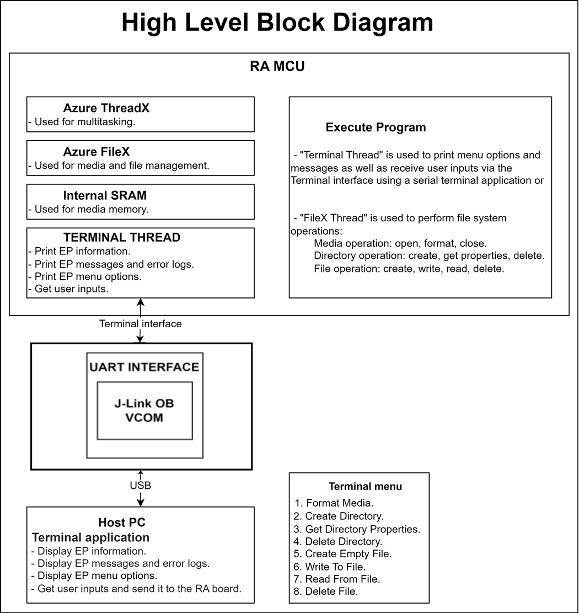
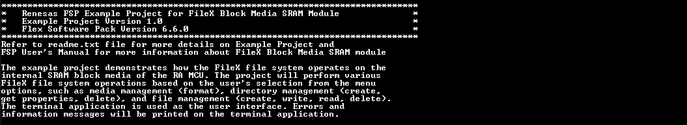
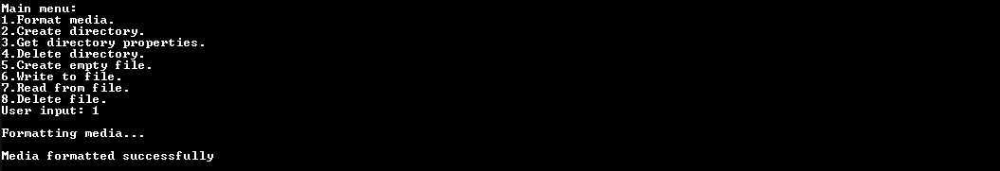
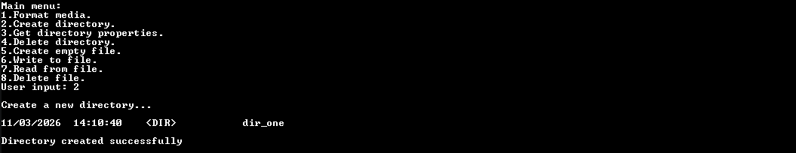
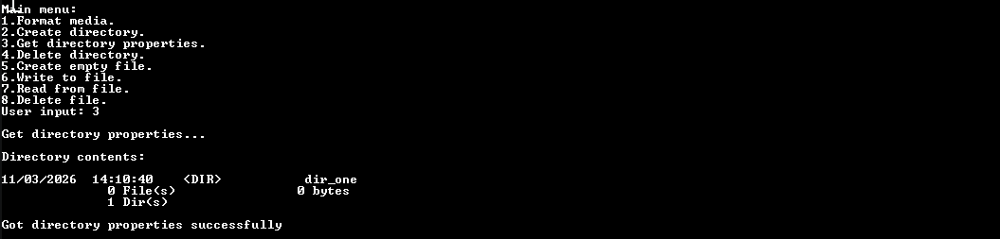
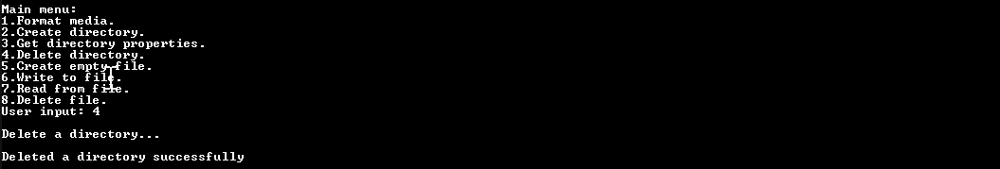
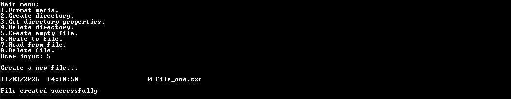
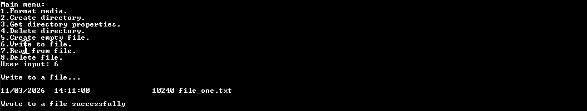
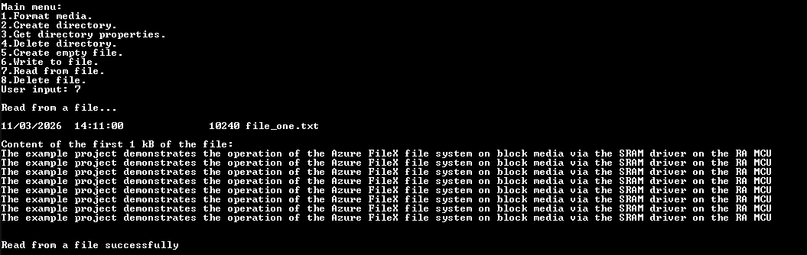

# Introduction #
The example project demonstrates how the FileX file system operates on the internal SRAM block media of the RA MCU. The project will perform various FileX file system operations based on the user's selection from the menu options, such as media management (format), directory management (create, get properties, delete), and file management (create, write, read, delete). The terminal application is used as the user interface. Errors and information messages will be printed on the terminal application.

Main menu:
1. Format Media.
2. Create Directory.
3. Get Directory Properties.
4. Delete Directory.
5. Create Empty File.
6. Write To File.
7. Read From File.
8. Delete File.

Please refer to the [Example Project Usage Guide](https://github.com/renesas/ra-fsp-examples/blob/master/example_projects/Example%20Project%20Usage%20Guide.pdf) for general information on example projects and [readme.txt](./readme.txt) for specifics of operation.

## Required Resources ## 
To build and run the FileX_block_media_sram example project, the following resources are needed.

### Software ###
* Renesas Flexible Software Package (FSP): Version 6.6.0
* e2 studio: Version 2026-07
* LLVM Embedded Toolchain for ARM: Version 22.1.0
* Terminal Console Application: Tera Term or a similar application  
Refer to the software required section in [Example Project Usage Guide](https://github.com/renesas/ra-fsp-examples/blob/master/example_projects/Example%20Project%20Usage%20Guide.pdf)

### Hardware ###
Supported RA boards: EK-RA8M1, MCK-RA8T1, EK-RA8D1, EK-RA6M3G, EK-RA6M3, CK-RA6M5, EK-RA6M5, EK-RA6M2, EK-RA6M4, EK-RA6M1, FPB-RA6E1, FPB-RA4E1, EK-RA4M2, EK-RA4M3, EK-RA8P1, EK-RA8M2, EK-RA8D2, MCK-RA8T2  
* 1 x Renesas RA board.
* 1 x USB cable for programming and debugging (USB cable type varies by board model).

### Hardware Connections  ###
* Connect the RA board USB debug port to the host PC using the appropriate USB cable for EP programming and debugging.
* For EK-RA8M2: The user must place jumper J6 on pins 2-3, J8 on pins 1-2, J9 on pins 2-3, and J29 on pins 1-2, 3-4, 5-6, 7-8 to use the on-board debug functionality.

## Related Collateral References ##
The following documents can be referred to for enhancing your understanding of the operation of this example project:
- [FSP User Manual on GitHub](https://renesas.github.io/fsp/)
- [FSP Known Issues](https://github.com/renesas/fsp/issues)

# Project Notes #

## System Level Block Diagram ##
 High level block diagram of the system is as shown below:
 

## FSP Modules Used ##
List all the various modules that are used in this example project. Refer to the FSP User Manual for further details on each module listed below.

| Module Name | Usage | Searchable Keyword  |
|-------------|-----------------------------------------------|-----------------------------------------------|
| Azure RTOS FileX on Block Media | Azure RTOS FileX on Block Media is used to configure the FileX system and media properties. | FileX |
| Block Media RAM Implementation | Middleware that implements a block media interface using internal RAM as a media area. | rm_block_media_ram |

## Module Configuration Notes ##
This section describes FSP configuration properties that are important or different from those selected by default.

**Note: The configuration shown in this document is based on the original target board (e.g., EK-RA8P1). Some settings may differ on other supported boards due to hardware differences.**

**Configuration Properties for using Azure RTOS FileX on Block Media**

|   Module Property Path and Identifier   |   Default Value   |   Used Value   |   Reason   |
|-----------------------------------------|-------------------|----------------|------------|
| configuration.xml > Stacks > g_fx_media Azure RTOS FileX on Block Media > Properties > Settings > Property > Module g_fx_media Azure RTOS FileX on Block Media > Volume Name | Volume 1 | RA SRAM | Set the volume label for the media. |
| configuration.xml > Stacks > g_fx_media Azure RTOS FileX on Block Media > Properties > Settings > Property > Module g_fx_media Azure RTOS FileX on Block Media > Number of FATs | 1 | 1 | Set the number of FATs in the media to 1. |
| configuration.xml > Stacks > g_fx_media Azure RTOS FileX on Block Media > Properties > Settings > Property > Module g_fx_media Azure RTOS FileX on Block Media > Directory Entries | 256 | 256 | Set the number of directory entries in the root directory. |
| configuration.xml > Stacks > g_fx_media Azure RTOS FileX on Block Media > Properties > Settings > Property > Module g_fx_media Azure RTOS FileX on Block Media > Hidden Sectors | 0 | 0 | set the number of sectors hidden. |
| configuration.xml > Stacks > g_fx_media Azure RTOS FileX on Block Media > Properties > Settings > Property > Module g_fx_media Azure RTOS FileX on Block Media > Total Sectors | 65536 | 128 | Set the total number of sectors in the media. |
| configuration.xml > Stacks > g_fx_media Azure RTOS FileX on Block Media > Properties > Settings > Property > Module g_fx_media Azure RTOS FileX on Block Media > Bytes per Sector | 512 | 512 | Set the number of bytes per sector. |
| configuration.xml > Stacks > g_fx_media Azure RTOS FileX on Block Media > Properties > Settings > Property > Module g_fx_media Azure RTOS FileX on Block Media > Sectors per Cluster | 1 | 1 | Set the number of sectors in each cluster. |
| configuration.xml > Stacks > g_fx_media Azure RTOS FileX on Block Media > Properties > Settings > Property > Module g_fx_media Azure RTOS FileX on Block Media > Working media memory size | 512 | 512 | Set the memory allocated for the file system. |

**Configuration Properties for using Block Media RAM Implementation**

|   Module Property Path and Identifier   |   Default Value   |   Used Value   |   Reason   |
|-----------------------------------------|-------------------|----------------|------------|
| configuration.xml > Stacks > g_rm_block_media Block Media RAM Implementation (rm_block_media_ram) > Properties > Settings > Property > Common > RAM Media Size | 65536 | 65536 | Select the size of the SRAM used as the media area. |

## API Usage ##
The table below lists the FSP provided API used at the application layer by this example project.

| API Name    | Usage                                                                          |
|-------------|--------------------------------------------------------------------------------|
| tx_event_flags_set | This API is used to set or clear event flags in an event flags group, depending upon the specified set option. |
| tx_event_flags_get | This API is used to retrieve event flags from the specified event flags group. |
| tx_thread_sleep | This API is used to cause the calling thread to suspend for the specified number of timer ticks. |
| fx_system_initialize | This API is used to initialize all the major FileX data structures. |
| fx_system_date_set | This API is used to set the system date as specified. |
| fx_system_time_set | This API is used to set the system time as specified. |
| fx_system_date_get | This API is used to retrieve the current system date. |
| fx_system_time_get | This API is used to retrieve the current system time. |
| fx_media_open | This API is used to open media for file access using the supplied I/O driver. |
| fx_media_format | This API is used to format the supplied media in a FAT 12/16/32 compatible manner based on the supplied parameters. |
| fx_media_flush | This API is used to flush all cached sectors and directory entries of any modified files to the physical media. |
| fx_media_close | This API is used to close the specified media. |
| fx_directory_create | This API is used to create a subdirectory in the current default directory or in the path supplied in the directory name. |
| fx_directory_first_full_entry_find | This API is used to retrieve the first entry name in the default directory with full information. |
| fx_directory_next_full_entry_find | This API is used to retrieve the next entry name in the default directory with full information. |
| fx_directory_delete | This API is used to delete the specified directory. |
| fx_directory_information_get | This API is used to get a directory's entry information. |
| fx_file_create | This API is used to create the specified file in the default directory or in the directory path supplied with the file name. |
| fx_file_open | This API is used to open the specified file for either reading or writing. |
| fx_file_truncate | This API is used to truncate the size of the file to the specified size. |
| fx_file_write | This API is used to write bytes from the specified buffer, starting at the file's current position. |
| fx_file_date_time_set | This API is used to set the date and time of the specified file. |
| fx_file_seek | This API is used to position the internal file read/write pointer at the specified byte offset. |
| fx_file_read | This API is used to read bytes from the file and store them in the supplied buffer. |
| fx_file_delete | This API is used to delete the specified file. |
| fx_file_close | This API is used to close the specified file. |
| RM_FILEX_BLOCK_MEDIA_Open | This API is used to initialize callbacks and configure the FileX Block Media interface. |
| RM_FILEX_BLOCK_MEDIA_BlockDriver | This API is used to access block media device functions such as open, close, read, write, and control. |  

## Verifying Operation ##
1. Import, generate, build the example project.
2. Before running the example project, make sure [Hardware Connections](#hardware-connections) are completed.
3. Open a serial terminal application (e.g., Tera Term) to view output log, configure the settings as shown below:  
    * To make sure the received data shows properly, the user needs to set:
        * [Setup] -> [Terminal...] -> [New-line] -> Select [Receive: CR] & [Transmit: CR].
    * To echo back characters typed in Tera Term, the user needs to enable it through:
        * [Setup] -> [Terminal...] -> Check [Local echo].
    * The configuration parameters of the serial port on the serial terminal application:
        * Port: The port is provided by the J-Link On-Board.
        * Speed: 115200
        * Data: 8 bit
        * Parity: none
        * Stop bits: 1 bit
        * Flow control: none
4. Debug or flash the EP to the RA board.
5. After the main menu is displayed on the terminal application, the user selects options to perform file system management as desired.
    * Type '1' and enter to format the media.
    * Type '2' and enter to create a new directory.
    * Type '3' and enter to get root directory properties.
    * Type '4' and enter to delete a directory.
    * Type '5' and enter to create an empty file.
    * Type '6' and enter to write a fixed content into a file.
    * Type '7' and enter to read the first 1 KB of content in a file.
    * Type '8' and enter to delete a file.

### The images below showcase the output on the Serial Terminal application (Tera Term) ###
The EP information:

Media Operation:

Directory Operation:

File Operation:

