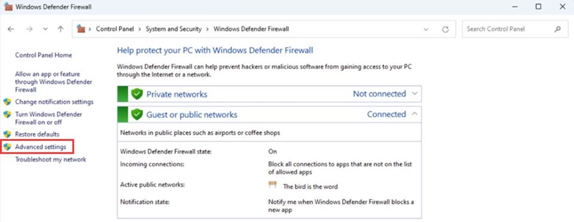
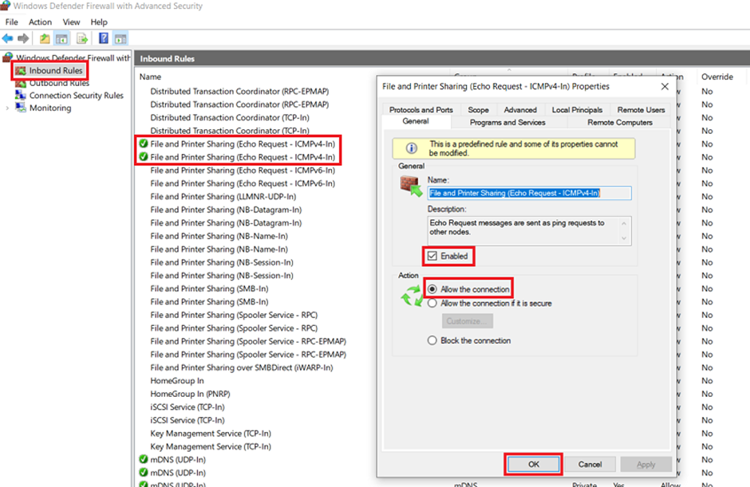
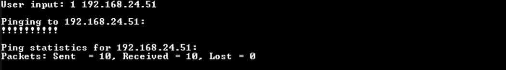

# Introduction #
This example project demonstrates FreeRTOS-Plus-TCP's networking capabilities using the Ethernet interface of the RA MCU. It utilizes the FreeRTOS-Plus-TCP stack to perform various network operations, including sending and receiving data over TCP and UDP protocols. The RA board will automatically obtain an IP address from the network using a DHCP (Dynamic Host Configuration Protocol) client service.

Once the RA board successfully acquires the IP address, users can interact with the system by selecting options from a menu, which is accessible via the terminal. After the RA board retrieves its IP address from the router, it will display the network configuration details, along with the available menu options, in the terminal. This enables the user to explore different features and operations supported by the network stack.

Key functionalities in this example include:
* TCP Client Service: Establish a connection with the server, send a request, wait for the server's response, and disconnect upon completion.
* UDP Client Service: Send a message to a server and listen for the response.
* DNS Client Service: Perform a DNS query based on a domain name specified by the user.
* Web HTTP Server: Process HTTP requests from a browser, allowing users to access the homepage, view board network configurations, control onboard LEDs, and check their status.

Please refer to the [Example Project Usage Guide](https://github.com/renesas/ra-fsp-examples/blob/master/example_projects/Example%20Project%20Usage%20Guide.pdf) for general information on example projects and [readme.txt](./readme.txt) for specifics of operation.

## Required Resources ##
To build and run the Getting_started_with_FreeRTOS_Network example project, the following resources are needed.

### Software ###
* Renesas Flexible Software Package (FSP): Version 6.6.0
* e2 studio: Version 2026-07
* LLVM Embedded Toolchain for ARM: Version 22.1.0
* Terminal Console Application: Tera Term or a similar application
* Socket Application (e.g., sokit version 1.3)
* Browser Application (e.g., Microsoft Edge, Google Chrome)

### Hardware ###
* Supported RA boards: EK-RA6M3, EK-RA6M3G, EK-RA6M4, EK-RA6M5, EK-RA8D1, EK-RA8M1, EK-RA8P1, EK-RA8D2, EK-RA8M2, EK-RA8T2, EK-RA8P1 V2.
  * 1 x Renesas RA board.
  * 1 x Ethernet router with an internet connection.
  * 2 x Ethernet cables to connect the RA board and the host PC to the router.
  * 1 x USB cable for programming and debugging (USB cable type varies by board model).

### Hardware Connections ###
* Power on the Router: Ensure the router is powered on and properly connected to the internet. Verify that the router’s LAN ports are active and available for connections.
* Connect the RA Board to the Router: Take an Ethernet cable and connect one end to the Ethernet port on the RA board, and the other end to one of the router's available LAN ports. This connection allows the RA board to communicate with the network and obtain an IP address via DHCP.
* Connect the host PC to the Router: Using a second Ethernet cable, connect the host PC to another LAN port on the same router. This step ensures that both the RA board and the host PC are on the same network, enabling communication between them for debugging and menu operations.
* Connect the RA board USB debug port to the host PC using the appropriate USB cable for EP programming and debugging. This connection is necessary for programming the RA board, enabling debugging, and displaying runtime information in the terminal.
* By following these steps, you'll establish proper hardware connections between the RA board, the router, and the host PC, ensuring smooth network communication and debugging capabilities.
* For EK-RA8D1: Set the configuration switches (SW1) as below.

  | SW1-1 PMOD1 | SW1-2 TRACE | SW1-3 CAMERA | SW1-4 ETHA | SW1-5 ETHB | SW1-6 GLCD | SW1-7 SDRAM | SW1-8 I3C |
  |-------------|-------------|--------------|------------|------------|------------|-------------|-----------|
  | OFF | OFF | OFF | OFF | ON | OFF | OFF | OFF |

* For EK-RA8M1: Remove jumper J61 to enable Ethernet B.

* For EK-RA8M2: The user must place jumper J6 on pins 2-3, J8 on pins 1-2, J9 on pins 2-3, and J29 on pins 1-2, 3-4, 5-6, 7-8 to use the on-board debug functionality.

* For EK-RA8T2:
	* The user must set the configuration switches (SW6 and SW4) as below to use the on-board debug functionality and enable Ethernet 0.

	  | SW6-1 | SW6-2 | SW6-3 | SW6-4 | SW6-5 | SW6-6 | SW6-7 | SW6-8 | SW6-9 | SW6-10 |
	  |-------|-------|-------|-------|-------|-------|-------|-------|-------|--------|
	  |  OFF  |  OFF  |  OFF  |  OFF  |  ON   |  OFF  |  ON   |  ON   |  ON   |   ON   |

	  | SW4-1 | SW4-2 | SW4-3 | SW4-4 | SW4-5 | SW4-6 | SW4-7 | SW4-8 |
	  |-------|-------|-------|-------|-------|-------|-------|-------|
	  |  OFF  |  OFF  |  OFF  |  OFF  |  OFF  |  OFF  |  OFF  |  OFF  |

* For EK-RA8P1 V2:
  * The user must set the configuration switches (SW6 and SW4) as below to use the on-board debug functionality and enable OSPI.

    | SW6-1 | SW6-2 | SW6-3 | SW6-4 | SW6-5 | SW6-6 | SW6-7 | SW6-8 | SW6-9 | SW6-10 |
	  |:-----:|:-----:|:-----:|:-----:|:-----:|:-----:|:-----:|:-----:|:-----:|:------:|
	  |  OFF  |  OFF  |  OFF  |  OFF  |  ON   |  OFF  |  ON   |  ON   |  ON   |   ON   |
    
    | SW4-1 | SW4-2 | SW4-3 | SW4-4 | SW4-5 | SW4-6 | SW4-7 | SW4-8 |
    |:-----:|:-----:|:-----:|:-----:|:-----:|:-----:|:-----:|:-----:|
    |  OFF  |  OFF  |  OFF  |  OFF  |  OFF  |  OFF  |  OFF  |  OFF  |

## Related Collateral References ##
The following documents can be referred to for enhancing your understanding of the operation of this example project:
- [FSP User Manual on GitHub](https://renesas.github.io/fsp/)
- [FSP Known Issues](https://github.com/renesas/fsp/issues)

# Project Notes #

## System Level Block Diagram ##


## FSP Modules Used ##
List all the various modules that are used in this example project. Refer to the FSP User Manual for further details on each module listed below.

| Module Name | Usage  | Searchable Keyword (using New Stack > Search) |
|-------------|-----------------------------------------------|-----------------------------------------------|
| FreeRTOS+FAT | This module provides a FAT file system for managing files on block devices. | FreeRTOS+FAT |
| FreeRTOS+FAT Port for RA | This module provides the hardware port layer for FreeRTOS+FAT file system. | rm_freertos_plus_fat |
| Block Media SPI Flash | Middleware to implement the block media interface on SPI flash memory. | rm_block_media_spi |
| FreeRTOS+TCP | This module implements a lightweight TCP/IP stack for enabling network communication. | FreeRTOS+TCP |
| FreeRTOS+TCP Wrapper to r_ether | This module provides the network interface required to use FreeRTOS Plus TCP with the Ethernet (r_ether) driver. | rm_freertos_plus_tcp |
| Ethernet | This module performs Ethernet frame transmission and reception using an Ethernet controller. | r_ether |
| OSPI Flash | Utilized for block media storage and file system implementation. | r_ospi_b |

For EK-RA6M3, EK-RA6M3G, EK-RA6M4, EK-RA6M5:

| Module Name | Usage | Searchable Keyword  |
|-------------|-----------------------------------------------|-----------------------------------------------|
| FreeRTOS+FAT | This module provides a FAT file system for managing files on block devices. | FreeRTOS+FAT |
| FreeRTOS+FAT Port for RA | This module provides the hardware port layer for FreeRTOS+FAT file system. | rm_freertos_plus_fat |
| Block Media SPI Flash | Middleware to implement the block media interface on SPI flash memory. | rm_block_media_spi |
| FreeRTOS+TCP | This module implements a lightweight TCP/IP stack for enabling network communication. | FreeRTOS+TCP |
| FreeRTOS+TCP Wrapper to r_ether | This module provides the network interface required to use FreeRTOS Plus TCP with the Ethernet (r_ether) driver. | rm_freertos_plus_tcp |
| Ethernet | This module performs Ethernet frame transmission and reception using an Ethernet controller. | r_ether |
| QSPI Flash | Utilized for block media storage and file system implementation. | r_qspi |

For EK-RA8P1, EK-RA8D2, EK-RA8M2, EK-RA8T2, EK-RA8P1 V2:

| Module Name | Usage | Searchable Keyword  |
|-------------|-----------------------------------------------|-----------------------------------------------|
| FreeRTOS+FAT | This module provides a FAT file system for managing files on block devices. | FreeRTOS+FAT |
| FreeRTOS+FAT Port for RA | This module provides the hardware port layer for FreeRTOS+FAT file system. | rm_freertos_plus_fat |
| Block Media SPI Flash | Middleware to implement the block media interface on SPI flash memory. | rm_block_media_spi |
| FreeRTOS+TCP | This module implements a lightweight TCP/IP stack for enabling network communication. | FreeRTOS+TCP |
| FreeRTOS+TCP Wrapper to r_ether | This module provides the network interface required to use FreeRTOS Plus TCP with the Ethernet (r_ether) driver. | rm_freertos_plus_tcp |
| RMAC | This module performs Ethernet frame transmission and reception using the RMAC controller. | r_rmac |
| OSPI Flash | Utilized for block media storage and file system implementation. | r_ospi_b |

## Module Configuration Notes ##
This section describes FSP Configurator properties which are important or different from those selected by default.

|   Module Property Path and Identifier   |   Default Value   |   Used Value   |   Reason   |
| :-------------------------------------: | :---------------: | :------------: | :--------: |
| configuration.xml > BSP > Properties > Settings > Property > RA Common > Heap size (bytes) | 0 | 0x1000 | Increased heap size for memory management. |
| configuration.xml > Stacks > Threads > Net Thread > Properties > Settings > Property > Thread > Stack size (bytes) | 1024 | 8192 | Increased stack size. |
| configuration.xml > Stacks > Threads > Net Thread > Properties > Settings > Property > Common > Memory Allocation > Support Dynamic Allocation | Disabled | Enabled | Enabled support for dynamic allocation. |
| configuration.xml > Stacks > Threads > Net Thread > Net Thread Stacks > FreeRTOS+TCP > Properties > Settings > Property > Common > DHCP callback function | Disabled | Enabled | Enabled DHCP callback function. |
| configuration.xml > Stacks > Threads > Net Thread > Net Thread Stacks > FreeRTOS+TCP > Properties > Settings > Property > Common > FreeRTOS_select() (and associated) API function is available | Disable | Enable | Enabled to facilitate multiple socket handling. |
| configuration.xml > Stacks > Threads > Net Thread > Net Thread Stacks > FreeRTOS+TCP > Properties > Settings > Property > Common > FreeRTOS_SendPingRequest() is available | Disable | Enable | Enabled to allow ping requests for network connectivity verification. |
| configuration.xml > Stacks > Threads > Net Thread > Net Thread Stacks > FreeRTOS+FAT > Properties > Settings > Property > Common > General > FAT12 Support | Disable | Enable | Enabled FAT12 format. |

Configuration Properties for using the serial terminal (UART)

| Interrupt event path | Default Value | Used Value | Reason |
| :------------------: | :-----------: | :--------: | :----: |
| configuration.xml > Interrupts > Interrupts Configuration > New User Event > SCI > SCI8 > SCI8 RXI (Receive data full) | empty | sci_b_uart_rxi_isr | Assign the UART receive ISR (Receive data full) to the interrupt vector table. |
| configuration.xml > Interrupts > Interrupts Configuration > New User Event > SCI > SCI8 > SCI8 TXI (Transmit data empty) | empty | sci_b_uart_txi_isr | Assign the UART transfer ISR (Transmit data empty) to the interrupt vector table. |
| configuration.xml > Interrupts > Interrupts Configuration > New User Event > SCI > SCI8 > SCI8 TEI (Transmit end) | empty | sci_b_uart_tei_isr | Assign the UART transfer ISR (Transmit end) to the interrupt vector table. |
| configuration.xml > Interrupts > Interrupts Configuration > New User Event > SCI > SCI8 > SCI8 ERI (Receive error) | empty | sci_b_uart_eri_isr | Assign the UART receive ISR (Receive error) to the interrupt vector table. |

| Clock path | Default Value | Used Value | Reason |
| :--------: | :-----------: | :--------: | :----: |
| configuration.xml > Clocks > Clocks Configuration | SCICLK Src: PLL2R | SCICLK Src: PLL2R | Enable operating clock for SCI module by PLL2R clock source. |

## API Usage ##

The table below lists the FSP provided API used at the application layer by this example project.

| No. | API                           | Description                                                   |
|-----|-------------------------------|--------------------------------------------------------------------------------|
| 1   | FreeRTOS_IPInit               | This API is used to initialize the FreeRTOS+TCP network stack. |
| 2   | FreeRTOS_gethostbyname        | This API is used to resolve a domain name into an IP address. |
| 3   | FreeRTOS_IsNetworkUp          | This API is used to check the current status of the network connection. |
| 4   | R_RMAC_LinkProcess            | This API is used to check the status of the Ethernet link. |
| 5   | FreeRTOS_GetAddressConfiguration | This API is used to get the current IPv4 address configuration. |
| 6   | FreeRTOS_inet_addr            | This API is used to convert the IP address from "w.x.y.z" (dotted decimal) format to the 32-bit format. |
| 7   | FreeRTOS_SendPingRequest      | This API is used to send an ICMP ping request to a remote host. |
| 8   | FreeRTOS_socket               | This API is used to create a socket in the FreeRTOS+TCP stack. |
| 9   | FreeRTOS_setsockopt           | This API is used to configure various options for a socket. |
| 10  | FreeRTOS_connect              | This API is used to initiate a connection from a TCP client socket to a remote server. |
| 11  | FreeRTOS_send                 | This API is used to send data over an already connected TCP socket. |
| 12  | FreeRTOS_recv                 | This API is used to receive data from a connected TCP socket. |
| 13  | FreeRTOS_shutdown             | This API is used to terminate the connection on a specified socket. |
| 14  | FreeRTOS_closesocket          | This API is used to close a socket in the FreeRTOS+TCP stack. |
| 15  | FreeRTOS_sendto               | This API is used to send data over a UDP socket. |
| 16  | FreeRTOS_recvfrom             | This API is used to receive data from a UDP socket. |
| 17  | FreeRTOS_inet_ntoa            | This API is used to convert the IP address to a string. |
| 18  | RM_FREERTOS_PLUS_FAT_Open     | This API is used to initialize the lower-layer media device. |
| 19  | RM_FREERTOS_PLUS_FAT_MediaInit | This API is used to initialize the media device. |
| 20  | RM_FREERTOS_PLUS_FAT_DiskInit | This API is used to initialize a FreeRTOS+FAT disk structure. |
| 21  | FF_Mount                      | This API is used to mount the specified partition. |
| 22  | FF_FS_Add                     | This API is used to add the disk to the file system. |
| 23  | RM_FREERTOS_PLUS_FAT_DiskDeinit | This API is used to de-initialize a FreeRTOS+FAT disk structure. |
| 24  | RM_FREERTOS_PLUS_FAT_Close    | This API is used to close the media device. |
| 25  | ff_fopen                      | This API is used to open files within a FAT file system. |
| 26  | ff_fwrite                     | This API is used to write data to an open file within a FAT file system. |
| 27  | ff_fclose                     | This API is used to close files within a FAT file system. |

## Verifying Operation ##
1. Set up the hardware connection properly mentioned in [Hardware Connections](#hardware-connections).
2. Import, generate, build, and download project to the RA board.
    * Note:
      * Keep the project path short to prevent errors during the build process.
      * Before performing test, please confirm that the host PC has enabled the inbound rule '**File and Printer Sharing (Echo Request - ICMPv4-In)**' for accept ping request from RA MCU to TCP server: **Windows Defender Firewall -> Advanced settings -> Inbound Rules -> Enable File and Printer Sharing (Echo Request - ICMPv4-In).**  
  .
  
3. Open a serial terminal application (e.g., Tera Term) to view output, configure the settings as follows: 
    * To make sure the received data shows properly, the user needs to set:
      * [Setup] -> [Terminal...] -> [New-line] -> Select [Receive: CR] & [Transmit: CR].
    * To echo back characters typed in Tera Term, the user needs to enable it through:
      * [Setup] -> [Terminal...] -> Check [Local echo].
    * The configuration parameters of the serial port on the serial terminal application:
      * Port: The port is provided by the J-Link On-Board.
      * Speed: 115200
      * Data: 8 bit
      * Parity: none
      * Stop bits: 1 bit
      * Flow control: none
4. After the main menu is displayed on the terminal application (Tera Term), the user can select options to perform EP operations.
    * Initialize Ethernet IP and obtain a dynamic IP address if DHCP is enabled.

      

    * Once the RA board successfully acquires the IP address, a menu will be show for user selection.

      

    * Send a ping request to the specified IP address.

      

    * Launch a socket application (e.g., Sokit version 1.3) on the host PC. Configure the TCP address and port, then click TCP Listen to create a TCP server.  
    Note: The IP address of System on which sokit is running must be entered under TCP Addr section, so that it runs TCP Server over this entered IP of host PC on network. Suggestion is to TCP server in PC should listen at a port number greater than 10000
      
      
    
      Use the RA board to transmit a TCP message to this server.

      
      
      On the host PC, after receiving the TCP message from the RA board, select the TCP connection and send a response to the RA board.

      

      The message from the host PC will be displayed on the terminal.

      

    * Configure the UDP address and port, then click UDP Listen to create a UDP server.
      
      
    
      Use the RA board to transmit a UDP message to this server.

      
      
      On the host PC, after receiving the UDP message from the RA board, select the UDP connection and send a response to the RA board.

      

      The message from the host PC will be displayed on the terminal.

      

    * Perform a DNS query based on a domain name specified by the user.

      

    * Start a simple HTTP server on the RA board and launch a web browser application to access the webpage.

      

      

    * The user clicks on SW1 or SW2 to toggle the LED on the board.

      

## Special Topic ##

**Special notes:**
* The HTTP server retrieves web resources from the `web.bin` file located at `Getting_started_with_FreeRTOS_Network_ek_ra8d1_ep/e2studio/src/web.bin`. This file is a FAT12-formatted binary image that encapsulates web assets such as HTML and images. To create `web.bin` in a Linux environment, such as Windows Subsystem for Linux (WSL), follow these steps:
  1. **Create an empty binary file (`web.bin`)**  
     ```bash
     dd if=/dev/zero of=web.bin bs=4096 count=32
     ```

  2. **Format the binary file as a FAT12 filesystem**  
     ```bash
     mkdosfs -F 12 -S 4096 -s 1 web.bin
     ```

  3. **Mount the FAT12 filesystem**  
     ```bash
     mkdir -p /mnt/web_bin
     sudo mount -o loop web.bin /mnt/web_bin
     ```

  4. **Copy resources into the filesystem**  
     ```bash
     sudo cp -r /path/to/web/resources/* /mnt/web_bin/
     ```

  5. **Unmount the filesystem**  
     ```bash
     sudo umount /mnt/web_bin
     ```
