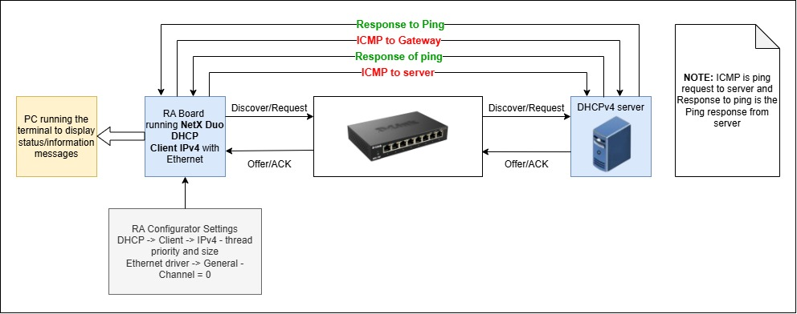
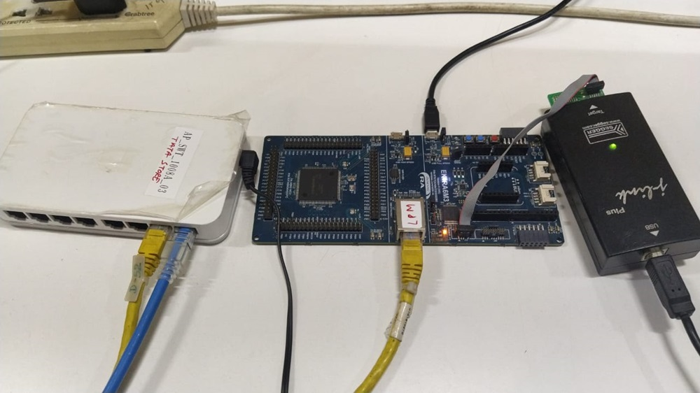
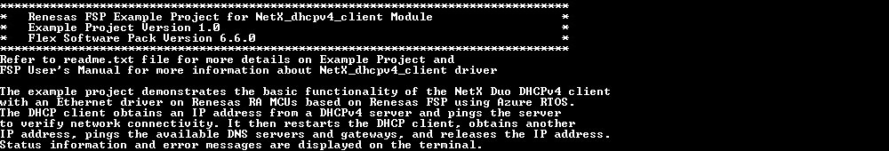
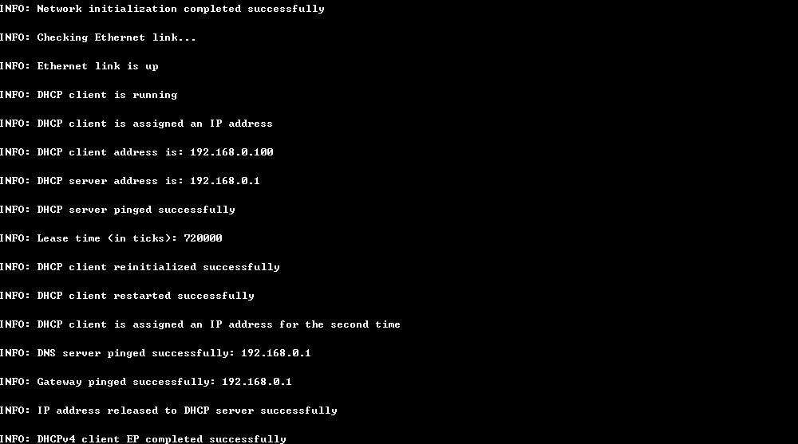

# Introduction #
The example project demonstrates the basic functionality of the NetX Duo DHCPv4 client with an Ethernet driver on Renesas RA MCUs based on Renesas FSP using Azure RTOS. The DHCP client obtains an IP address from a DHCPv4 server and pings the server to verify network connectivity. It then restarts the DHCP client, obtains another IP address, pings the available DNS servers and gateways, and releases the IP address. Status information and error messages are displayed on the terminal.

NetX Duo DHCP Client is compliant with [RFC2132](https://tools.ietf.org/html/rfc2132), [RFC2131](https://tools.ietf.org/html/rfc2131).

Please refer to the [Example Project Usage Guide](https://github.com/renesas/ra-fsp-examples/blob/master/example_projects/Example%20Project%20Usage%20Guide.pdf) for general information on example projects.

## Required Resources ##
To build and run the NetX DHCPv4 client example project, the following resources are needed.

### Software ###
Refer to software requirements mentioned in [Example Project Usage Guide](https://github.com/renesas/ra-fsp-examples/blob/master/example_projects/Example%20Project%20Usage%20Guide.pdf)

### Hardware ###
* Supported RA boards: CK-RA6M5, EK-RA6M3, EK-RA6M4, EK-RA6M5, EK-RA8M1, EK-RA8D1, MCK-RA8T1, EK-RA8P1, EK-RA8D2, EK-RA8M2, MCK-RA8T2, EK-RA8T2.
    * 1 x Renesas RA board.
    * 1 x USB cable for programming and debugging (USB cable type varies by board model).
    * 1 x Ethernet/LAN cable (Ethernet cable CAT5/6).
    * 1 x Ethernet switch/router.

### Hardware Connections ###
* Connect the RA board USB debug port to the host PC using the appropriate USB cable for EP programming and debugging.

* For CK-RA6M5, EK-RA6M3, EK-RA6M4, EK-RA6M5:
    * Connect the Ethernet port on the RA board to an Ethernet switch/router using an Ethernet/LAN cable.

* For EK-RA8M1:
    * Connect the Ethernet port on the RA board to an Ethernet switch/router using an Ethernet/LAN cable.
    * Remove jumper J61 to enable Ethernet B.

* For EK-RA8D1:
    * Connect the Ethernet port on the RA board to an Ethernet switch/router using an Ethernet/LAN cable.
    * Set the configuration switches (SW1) as below to avoid potential failures:
        * CAUTION: Do not enable SW1-4 and SW1-5 together. 

        | SW1-1 PMOD1 | SW1-2 TRACE | SW1-3 CAMERA | SW1-4 ETHA | SW1-5 ETHB | SW1-6 GLCD | SW1-7 SDRAM | SW1-8 I3C |
        |-------------|-------------|--------------|------------|------------|------------|-------------|-----------|
        | OFF | OFF | OFF | OFF | ON | OFF | OFF | OFF |

* For MCK-RA8T1, EK-RA8P1, EK-RA8D2, EK-RA8M2:
    * Note: For EK-RA8M2, the user must place jumper J6 on pins 2-3, J8 on pins 1-2, J9 on pins 2-3, and J29 on pins 1-2, 3-4, 5-6, 7-8 to use the on-board debug functionality.
    * Connect the Ethernet port on the RA board to an Ethernet switch/router using an Ethernet/LAN cable.

* For MCK-RA8T2:
    * Connect the Ethernet port 0 (CN14) on the RA board to an Ethernet switch/router using an Ethernet/LAN cable.

* For EK-RA8T2:
    * The user must set the configuration switches (SW6 and SW4) as below to use the on-board debug functionality and enable Ethernet 0.

		| SW6-1 | SW6-2 | SW6-3 | SW6-4 | SW6-5 | SW6-6 | SW6-7 | SW6-8 | SW6-9 | SW6-10 |
		|-------|-------|-------|-------|-------|-------|-------|-------|-------|--------|
		|  OFF  |  OFF  |  OFF  |  OFF  |  ON   |  OFF  |  ON   |  ON   |  ON   |   ON   |

		| SW4-1 | SW4-2 | SW4-3 | SW4-4 | SW4-5 | SW4-6 | SW4-7 | SW4-8 |
		|-------|-------|-------|-------|-------|-------|-------|-------|
		|  OFF  |  OFF  |  OFF  |  OFF  |  OFF  |  OFF  |  OFF  |  OFF  |

    * Connect the Ethernet port 0 (J15) on the RA board to an Ethernet switch/router using an Ethernet/LAN cable.

## Related Collateral References ##
The following documents can be referred to for enhancing your understanding of the operation of this example project:
- [FSP User Manual on GitHub](https://renesas.github.io/fsp/)
- [FSP Known Issues](https://github.com/renesas/fsp/issues)

# Project Notes #

## System Level Block Diagram ##

## FSP Modules Used ##
List all the various modules that are used in this example project. Refer to the FSP User Manual for further details on each module listed below.

| Module Name | Usage  | Searchable Keyword (using New Stack > Search) |
|-------------|-----------------------------------------------|-----------------------------------------------|
| NetX Duo DHCP IPV4 Client | DHCPv4 module is used to obtain IP addresses, network parameters and to automate the process of configuring devices on IP networks, thus allowing them to use network services such as DNS, NTP, and any communication protocol based on UDP or TCP. | dhcp |

## Module Configuration Notes ##
This section describes FSP Configurator properties which are important or different from those selected by default.

**Note: The configuration shown in this document is based on the original target board (e.g., EK-RA8P1). Some settings may differ on other supported boards due to hardware differences.**

|   Module Property Path and Identifier   |   Default Value   |   Used Value   |   Reason   |
| :-------------------------------------: | :---------------: | :------------: | :--------: |
| configuration.xml > BSP > Properties > Settings > Property > RA Common > Main stack size (bytes) | 0x400 | 0x1000 | Main program thread stack is configured to store the local variables of different functions in the code. |
| configuration.xml > BSP > Properties > Settings > Property > RA Common > Heap size (bytes) | 0 | 0x2000 | Heap size is required for standard library functions to be used. |
| configuration.xml > Stacks > Threads > DHCP Client Thread > Properties > Settings > Property > Thread > Stack size (bytes) | 1024 | 2048 | This is changed to handle its worst-case function call nesting and local variable usage. |
| configuration.xml > Stacks > Threads > DHCP Client Thread > Properties > Settings > Property > Thread > Priority | 1 | 3 | DHCP Client thread priority is lowered to allow the IP thread to process incoming packets at the fastest rate possible. |
| configuration.xml > Stacks > Threads > DHCP Client Thread > DHCP Client Thread Stacks > g_dhcp_client0 Azure RTOS NetX Duo DHCP IPv4 Client > Properties > Settings > Property > Common > DHCP > Client > IPv4 > Persistent client state | Disable | Enable | Persistent client state property is enabled to obtain a record of the current client state. |
| configuration.xml > Stacks > Threads > Terminal Thread > Properties > Settings > Property > Thread > Priority | 1 | 4 | Terminal thread priority is lowered to allow the DHCP Client and IP threads to process incoming packets at the fastest rate possible. |

## API Usage ##

The table below lists the DHCP Client APIs used at the application layer by this example project.

| API Name    | Usage                                                                          |
|-------------|--------------------------------------------------------------------------------|
| nx_system_initialize | This API is used to initialize the NetX system. |
| nx_dhcp_create | This API is used to create a DHCP client instance. |
| nx_dhcp_state_change_notify | This API is used to notify the application of a DHCP state change. |
| nx_dhcp_start | This API is used to start DHCP processing. |
| nx_dhcp_server_address_get | This API is used to get the DHCP client’s DHCP server IP address. |
| nx_dhcp_packet_pool_set | This API is used to set the packet pool for the DHCP client. |
| nx_dhcp_client_get_record | This API is used to obtain a record of the current client state. |
| nx_dhcp_stop | This API is used to stop DHCP processing. |
| nx_dhcp_reinitialize | This API is used to clear the DHCP client network parameters. |
| nx_dhcp_user_option_retrieve | This API is used to retrieve a DHCP option from last server response. |
| nx_dhcp_release | This API is used to release the IP address back to the Server. |
| nx_dhcp_delete | This API is used to delete a DHCP instance. |
| nx_ip_create | This API is used to create an IP instance. |
| nx_ip_gateway_address_set | This API is used to set the gateway address for an IP instance. |
| nx_ip_driver_direct_command | This API is used to issue command to network driver. |
| nx_ip_address_get | This API is used to retrieve IP address and network mask. |
| nx_ip_status_check | This API is used to check status of an IP instance. |
| nx_icmp_enable |This API is used to enable ICMP processing for an IP instance.  |
| nx_icmp_ping | This API is used to send ping request to specified IP address. |
| nx_packet_pool_create | This API is used to create a packet pool. |
| nx_packet_release | This API is used to release previously allocated packet. |
| nx_arp_enable | This API is used to enable ARP for an IP instance. |
| nx_udp_enable | This API is used to enable UDP processing for an IP instance. |

## Verifying Operation ##
1. Import, generate, and build the example project (see section Starting Development of **FSP User Manual**).
2. Before running the example project, set up hardware connection properly as mentioned in [Hardware Connections](#hardware-connections) section.
    * **Note: A DHCP server must be available on the network to assign an IP address to the RA board running this DHCP client EP.**
3. Open a serial terminal application (e.g., Tera Term) to view output logs, configure the settings as shown below:
    * To make sure the received data shows properly, the user needs to set:
        * [Setup] -> [Terminal...] -> [New-line] -> Select [Receive: CR] & [Transmit: CR].
    * To echo back characters typed in Tera Term, the user needs to enable it through:
        * [Setup] -> [Terminal...] -> Check [Local echo].
    * The configuration parameters of the serial port on the serial terminal application:
        * Port: The port is provided by the J-Link On-Board.
        * Speed: 115200
        * Data: 8 bit
        * Parity: none
        * Stop bits: 1 bit
        * Flow control: none
4. Debug or flash the EP to the RA board.

The image below showcases the hardware connection setup required for running the EP:

The images below showcase the output on the serial terminal:

