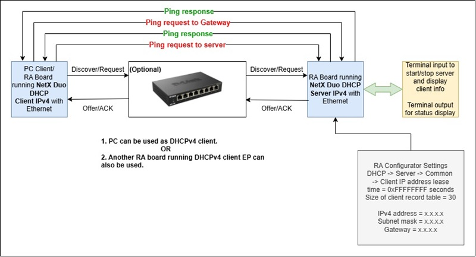
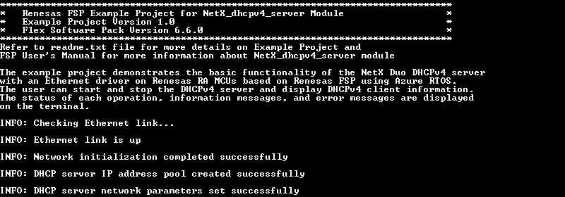
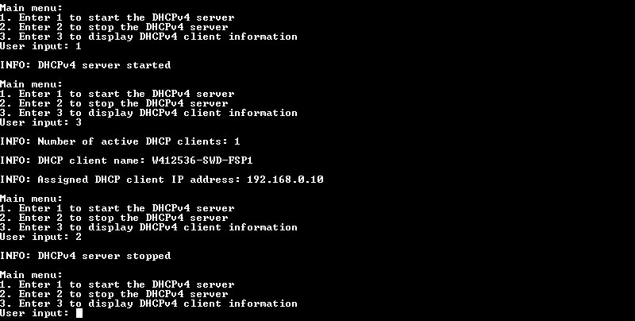

# Introduction #
The example project demonstrates the basic functionality of the NetX Duo DHCPv4 server with an Ethernet driver on Renesas RA MCUs based on Renesas FSP using Azure RTOS. The user can start and stop the DHCPv4 server and display DHCPv4 client information. The status of each operation, information messages, and error messages are displayed on the terminal.

**Note:** The IP address range for DHCP clients is 192.168.0.10 to 192.168.0.20.

NetX Duo DHCPv4 Server is compliant with [RFC2132](https://tools.ietf.org/html/rfc2132), [RFC2131](https://tools.ietf.org/html/rfc2131), and related RFCs.

Please refer to the [Example Project Usage Guide](https://github.com/renesas/ra-fsp-examples/blob/master/example_projects/Example%20Project%20Usage%20Guide.pdf) for general information on example projects.

## Required Resources ##
To build and run the NetX DHCPv4 Server example project, the following resources are needed.

### Software ###
Refer to software requirements mentioned in [Example Project Usage Guide](https://github.com/renesas/ra-fsp-examples/blob/master/example_projects/Example%20Project%20Usage%20Guide.pdf)

### Hardware ###
* Supported RA boards: EK-RA6M3, EK-RA6M4, EK-RA6M5, EK-RA8D1, EK-RA8M1, MCK-RA8T1, EK-RA8D2, EK-RA8M2, EK-RA8P1, MCK-RA8T2, EK-RA8T2.
    * 1 x Renesas RA Board.
    * 1 x USB cable for programming and debugging (USB cable type varies by board model).
    * 1 × PC supported Ethernet or another RA board running the DHCPv4 Client example project (EP).
	* Without Ethernet switch:
	    * 1 x Ethernet/LAN cable (Ethernet cable CAT5/6).
	* With Ethernet switch (Optional):
	    * 1 x Ethernet switch.
	    * 2 x Ethernet/LAN cables (Ethernet cable CAT5/6).
	    * **Note:** The Ethernet switch should not have Internet access; it only serves as a connection hub.

### Hardware Connections ###
* Connect the RA board USB debug port to the host PC using the appropriate USB cable for EP programming and debugging.

* For EK-RA6M3, EK-RA6M4, EK-RA6M5:
    * Without an Ethernet switch:
        * Connect the Ethernet port of the RA board to the Ethernet port of the PC/another RA board running the DHCPv4 Client EP using an Ethernet/LAN cable.
    * With an Ethernet switch (Optional):
        * Connect the Ethernet ports of the RA board and the PC/another RA board running the DHCPv4 Client EP to an Ethernet switch using two Ethernet/LAN cables.

* For EK-RA8M1:
    * Without an Ethernet switch:
        * Connect the Ethernet port of the RA board to the Ethernet port of the PC/another RA board running the DHCPv4 Client EP using an Ethernet/LAN cable.
    * With an Ethernet switch (Optional):
        * Connect the Ethernet ports of the RA board and the PC/another RA board running the DHCPv4 Client EP to an Ethernet switch using two Ethernet/LAN cables.
    * Remove jumper J61 to enable Ethernet B.

* For EK-RA8D1:
    * Without an Ethernet switch:
        * Connect the Ethernet port of the RA board to the Ethernet port of the PC/another RA board running the DHCPv4 Client EP using an Ethernet/LAN cable.
    * With an Ethernet switch (Optional):
        * Connect the Ethernet ports of the RA board and the PC/another RA board running the DHCPv4 Client EP to an Ethernet switch using two Ethernet/LAN cables.
    * Set the configuration switches (SW1) as below to avoid potential failures.
        * CAUTION: Do not enable SW1-4 and SW1-5 together.

        | SW1-1 PMOD1 | SW1-2 TRACE | SW1-3 CAMERA | SW1-4 ETHA | SW1-5 ETHB | SW1-6 GLCD | SW1-7 SDRAM | SW1-8 I3C |
        |-------------|-------------|--------------|------------|------------|------------|-------------|-----------|
        | OFF | OFF | OFF | OFF | ON | OFF | OFF | OFF |

* For MCK-RA8T1, EK-RA8P1, EK-RA8D2, EK-RA8M2:
    * For EK-RA8M2, the user must place jumper J6 on pins 2-3, J8 on pins 1-2, J9 on pins 2-3, and J29 on pins 1-2, 3-4, 5-6, 7-8 to use the on-board debug functionality.
    * Without an Ethernet switch:
        * Connect the Ethernet port of the RA board to the Ethernet port of the PC/another RA board running the DHCPv4 Client EP using an Ethernet/LAN cable.
    * With an Ethernet switch (Optional):
        * Connect the Ethernet ports of the RA board and the PC/another RA board running the DHCPv4 Client EP to an Ethernet switch using two Ethernet/LAN cables.

* For MCK-RA8T2:
    * Without an Ethernet switch:
        * Connect the Ethernet port 0 (CN14) of the RA board to the Ethernet port of the PC/another RA board running the DHCPv4 Client EP using an Ethernet/LAN cable.
    * With an Ethernet switch (Optional):
        * Connect the Ethernet port 0 (CN14) of the RA board and the Ethernet port of the PC/another RA board running the DHCPv4 Client EP to an Ethernet switch using two Ethernet/LAN cables.

* For EK-RA8T2:
    * The user must set the configuration switches (SW6 and SW4) as below to use the on-board debug functionality and enable Ethernet 0.

		| SW6-1 | SW6-2 | SW6-3 | SW6-4 | SW6-5 | SW6-6 | SW6-7 | SW6-8 | SW6-9 | SW6-10 |
		|-------|-------|-------|-------|-------|-------|-------|-------|-------|--------|
		|  OFF  |  OFF  |  OFF  |  OFF  |  ON   |  OFF  |  ON   |  ON   |  ON   |   ON   |

		| SW4-1 | SW4-2 | SW4-3 | SW4-4 | SW4-5 | SW4-6 | SW4-7 | SW4-8 |
		|-------|-------|-------|-------|-------|-------|-------|-------|
		|  OFF  |  OFF  |  OFF  |  OFF  |  OFF  |  OFF  |  OFF  |  OFF  |

    * Without an Ethernet switch:
        * Connect the Ethernet port 0 (J15) of the RA board to the Ethernet port of the PC/another RA board running the DHCPv4 Client EP using an Ethernet/LAN cable.
    * With an Ethernet switch (Optional):
        * Connect the Ethernet port 0 (J15) of the RA board and the Ethernet port of the PC/another RA board running the DHCPv4 Client EP to an Ethernet switch using two Ethernet/LAN cables.

## Related Collateral References ##
The following documents can be referred to for enhancing your understanding of the operation of this example project:
- [FSP User Manual on GitHub](https://renesas.github.io/fsp/)
- [FSP Known Issues](https://github.com/renesas/fsp/issues)

# Project Notes #

## System Level Block Diagram ##

## FSP Modules Used ##
List all the various modules that are used in this example project. Refer to the FSP User Manual for further details on each module listed below.

| Module Name | Usage  | Searchable Keyword (using New Stack > Search) |
|-------------|-----------------------------------------------|-----------------------------------------------|
| NetX Duo DHCP IPv4 Server | DHCPv4 Server module is used to provide and assign IP addresses automatically, default gateways and other network parameters to DHCPv4 client devices.| dhcp |

## Module Configuration Notes ##
This section describes FSP Configurator properties which are important or different from those selected by default.

**Note: The configuration shown in this document is based on the original target board (e.g., EK-RA8P1). Some settings may differ on other supported boards due to hardware differences.**

|   Module Property Path and Identifier   |   Default Value   |   Used Value   |   Reason   |
| :-------------------------------------: | :---------------: | :------------: | :--------: |
| configuration.xml > BSP > Properties > Settings > Property > RA Common > Heap size (bytes) | 0 | 0x400 | Heap size is required for standard library functions to be used as per FSP requirements. |
| configuration.xml > Stacks > Threads > DHCPv4 Server Thread > Properties > Settings > Property > Thread > Priority | 1 | 2 | DHCPv4 server thread priority is lowered to allow the IP thread to process incoming packets at the fastest rate possible. |
| configuration.xml > Stacks > Threads > Terminal Thread > Properties > Settings > Property > Thread > Priority | 1 | 3 | Terminal thread priority is lowered to allow the DHCP server and IP threads to process incoming packets at the fastest rate possible. |
| configuration.xml > Stacks > Threads > DHCPv4 Server Thread > DHCPv4 Server Thread Stacks > g_ether0 Ethernet MAC (r_rmac) > Properties > Settings > Property > Module g_ether0 Ethernet MAC (r_rmac) > General > MAC address | 00:11:22:33:44:55 | 00:11:22:33:44:66 | Sets the MAC address, as server and client can not use same MAC address. |
| configuration.xml > Stacks > Threads > DHCPv4 Server Thread > DHCPv4 Server Thread Stacks > g_layer3_switch0 Switch (r_layer3_switch) > Properties > Settings > Property > Module g_layer3_switch0 Switch (r_layer3_switch) > Port > Port 1 > MAC address | 00:11:22:33:44:55 | 00:11:22:33:44:66 | Sets the MAC address for Port 1. |

## API Usage ##
The table below lists the DHCPv4 Server APIs used at the application layer by this example project.

| API Name | Usage |
|----------|-------|
| nx_system_initialize | This API is used to initialize the NetX system. |
| nx_packet_pool_create | This API is used to create a packet pool. |
| nx_ip_create | This API is used to create an IP instance. |
| nx_arp_enable | This API is used to enable ARP for an IP instance. |
| nx_udp_enable | This API is used to enable UDP processing for an IP instance. |
| nx_icmp_enable | This API is used to enable ICMP processing for an IP instance. |
| nx_ip_status_check | This API is used to check the status of an IP instance. |
| nx_dhcp_server_create | This API is used to create a DHCP server instance. |
| nx_dhcp_create_server_ip_address_list | This API is used to create a pool of IP addresses from the given range. |
| nx_dhcp_set_interface_network_parameters | This API is used to set network parameters returned by the DHCP server. |
| nx_dhcp_server_start | This API is used to start DHCP server processing. |
| nx_dhcp_server_stop | This API is used to stop DHCP server processing. |
| nx_dhcp_server_delete | This API is used to delete a DHCP server instance. |

## Verifying Operation ##
1. Import, generate, and build the example project (see section Starting Development of **FSP User Manual**).
2. Before running the example project, make sure [Hardware Connections](#hardware-connections) are completed.
3. Open a serial terminal application (e.g., Tera Term) to view output logs, configure the settings as shown below:
    * To make sure the received data shows properly, the user needs to set:
        * [Setup] -> [Terminal...] -> [New-line] -> Select [Receive: CR] & [Transmit: CR].
    * To echo back characters typed in Tera Term, the user needs to enable it through:
        * [Setup] -> [Terminal...] -> Check [Local echo].
    * The configuration parameters of the serial port on the serial terminal application:
        * Port: The port is provided by the J-Link On-Board.
        * Speed: 115200
        * Data: 8 bit
        * Parity: none
        * Stop bits: 1 bit
        * Flow control: none
4. Debug or flash the EP to the RA board.

The image below shows the hardware connection setup required to run the example project:

The images below show the output on the serial terminal:

* **Note:** The user should wait for the "Ethernet link is up" message on the terminal to confirm that the Ethernet link is up.

