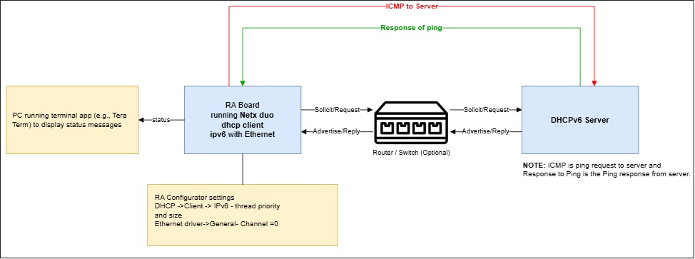
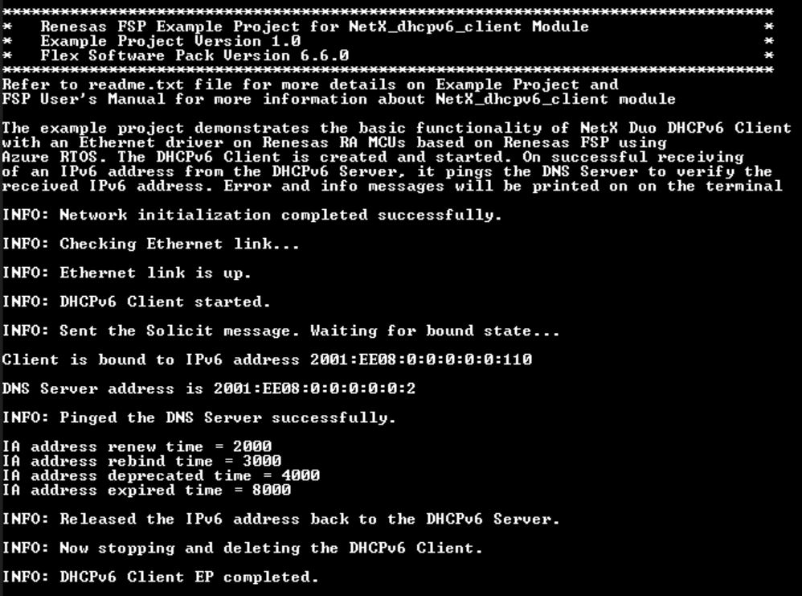

# Introduction #
The example project demonstrates the basic functionality of NetX Duo DHCPv6 Client with an Ethernet driver on Renesas RA MCUs based on Renesas FSP using Azure RTOS. The DHCPv6 Client is created and started. On successful receiving of an IPv6 address from the DHCPv6 Server, it pings the DNS Server to verify the received IPv6 address. The error and info messages will be printed on the serial terminal.

NetX Duo DHCPv6 Client is compliant with [RFC3315](https://tools.ietf.org/html/rfc3315), [RFC3646](https://tools.ietf.org/html/rfc3646), and related RFCs.

Please refer to the [Example Project Usage Guide](https://github.com/renesas/ra-fsp-examples/blob/master/example_projects/Example%20Project%20Usage%20Guide.pdf) for general information on example projects and [readme.txt](./readme.txt) for specifics of operation.

## Required Resources ##
To build and run the NetX DHCPv6 Client example project, the following resources are needed.

### Software ###
* Renesas Flexible Software Package (FSP): Version 6.6.0
* e2 studio: Version 2026-07
* Terminal Console Application: Tera Term or a similar application
* LLVM Embedded Toolchain for ARM: Version 22.1.0

Refer to software requirements mentioned in [Example Project Usage Guide](https://github.com/renesas/ra-fsp-examples/blob/master/example_projects/Example%20Project%20Usage%20Guide.pdf)

### Hardware ###
* Supported RA boards: EK-RA6M3, EK-RA6M4, EK-RA6M5, EK-RA8M1, EK-RA8D1, MCK-RA8T1, EK-RA8P1, EK-RA8D2, EK-RA8M2, MCK-RA8T2, EK-RA8T2, EK-RA8P1 V2.
	* 2 x Renesas RA board.
		- 1 x RA board runs the NetX_dhcpv6_server example project.
		- 1 x RA board runs the NetX_dhcpv6_client example project.
	* 2 x USB cables for programming and debugging (USB cable type varies by board model).
    * 1 x Ethernet/LAN cable (Ethernet cable CAT5/6).

### Hardware Connections ###
* Connect USB debug ports of the two RA boards to USB ports of the host PC using two appropriate USB cables for EP programming and debugging.
* For EK-RA6M3, EK-RA6M4, EK-RA6M5:
    * Connect the ethernet port of the RA board to the ethernet port of another RA board running NetX_dhcpv6_server using a LAN cable.
* For EK-RA8M1:
    * Connect the ethernet port of the RA board to the ethernet port of another RA board running NetX_dhcpv6_server using a LAN cable.
    * Remove jumper J61 to enable Ethernet B.
* For EK-RA8D1:
    * Connect the ethernet port of the RA board to the ethernet port of another RA board running NetX_dhcpv6_server using a LAN cable.
    * Set the configuration switches (SW1) as below to avoid potential failures:
        * CAUTION: Do not enable SW1-4 and SW1-5 together. 

        | SW1-1 PMOD1 | SW1-2 TRACE | SW1-3 CAMERA | SW1-4 ETHA | SW1-5 ETHB | SW1-6 GLCD | SW1-7 SDRAM | SW1-8 I3C |
        |-------------|-------------|--------------|------------|------------|------------|-------------|-----------|
        | OFF | OFF | OFF | OFF | ON | OFF | OFF | OFF |

* For MCK-RA8T1:
    * Connect the ethernet port of the RA board to the ethernet port of another RA board running NetX_dhcpv6_server using a LAN cable.

* For EK-RA8P1, EK-RA8D2, EK-RA8M2, EK-RA8P1 V2:
    * Connect the ethernet port of the RA board to the ethernet port of another RA board running NetX_dhcpv6_server using a LAN cable.
    * For EK-RA8M2: The user must place jumper J6 on pins 2-3, J8 on pins 1-2, J9 on pins 2-3, and J29 on pins 1-2, 3-4, 5-6, 7-8 to use the on-board debug functionality.
    * For EK-RA8P1 V2: The user must set the configuration switches (SW6) as below to use the on-board debug functionality.

		| SW6-1 | SW6-2 | SW6-3 | SW6-4 | SW6-5 | SW6-6 | SW6-7 | SW6-8 | SW6-9 | SW6-10 |
		|-------|-------|-------|-------|-------|-------|-------|-------|-------|--------|
		|  OFF  |  OFF  |  OFF  |  OFF  |  ON   |  OFF  |  ON   |  ON   |  ON   |   ON   |

* For MCK-RA8T2:
    * Connect the ethernet port 0 (CN14) of the RA board to the ethernet port of another RA board running NetX_dhcpv6_server using a LAN cable.

* For EK-RA8T2:
    * The user must set the configuration switches (SW6 and SW4) as below to use the on-board debug functionality and enable ethernet 0.

		| SW6-1 | SW6-2 | SW6-3 | SW6-4 | SW6-5 | SW6-6 | SW6-7 | SW6-8 | SW6-9 | SW6-10 |
		|-------|-------|-------|-------|-------|-------|-------|-------|-------|--------|
		|  OFF  |  OFF  |  OFF  |  OFF  |  ON   |  OFF  |  ON   |  ON   |  ON   |   ON   |

		| SW4-1 PMOD1 | SW4-2 PMOD1 | SW4-3 CAN0 | SW4-3 CAN1 | SW4-5 PMIC | SW4-6 ETH0 | SW4-7 USBFS | SW4-8 RS485 |
		|-------------|-------------|------------|------------|------------|------------|-------------|-------------|
		|     OFF     |     OFF     |     OFF    |     OFF    |     OFF    |     OFF    |     OFF     |      OFF    |

    * Connect the ethernet port 0 (J15) of the RA board to the ethernet port of another RA board running NetX_dhcpv6_server using a LAN cable.

## Related Collateral References ##
The following documents can be referred to for enhancing your understanding of the operation of this example project:
- [FSP User Manual on GitHub](https://renesas.github.io/fsp/)
- [FSP Known Issues](https://github.com/renesas/fsp/issues)

# Project Notes #

## System Level Block Diagram ##

## FSP Modules Used ##
List all the various modules that are used in this example project. Refer to the FSP User Manual for further details on each module listed below.

| Module Name | Usage  | Searchable Keyword (using New Stack > Search) |
|-------------|-----------------------------------------------|-----------------------------------------------|
| NetX Duo DHCP IPV6 Client | DHCPv6 client module is used for dynamic global IPv6 address assignment from a DHCPv6 server and to automate the process of configuring devices on IP networks, thus allowing them to use network services such as DNS, and any communication protocol based on UDP or TCP.| dhcp |

## Module Configuration Notes ##
This section describes FSP Configurator properties which are important or different from those selected by default.  
**Note: The configuration shown in this document is based on the original target board (e.g., EK-RA8P1). Some settings may differ on other supported boards due to hardware differences.**

|   Module Property Path and Identifier   |   Default Value   |   Used Value   |   Reason   |
| :-------------------------------------: | :---------------: | :------------: | :--------: |
| configuration.xml > BSP > Properties > Settings > Property > RA Common > Heap size (bytes) | 0 | 0x400 | Heap size is required for standard library functions to be used as per FSP requirements. |
| configuration.xml > Stacks > Threads > DHCP Client Thread > Properties > Settings > Property > Thread > Priority | 1 | 3 | DHCP Client Thread priority is lowered to match the IP thread priority, so that the DHCP Client Thread does not preempt the IP thread while it processes incoming packets. |
| configuration.xml > Stacks > Threads > DHCP Client Thread > DHCP Client Thread Stacks > g_dhcpv6_client0 Azure RTOS NetX Duo DHCP IPv6 Client > Properties > Settings > Property > Common > Common > Duplicate Address Detection support | Enabled (default) | Disabled | Duplicate Address Detection property is disabled to avoid detecting any duplicate address. |
| configuration.xml > Stacks > Threads > Terminal Thread > Properties > Settings > Property > Thread > Priority | 1 | 4 | Terminal thread priority is lowered to allow the DHCP Client and IP threads to process incoming packets at the fastest rate possible. |
| configuration.xml > Stacks > HAL/Common > Azure RTOS ThreadX > Properties > Settings > Property > Timer > Timer Ticks Per Second | 100 | 1000 | Sets the ThreadX tick to 1 ms, which is the unit of the wait times used by this EP. |

## API Usage ##

The table below lists the DHCP Client API used at the application layer by this example project.

| API Name    | Usage                                                                          |
|-------------|--------------------------------------------------------------------------------|
| nx_ip_interface_status_check | This API is used to wait for the IP instance initialization to finish. |
| nx_ip_driver_direct_command | This API is used to issue command to network driver. |
| nx_dhcpv6_create_client_duid | This API is used to create a Link Layer Plus Time DUID for the DHCPv6 Client. |
| nx_dhcpv6_create_client_iana | This API is used to add an Identity Association to the Client. |
| nx_dhcpv6_request_option_timezone | This API is used to add the time zone option to the Client option request data in request messages to the Server. |
| nx_dhcpv6_request_option_DNS_server | This API is used to add the DNS Server option to the Client option request data in request messages to the Server. |
| nx_dhcpv6_start | This API is used to start the DHCPv6 Client thread task. |
| nx_dhcpv6_request_solicit | This API is used to send a DHCPv6 SOLICIT request to any Server on the Client network (broadcast). |
| nx_dhcpv6_get_valid_ip_address_count | This API is used to get the number of IPv6 addresses assigned to the DHCPv6 Client. |
| nx_dhcpv6_get_IP_address | This API is used to get the global IPv6 address assigned to the DHCPv6 Client. |
| nx_dhcpv6_get_DNS_server_address | This API is used to get DNS Server address at the specified index into the DHCPv6 Client DNS Server list. |
| nxd_icmp_ping | This API is used to send out an ICMP Echo Request packet through an appropriate physical interface and waits for an Echo Reply from the destination host. |
| nx_packet_release | This API is used to release the Echo Reply packet of the ping back to the packet pool. |
| nx_dhcpv6_get_lease_time_data | This API is used to retrieve Client’s IA address lease time data. |
| nx_dhcpv6_request_release | This API is used to release the IP address back to the Server. |
| nx_dhcpv6_stop | This API is used to stop the DHCPv6 Client thread task. |
| nx_dhcpv6_client_delete | This API is used to delete a DHCPv6 Client instance. |

## Verifying Operation ##
* Import, build and download the EP (see section Starting Development of **FSP User Manual**). After running the EP, open a serial terminal application (e.g., Tera Term) to see the output.
* Before running the example project, make sure [Hardware Connections](#hardware-connections) are completed.
* To view output logs on a serial terminal application (e.g., Tera Term), configure the settings as follows:
    * To make sure the received data shows properly, the user needs to set:
      * [Setup] -> [Terminal...] -> [New-line] -> Select [Receive: CR] & [Transmit: CR].
    * To echo back characters typed in Tera Term, the user needs to enable it through:
      * [Setup] -> [Terminal...] -> Check [Local echo].
    * The configuration parameters of the serial port on the serial terminal application:
      * Port: The port is provided by the J-Link On-Board.
      * Speed: 115200
      * Data: 8 bit
      * Parity: none
      * Stop bits: 1 bit
      * Flow control: none

**To run DHCPv6 Client please follow steps:**
* After confirming all necessary hardware connections, run the NetX_dhcpv6_server example project (EP) on the first RA board. Then, start the DHCPv6 Server using the menu option, so that it can assign an IPv6 address to the DHCPv6 Client.
* Once the DHCPv6 Server is running, execute this NetX_dhcpv6_client example project (EP) on the second RA board and monitor the output and status information using the serial terminal.

The image below shows the hardware connection setup required to run the example project:

The images below show the output on the serial terminal:

## Special Topics ##
If the example project is not functioning correctly in terms of network connectivity or IP assignment, please re-check [readme.txt](./readme.txt).
