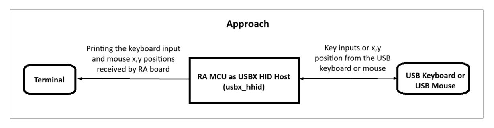
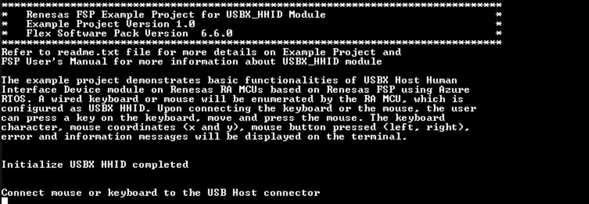
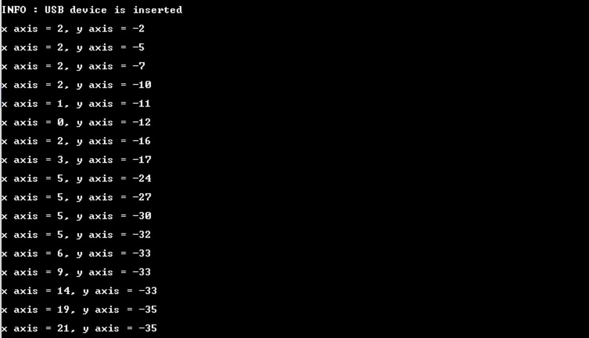

# Introduction #
The example project demonstrates basic functionalities of USBX Host Human Interface Device module on Renesas RA MCUs based on Renesas FSP using Azure RTOS. A wired keyboard or mouse will be enumerated by the RA MCU, which is configured as USBX HHID. Upon connecting the keyboard or the mouse, the user can press a key on the keyboard, move and press the mouse. The keyboard character, mouse coordinates (x and y), mouse button pressed (left, right), error and information messages will be displayed on the terminal.

Please refer to the [Example Project Usage Guide](https://github.com/renesas/ra-fsp-examples/blob/master/example_projects/Example%20Project%20Usage%20Guide.pdf) for general information on example projects and [readme.txt](./readme.txt) for specifics of operation.

## Required Resources ##
To build and run the USBX HHID example project, the following resources are needed.

### Software ###
* Renesas Flexible Software Package (FSP): Version 6.6.0
* e2 studio: Version 2026-07
* LLVM Embedded Toolchain for ARM: Version 22.1.0
* Refer to the software required section in [Example Project Usage Guide](https://github.com/renesas/ra-fsp-examples/blob/master/example_projects/Example%20Project%20Usage%20Guide.pdf)

### Hardware ###
* Supported RA boards: EK-RA6M4, EK-RA4M2, EK-RA4M3, EK-RA6M3, EK-RA6M5, EK-RA8M1, EK-RA8D1, MCK-RA8T1, EK-RA4L1, EK-RA8E2, EK-RA8P1, MCK-RA8T2, EK-RA8D2, EK-RA8M2
    * 1 x Renesas RA board.
    * 1 x USB cable for programming and debugging (USB cable type varies by board model).
    * 1 x OTG cable for connection between the RA board and the wired USB keyboard/mouse (OTG cable type varies by board model).  
    * 1 x Wired USB keyboard (e.g., HP PN: 803181-001).
    * 1 x Wired USB mouse (When using USBX HHID, please use wired device).

### Hardware Connections ###
* Connect the RA board USB debug port to the host PC using the appropriate USB cable for EP programming and debugging.

* For EK-RA6M5, EK-RA6M4, EK-RA4M3, EK-RA4M2, EK-RA6M3, EK-RA8M1, EK-RA8D1 (Full-Speed):
    * Jumper J12 placement is pins 1-2.
    * Remove jumper J15 pins.
    * Connect the wired USB keyboard/mouse to J11 connector using the appropriate OTG cable.  

* For MCK-RA8T1 (Full-Speed):
    * Jumper JP9 placement is pins 1-2.
    * Remove jumper JP10 pins.
    * Connect the wired USB keyboard/mouse to CN14 connector using the appropriate OTG cable.  

* For EK-RA4L1 (Full-Speed):
    * Turn OFF S4-4 to select USB Host mode.
    * Set J17 jumper to pins 2-3, set J7 jumper to use P407 for USBFS VBUS.
    * Connect the wired USB keyboard/mouse to J11 connector using the appropriate OTG cable.  

* For EK-RA8E2, EK-RA8P1, EK-RA8D2, EK-RA8M2 (Full-Speed):
    * For EK-RA8M2, the user must place jumper J6 on pins 2-3, J8 on pins 1-2, J9 on pins 2-3, and J29 on pins 1-2, 3-4, 5-6, 7-8 to use the on-board debug functionality.
    * Connect the wired USB keyboard/mouse to J11 connector using the appropriate OTG cable.  

* For MCK-RA8T2 (Full-Speed):
	* Jumper JP6 placement is pins 1-2.
	* Remove jumper JP7 pins.
    * Connect the wired USB keyboard/mouse to CN18 connector using the appropriate OTG cable.  

## Related Collateral References ##
The following documents can be referred to for enhancing your understanding of the operation of this example project:
- [FSP User Manual on GitHub](https://renesas.github.io/fsp/)
- [Microsoft Azure USBX Host Class API ](https://docs.microsoft.com/en-us/azure/rtos/usbx/usbx-host-stack-5)
- [FSP Known Issues](https://github.com/renesas/fsp/issues)

# Project Notes #
## System Level Block Diagram ##
High level block diagram of the system is shown below:
 

## FSP Modules Used ##
List of important modules that are used in this example project. Refer to the FSP User Manual for further details on each module listed below.

| Module Name | Usage | Searchable Keyword  |
|-------------|-----------------------------------------------|-----------------------------------------------|
| USBX HHID | This usbx_hhid module combines with the r_usb_basic module to provide a USBX Host Human Interface Device Class (HHID) driver. | HHID |
| USB Porting layer | This USB driver works by combining USBX and r_usb_basic module. | rm_usb_port |
| USB Basic Driver | USB driver operates in combination with the device class drivers provided by Renesas to form a complete USB stack. | r_usb_basic |

## Module Configuration Notes ##
This section describes FSP Configurator properties which are important or different than those selected by default.

**Note: The configuration shown in this document is based on the original target board (e.g., EK-RA8P1). Some settings may differ on other supported boards due to hardware differences.**

**Common Configuration properties**
|   Module Property Path and Identifier   |   Default Value   |   Used Value   |   Reason   |
| :-------------------------------------: | :---------------: | :------------: | :--------: |
| configuration.xml > Stacks > Threads > HHID Thread > Properties > Settings > Property > Common > Timer > Timer Ticks Per Second | 100 | 1000 | The default UX_PERIODIC_RATE ticks should be 1000 indicating 1 tick per millisecond. |
| configuration.xml > Stacks > Threads > HHID Thread > Properties > Settings > Property > Thread > Priority | 1 | 20 | HHID thread priority is lowered to allow the other usb operations at faster rate. |
| configuration.xml > Stacks > Threads > Terminal Thread > Properties > Settings > Property > Thread > Priority | 1 | 21 | Terminal thread priority is lowered to allow the USBX HHID data process at the fastest rate possible. |

The table below lists the FSP provided API used at the application layer by this example project.

| API Name    | Usage                                                                          |
|-------------|--------------------------------------------------------------------------------|
| ux_system_initialize | This API is used to initialize the USBX system. |
| ux_host_stack_initialize | This API is used to initialize the USBX host stack. |
| R_USB_Open | This API is used to open the USB basic driver. |
| ux_host_class_hid_keyboard_key_get | This API is used to get the keyboard key and state. |
| ux_host_class_hid_mouse_buttons_get | This API is used to get the mouse buttons pressed. |
| ux_host_class_hid_mouse_position_get | This API is used to get the mouse position in x & y coordinates. |
| R_USB_Close | This API is used to close the USB instance. |
| ux_host_stack_uninitialize | This API is used to uninitialize all the host code for USBX. |

* Callback:  
apl_host_hid_change_function callback function is called to identify the USB events and respond accordingly. There are only two events available in the EP, which are used to signal to the HHID that USB communication can be started.
1. When event UX_DEVICE_INSERTION is received the USBX_HHID checks for the Host device connected and sets the event flag to perform USBX_HHID operation.
2. When event UX_DEVICE_REMOVAL is received the USBX_HHID will clear the event flag and will wait for USB_INSERTION event.

## Verifying Operation ##
1. Import, generate, build the example project.
2. Before running the example project, make sure [Hardware Connections](#hardware-connections) are completed.
3. Open a serial terminal application (e.g., Tera Term) to view output log, configure the settings as shown below:
    * To make sure the received data shows properly, the user needs to set:
        * [Setup] -> [Terminal...] -> [New-line] -> Select [Receive: CR] & [Transmit: CR].
    * To echo back characters typed in Tera Term, the user needs to enable it through:
        * [Setup] -> [Terminal...] -> Check [Local echo].
    * The configuration parameters of the serial port on the serial terminal application:
        * Port: The port is provided by the J-Link On-Board.
        * Speed: 115200
        * Data: 8 bit
        * Parity: none
        * Stop bits: 1 bit
        * Flow control: none
4. Debug or flash the EP to the RA board.
5. Connect host device (e.g., keyboard or mouse).

### The images below showcase the output on the terminal ###    
The EP information:
 
 
 
Keyboard is connected as host device, press key and check pressed key output.

 

Mouse is connected as host device, check the x and y coordinates and button pressed of mouse.

 

 

## Special Topics ##
* The EP does not support High Speed as USBX HHID does not support it.
* The EP has been confirmed to work properly with the HP brand keyboard (e.g., HP PN: 803181-001), while some other keyboard models may not be compatible.
