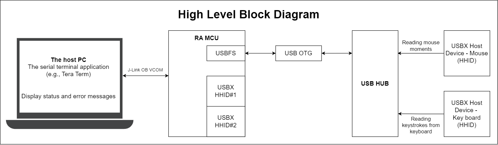
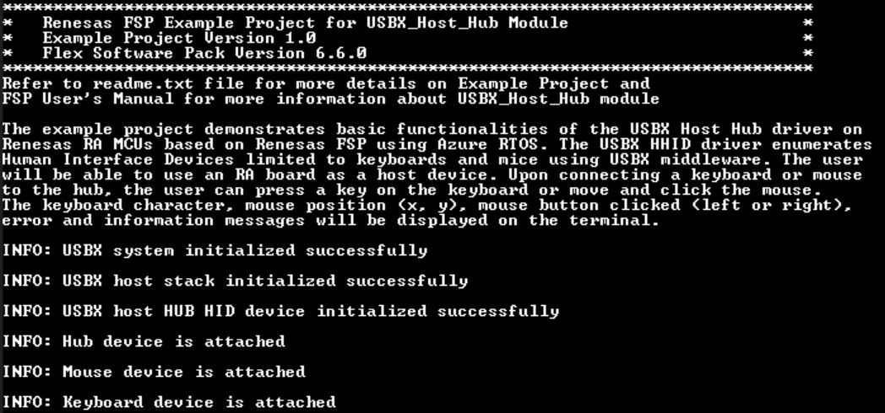
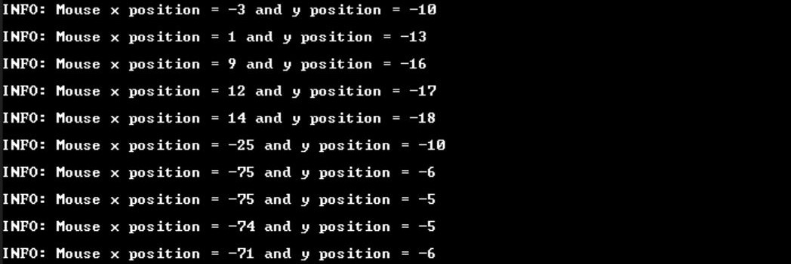
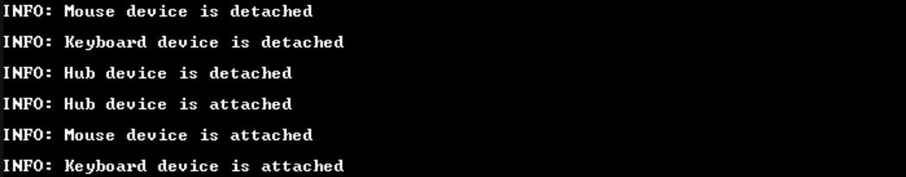

# Introduction #
The example project demonstrates basic functionalities of the USBX Host Hub driver on Renesas RA MCUs based on Renesas FSP using Azure RTOS. The USBX HHID driver enumerates Human Interface Devices limited to keyboards and mice using USBX middleware. The user will be able to use an RA board as a host device. Upon connecting a keyboard or mouse to the hub, the user can press a key on the keyboard or move and click the mouse. The keyboard character, mouse position (x, y), mouse button clicked (left or right), error and information messages will be displayed on the terminal.

Please refer to the [Example Project Usage Guide](https://github.com/renesas/ra-fsp-examples/blob/master/example_projects/Example%20Project%20Usage%20Guide.pdf) for general information on example projects and [readme.txt](./readme.txt) for specifics of operation.

## Required Resources ##
To build and run the USBX Host Hub example project, the following resources are needed.

### Software ###
1. Refer to the software required section in [Example Project Usage Guide](https://github.com/renesas/ra-fsp-examples/blob/master/example_projects/Example%20Project%20Usage%20Guide.pdf)

### Hardware ###
* Supported RA boards: EK-RA4M2, EK-RA4M3, EK-RA6M3, EK-RA6M4, EK-RA6M5, EK-RA8M1, EK-RA8D1, MCK-RA8T1, EK-RA4L1, EK-RA8E2, EK-RA8P1, MCK-RA8T2, EK-RA8D2, EK-RA8M2.
    * 1 x Renesas RA board.
    * 1 x USB cable for programming and debugging (USB cable type varies by board model).
    * 1 x OTG cable used with the USB communication cable between the RA board and the USB hub (OTG cable type varies by board model).
    * 1 x USB hub.
    * 1 x Wired USB keyboard.
    * 1 x Wired USB mouse.

### Hardware Connections ###
* Connect the RA board USB debug port to the host PC using the appropriate USB cable for EP programming and debugging.
* For EK-RA4M2, EK-RA4M3, EK-RA6M3, EK-RA6M4, EK-RA6M5, EK-RA8M1, EK-RA8D1 (Full-Speed):
    * Jumper J12 placement is pins 1-2.
    * Remove Jumper J15 pins.
    * Connect the USB hub to J11 connector using the appropriate OTG cable.
    * Connect a wired USB keyboard and mouse to the USB hub.
      
* For MCK-RA8T1 (Full-Speed):
    * Jumper JP9 placement is pins 1-2.
    * Remove Jumper JP10 pins.
    * Connect the USB hub to CN14 connector using the appropriate OTG cable.
    * Connect a wired USB keyboard and mouse to the USB hub.

* For EK-RA4L1 (Full-Speed):
    * Turn OFF S4-4 to use USB Host Controller.
    * Set J17 jumper to pins 2-3, Set J7 jumper to use P407 for USBFS VBUS.
    * Connect the USB hub to J11 connector using the appropriate OTG cable.
    * Connect a wired USB keyboard and mouse to the USB hub.

* For EK-RA8E2, EK-RA8P1, EK-RA8D2, EK-RA8M2 (Full-Speed):
    * For EK-RA8M2, the user must place jumper J6 on pins 2-3, J8 on pins 1-2, J9 on pins 2-3, and J29 on pins 1-2, 3-4, 5-6, 7-8 to use the on-board debug functionality.
    * Connect the USB hub to J11 connector using the appropriate OTG cable.
    * Connect a wired USB keyboard and mouse to the USB hub.

* For MCK-RA8T2 (Full Speed):
    * Jumper JP6 placement is pins 1-2.
    * Remove Jumper JP7 pins.
    * Connect the USB hub to CN18 connector using the appropriate OTG cable.
    * Connect a wired USB keyboard and mouse to the USB hub.

## Related Collateral References ##
The following documents can be referred to for enhancing your understanding of the operation of this example project:
* [FSP User Manual on GitHub](https://renesas.github.io/fsp/)
* [Microsoft Azure USBX Host Class API ](https://docs.microsoft.com/en-us/azure/rtos/usbx/usbx-host-stack-5)
* [FSP Known Issues](https://github.com/renesas/fsp/issues)

# Project Notes #
## System Level Block Diagram ##
High level block diagram

## FSP Modules Used ##
List of important modules that are used in this example project. Refer to the FSP User Manual for further details on each module listed below.

**Note: The configuration shown in this document is based on the original target board (e.g., EK-RA8P1). Some settings may differ on other supported boards due to hardware differences.**

| Module Name | Usage | Searchable Keyword |
|-------------|-----------------------------------------------|-----------------------------------------------|
| USBX HHID | This usbx_hhid module combines with the r_usb_basic module to provide a USBX Host Human Interface Device Class (HHID) driver. | HHID |
| USB Porting layer | This USB driver works by combining USBX and r_usb_basic module. | rm_usb_port |
| USB Basic Driver | USB driver operates in combination with the device class drivers provided by Renesas to form a complete USB stack. | r_usb_basic |

## Module Configuration Notes ##
This section describes FSP Configurator properties which are important or different from those selected by default.

**Common Configuration properties**
|   Module Property Path and Identifier   |   Default Value   |   Used Value   |   Reason   |
| :-------------------------------------: | :---------------: | :------------: | :--------: |
| configuration.xml > BSP > Properties > Settings > Property > RA Common > Main stack size (bytes) | 0x400 | 0x1000 | Main Program thread stack is configured to store the local variables of different functions in the code. |
| configuration.xml > BSP > Properties > Settings > Property > RA Common > Heap size (bytes) | 0 | 0x400 | Heap size is required for standard library functions to be used. |
| configuration.xml > Stacks > Threads > HID Mouse HUB Thread > Properties > Settings > Property > Common > Timer > Timer Ticks Per Second | 100 | 1000 | The default UX_PERIODIC_RATE ticks should be 1000 indicating 1 tick per millisecond. |
| configuration.xml > Stacks > Threads > HID Mouse HUB Thread > Properties > Settings > Property > Thread > Priority | 1 | 15 | HID Mouse HUB thread priority is lowered to allow the other USB operations at faster rate. |
| configuration.xml > Stacks > Threads > HID Keyboard HUB Thread > Properties > Settings > Property > Thread > Priority | 1 | 15 | HID Keyboard HUB thread priority is lowered to allow the other USB operations at faster rate. |
| configuration.xml > Stacks > Threads > HID Keyboard HUB Thread > HID Keyboard HUB Thread Stacks > Azure RTOS USBX HHID > Properties > Settings > Property > Common > USBX Hub Multi HID | Disabled | Enabled | Enable USBX Hub support for HID-HID. |
| configuration.xml > Stacks > Threads > Terminal Thread > Properties > Settings > Property > Thread > Priority | 1 | 16 | Terminal thread priority is lowered to allow the USBX HHID data process at the fastest rate possible. |
| configuration.xml > Stacks > Threads > Terminal Thread > Properties > Settings > Property > Thread > Stack size (bytes) | 1024 | 4096 | The size of the Terminal Thread Stack is increased so that data from any type of file can be printed on the terminal. |

The table below lists the FSP provided API used at the application layer by this example project.

| API Name    | Usage                                                                          |
|-------------|--------------------------------------------------------------------------------|
| R_USB_Open | This API is used to open the USB basic driver. |
| R_USB_Close | This API is used to close the USB instance. |
| ux_system_initialize | This API is used to initialize the USBX system. |
| ux_system_uninitialize | This API is used to uninitialize the USBX system. |
| ux_host_stack_initialize | This API is used to initialize the USBX host stack. |
| ux_host_stack_uninitialize | This API is used to uninitialize the USBX host stack. |
| ux_host_class_hid_keyboard_key_get | This API is used to get the keyboard key and state. |
| ux_host_class_hid_mouse_buttons_get | This API is used to get the mouse buttons pressed. |
| ux_host_class_hid_mouse_position_get | This API is used to get the mouse position in x and y coordinates. |
| _ux_utility_memory_compare | This API is used to compare two memory blocks. |
| _ux_utility_string_length_get | This API is used to get the length of a string. |

**Note:**
* The EP does not support USB High-Speed because USBX HHID does not support it.
* The EP does not support HP brand keyboard for testing (e.g., HP PN: 803181-001).

## Verifying Operations ##
1. Import, generate, and build the example project (EP).
2. Set up hardware connection properly as mentioned in [Hardware Connections](#hardware-connections) section.
3. Flash EP into the RA board.
4. Open a serial terminal application (e.g., Tera Term), configure the settings as shown below:
    * To make sure the received data shows properly, the user needs to set:
        * [Setup] -> [Terminal...] -> [New-line] -> Select [Receive: CR] & [Transmit: CR].

    * To echo back characters typed in Tera Term, the user needs to enable it through:
        * [Setup] -> [Terminal...] -> Check [Local echo].

    * The configuration parameters of the serial port on the serial terminal application:
        * Port: The port is provided by the J-Link On-Board.
        * Speed: 115200
        * Data: 8 bit
        * Parity: none
        * Stop bits: 1 bit
        * Flow control: none
5. Press any key on the keyboard and check the key pressed event output on the terminal.
6. Check the x and y coordinates and button pressed of the mouse on the terminal.

The images below showcase the output on the terminal:
 

 

