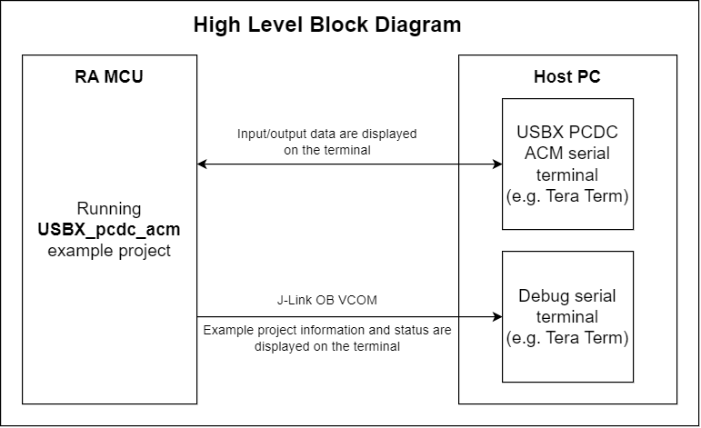
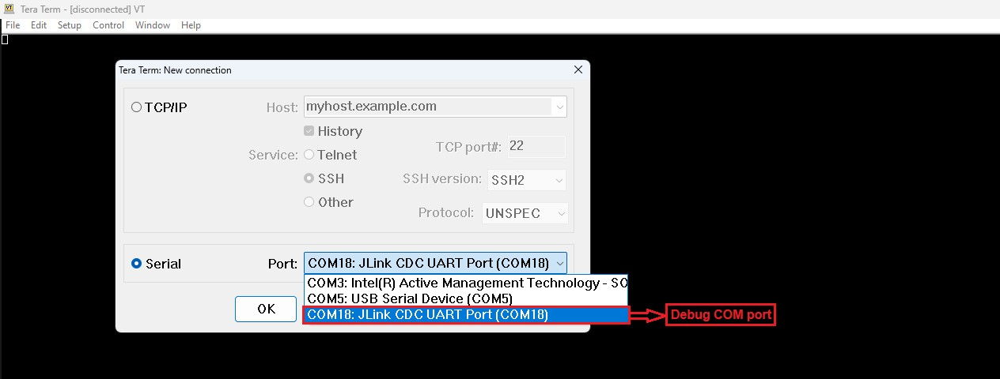
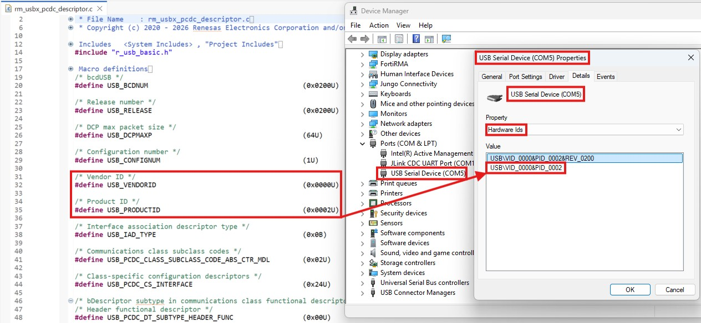
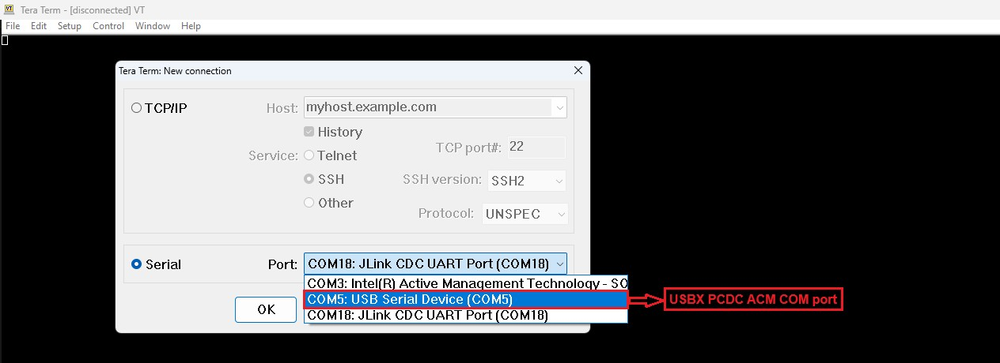
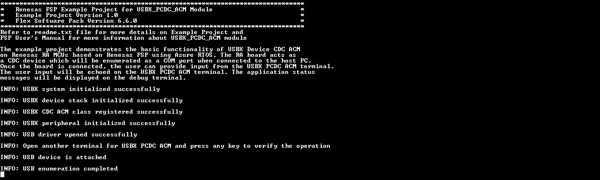

# Introduction #
The example project demonstrates the basic functionality of USBX Device CDC ACM on Renesas RA MCUs based on Renesas FSP using Azure RTOS. The RA board acts as a CDC device which will be enumerated as a COM port when connected to the host PC. Once the board is connected, the user can provide input from the USBX PCDC ACM terminal. The user input will be echoed on the USBX PCDC ACM terminal. The application status messages will be displayed on the debug terminal.

Please refer to the [Example Project Usage Guide](https://github.com/renesas/ra-fsp-examples/blob/master/example_projects/Example%20Project%20Usage%20Guide.pdf) for general information on example projects and [readme.txt](./readme.txt) for specifics of operation.

## Required Resources ##
To build and run the USBX PCDC ACM example project, the following resources are needed.

### Software ###
1. Refer to the software required section in [Example Project Usage Guide](https://github.com/renesas/ra-fsp-examples/blob/master/example_projects/Example%20Project%20Usage%20Guide.pdf).
2. Refer to [Special Topics](#special-topics) for more information of USBX PCDC ACM setup.

### Hardware ###
* Supported RA boards: EK-RA4M2, EK-RA4M3, EK-RA6M1, EK-RA6M2, EK-RA6M3, EK-RA6M4, EK-RA6M5, EK-RA8M1, EK-RA8D1, MCK-RA8T1, EK-RA4L1, EK-RA8E2, EK-RA8P1, MCK-RA8T2, EK-RA8M2, EK-RA8D2.
	* 1 x Renesas RA board.
	* 1 x USB cable for programming and debugging (USB cable type varies by board model).
	* 1 x USB cable for USB communication between the RA board and the host PC (USB cable type varies by board model).
	* 1 x Host PC with at least 2 USB ports (1 for debug, 1 for COM port).

### Hardware Connections ###
* Connect the RA board USB debug port to the host PC using the appropriate USB cable for EP programming and debugging.

* For EK-RA6M1, EK-RA6M2 (Full-Speed):
	1. Connect the RA board USB FS port (J9) to the PC using the appropriate USB cable.

* For EK-RA6M4, EK-RA4M2, EK-RA4M3 (Full-Speed):
	1. Jumper J12 placement is pins 2-3.
	2. Connect jumper J15 pins.
	3. Connect the RA board USB FS port (J11) to the PC using the appropriate USB cable.

* For MCK-RA8T1 (Full-Speed):
	1. Jumper JP9: Connect pins 2-3.
	2. Connect jumper JP10 pins.
	3. Connect the RA board USB FS port (CN14) to the PC using the appropriate USB cable.

* For EK-RA4L1 (Full-Speed):
	1. Turn ON S4-4 to select USB device mode.
	2. Set J17 jumper to pins 2-3, Set J7 jumper to use P407 for USBFS VBUS.
	3. Connect the RA board USB FS port (J11) to the PC using the appropriate USB cable.

* For EK-RA8E2, EK-RA8P1, EK-RA8D2, EK-RA8M2 (Full-Speed):
	* Note: For EK-RA8M2, the user must place jumper J6 on pins 2-3, J8 on pins 1-2, J9 on pins 2-3,and J29 on pins 1-2, 3-4, 5-6, 7-8 to use the on-board debug functionality.
	1. Connect the RA board USB FS port (J11) to the PC using the appropriate USB cable.

* For MCK-RA8T2 (Full-Speed):
	1. Jumper JP6: Connect pins 2-3.
	2. Connect jumper JP7 pins.
	3. Connect the RA board USB FS port (CN18) to the PC using the appropriate USB cable.

* For EK-RA6M3 (High-Speed):
	1. Jumper J7: Connect pins 2-3.
	2. Connect jumper J17 pins.
	3. Connect the RA board USB HS port (J6) to the PC using the appropriate USB cable.

* For EK-RA6M5, EK-RA8M1, EK-RA8D1 (High-Speed):
	* Note: For EK-RA8D1, the user must turn OFF SW1-6 to use USBHS.
	1. Jumper J7: Connect pins 2-3.
	2. Connect jumper J17 pins.
	3. Connect the RA board USB HS port (J31) to the PC using the appropriate USB cable.

* For EK-RA8P1, EK-RA8D2, EK-RA8M2 (High-Speed):
	* Note: For EK-RA8M2, the user must place jumper J6 on pins 2-3, J8 on pins 1-2, J9 on pins 2-3, and J29 on pins 1-2, 3-4, 5-6, 7-8 to use the on-board debug functionality.
	1. Connect the RA board USB HS port (J7) to the PC using the appropriate USB cable.

## Related Collateral References ##
The following documents can be referred to for enhancing your understanding of the operation of this example project:
* [FSP User Manual on GitHub](https://renesas.github.io/fsp/).
* [FSP Known Issues](https://github.com/renesas/fsp/issues).

# Project Notes #

## System Level Block Diagram ##
High level block diagram

## FSP Modules Used ##
List all the various modules that are used in this example project. Refer to the FSP User Manual for further details on each module listed below.

| Module Name | Usage | Searchable Keyword  |
|-------------|-----------------------------------------------|-----------------------------------------------|
| USBX PCDC | USBX PCDC is used to communicate with the host PC to read user input and echo it back on the USBX PCDC ACM terminal. | USBX PCDC |
| USB Basic Driver | USB driver is required for hardware configuration on RA MCU. | r_usb_basic |
| DMAC Transfer | DMAC is used to transfer USB data for faster processing. | r_dmac |

## Module Configuration Notes ##
This section describes FSP Configurator properties which are important or different than those selected by default.

**Note: The configuration shown in this document is based on the original target board (e.g., EK-RA8P1). Some settings may differ on other supported boards due to hardware differences.**

**Common Configuration Properties**
|   Module Property Path and Identifier   |   Default Value   |   Used Value   |   Reason   |
| :-------------------------------------: | :---------------: | :------------: | :--------: |
| configuration.xml > Stacks > Threads > PCDC ACM Thread > Properties > Settings > Property > Common > Timer > Timer Ticks Per Second | 100 | 1000 | The default ticks should be 1000 indicating 1 tick per millisecond. |
| configuration.xml > Stacks > Threads > PCDC ACM Thread > Properties > Settings > Property > Thread > Priority | 1 | 15 | PCDC ACM thread priority is lowered to allow other USB operations to run at a faster rate. |
| configuration.xml > Stacks > Threads > Terminal Thread > Properties > Settings > Property > Thread > Priority | 1 | 16 | Terminal thread priority is lowered to allow USBX PCDC ACM data processing at the fastest rate possible. |
| configuration.xml > Stacks > Threads > PCDC ACM Thread > g_basic0 USB (r_usb_basic) > Properties > Settings > Property > Common > DMA/DTC Support | DMA Disabled | DMA Enabled | DMA is used to offload CPU usage, to transfer the USB data for faster process. |

**Configuration Properties if USB Speed as High-Speed**
|   Module Property Path and Identifier   |   Default Value   |   Used Value   |   Reason   |
| :-------------------------------------: | :---------------: | :------------: | :--------: |
| configuration.xml > Stacks > Threads > PCDC ACM Thread > g_basic0 USB (r_usb_basic) > Properties > Settings > Property > Module g_basic0 USB (r_usb_basic) > USB Speed | Full Speed | Hi Speed | USB Speed is configured as **Hi Speed**. According to the USB Speed, DMA settings should be updated. |
| configuration.xml > Stacks > Threads > PCDC ACM Thread > g_basic0 USB (r_usb_basic) > Properties > Settings > Property > Module g_basic0 USB (r_usb_basic) > USB Module Number | USB_IP0 Port | USB_IP1 Port | This property is used to specify USB module number to be used as per configured USB speed. |
| configuration.xml > Stacks > Threads > PCDC ACM Thread > g_transfer0 Transfer (r_dmac) USBHS FIFO 1 (DMA transfer request 1) > Properties > Settings > Property > Module g_transfer0 Transfer (r_dmac) USBHS FIFO 1 (DMA transfer request 1) > Transfer Size | 2 Bytes | 4 Bytes | The transfer size of DMA for **High Speed** requires **4 Bytes**. |
| configuration.xml > Stacks > Threads > PCDC ACM Thread > g_transfer0 Transfer (r_dmac) USBHS FIFO 1 (DMA transfer request 1) > Properties > Settings > Property > Module g_transfer0 Transfer (r_dmac) USBHS FIFO 1 (DMA transfer request 1) > Activation Source | No ELC Trigger | USBHS FIFO 1 (DMA transfer request 1) | This is an event trigger for DMA transfer 0 instance for destination pointer address. |
| configuration.xml > Stacks > Threads > PCDC ACM Thread > g_transfer1 Transfer (r_dmac) USBHS FIFO 0 (DMA transfer request 0) > Properties > Settings > Property > Module g_transfer1 Transfer (r_dmac) USBHS FIFO 0 (DMA transfer request 0) > Transfer Size | 2 Bytes | 4 Bytes | The transfer size of DMA for **High Speed** requires **4 Bytes**. |
| configuration.xml > Stacks > Threads > PCDC ACM Thread > g_transfer1 Transfer (r_dmac) USBHS FIFO 0 (DMA transfer request 0) > Properties > Settings > Property > Module g_transfer1 Transfer (r_dmac) USBHS FIFO 0 (DMA transfer request 0) > Activation Source | No ELC Trigger | USBHS FIFO 0 (DMA transfer request 0) | This is an event trigger for DMA transfer 1 instance for source pointer address. |

**Configuration Properties if USB Speed as Full-Speed**
|   Module Property Path and Identifier   |   Default Value   |   Used Value   |   Reason   |
| :-------------------------------------: | :---------------: | :------------: | :--------: |
| configuration.xml > Stacks > Threads > PCDC ACM Thread > g_basic0 USB (r_usb_basic) > Properties > Settings > Property > Module g_basic0 USB (r_usb_basic) > USB Speed | Full Speed | Full Speed | USB Speed is configured as **Full Speed**. According to the USB Speed, DMA settings should be updated. |
| configuration.xml > Stacks > Threads > PCDC ACM Thread > g_basic0 USB (r_usb_basic) > Properties > Settings > Property > Module g_basic0 USB (r_usb_basic) > USB Module Number | USB_IP0 Port | USB_IP0 Port | This property is used to specify USB module number to be used as per configured USB speed. |
| configuration.xml > Stacks > Threads > PCDC ACM Thread > g_transfer0 Transfer (r_dmac) USBFS FIFO 1 (DMA/DTC transfer request 1) > Properties > Settings > Property > Module g_transfer0 Transfer (r_dmac) USBFS FIFO 1 (DMA/DTC transfer request 1) > Transfer Size | 2 Bytes | 2 Bytes | The transfer size of DMA for **Full Speed** requires **2 Bytes**. |
| configuration.xml > Stacks > Threads > PCDC ACM Thread > g_transfer0 Transfer (r_dmac) USBFS FIFO 1 (DMA/DTC transfer request 1) > Properties > Settings > Property > Module g_transfer0 Transfer (r_dmac) USBFS FIFO 1 (DMA/DTC transfer request 1) > Activation Source | No ELC Trigger | USBFS FIFO 1 (DMA/DTC transfer request 1) | This is an event trigger for DMA transfer 0 instance for destination pointer address. |
| configuration.xml > Stacks > Threads > PCDC ACM Thread > g_transfer1 Transfer (r_dmac) USBFS FIFO 0 (DMA/DTC transfer request 0) > Properties > Settings > Property > Module g_transfer1 Transfer (r_dmac) USBFS FIFO 0 (DMA/DTC transfer request 0) > Transfer Size | 2 Bytes | 2 Bytes | The transfer size of DMA for **Full Speed** requires **2 Bytes**. |
| configuration.xml > Stacks > Threads > PCDC ACM Thread > g_transfer1 Transfer (r_dmac) USBFS FIFO 0 (DMA/DTC transfer request 0) > Properties > Settings > Property > Module g_transfer1 Transfer (r_dmac) USBFS FIFO 0 (DMA/DTC transfer request 0) > Activation Source | No ELC Trigger | USBFS FIFO 0 (DMA/DTC transfer request 0) | This is an event trigger for DMA transfer 1 instance for source pointer address. |

## API Usage ##
The table below lists the FSP provided API used at the application layer by this example project.

| API Name    | Usage                                                                          |
|-------------|--------------------------------------------------------------------------------|
| R_USB_Open | This API is used to open the USB basic driver. |
| R_USB_Close | This API is used to close the USB basic driver. |
| ux_system_initialize | This API is used to initialize the USBX system. |
| ux_system_uninitialize | This API is used to uninitialize the USBX system. |
| ux_device_stack_initialize | This API is used to initialize the USBX device stack. |
| ux_device_stack_uninitialize | This API is used to uninitialize the USBX device stack. |
| ux_device_stack_class_register | This API is used to register a class with the USBX device stack. |
| ux_device_stack_class_unregister | This API is used to unregister a class from the USBX device stack. |
| ux_device_class_cdc_acm_read | This API is used to read data from the CDC ACM class. |
| ux_device_class_cdc_acm_write | This API is used to write data to the CDC ACM class. |

Refer to [USBX Device Class Considerations](https://docs.microsoft.com/en-us/azure/rtos/usbx/usbx-device-stack-5#usb-device-cdc-acm-class) for more details of API used.

## Verifying Operations ##
1. Import, generate, and build the example project (EP).
2. Set up the hardware connections as mentioned in the [Hardware Connections](#hardware-connections) section.
3. Download the EP to the RA board.
4. To view the output logs on a serial terminal application (e.g., Tera Term), configure the settings as shown below:
	* To make sure the received data shows properly, the user needs to set:
		* [Setup] -> [Terminal...] -> [New-line] -> Select [Receive: CR] & [Transmit: CR].

	* To echo back characters typed in Tera Term, the user needs to enable it through:
		* [Setup] -> [Terminal...] -> Check [Local echo].

	* The configuration parameters of the serial port on the serial terminal application:
		* Port: The port is provided by the J-Link On-Board.
		* Speed: 115200
		* Data: 8 bit
		* Parity: none
		* Stop bits: 1 bit
		* Flow control: none

5. On the host PC, open **Device Manager**. Expand **Ports (COM & LPT)**, locate **USB Serial Device (COMxx)**, and note the COM port number for use in the next step (for example, COM5). The user can update the Vendor ID and Product ID in the descriptor file.

6. Open another serial terminal application (e.g., Tera Term) for USBX PCDC ACM. When prompted, select the serial option and select the COM port noted in the previous step.
	* To echo back characters typed in Tera Term, enable:
		* [Setup] -> [Terminal...] -> Check [Local echo].

The output on the debug terminal:

The output on the USBX PCDC ACM terminal:

## Special Topics ##
### Changing USB Speed in Source Code ###
* To change the USB speed, the user needs to update the source code in rm_usbx_pcdc_descriptor.c as shown below:
	* **For High-Speed**:
		* Comment out USB_DT_CONFIGURATION and uncomment USB_DT_OTHER_SPEED_CONF in g_device_framework_full_speed[DEVICE_FRAME_LENGTH_FULL_SPEED].
		* Uncomment USB_DT_CONFIGURATION and comment out USB_DT_OTHER_SPEED_CONF in g_device_framework_hi_speed[DEVICE_FRAME_LENGTH_HI_SPEED].

	* **For Full-Speed**:
		* Uncomment USB_DT_CONFIGURATION and comment out USB_DT_OTHER_SPEED_CONF in g_device_framework_full_speed[DEVICE_FRAME_LENGTH_FULL_SPEED].
		* Comment out USB_DT_CONFIGURATION and uncomment USB_DT_OTHER_SPEED_CONF in g_device_framework_hi_speed[DEVICE_FRAME_LENGTH_HI_SPEED].

### Developing Descriptor ###
1. Refer to the **Descriptor** section in [Device Class (rm_usbx_port)](https://renesas.github.io/fsp/group___u_s_b_x.html) for information on developing the descriptor. We can take a template file of required USB combination from the mentioned path in above link and use the same in the source folder by removing the **.template** file extension.

### User Callback Handlers ###
1. **usbx_status_callback()** handles USB attached and removed events.
2. **ux_cdc_device0_instance_activate()** and **ux_cdc_device0_instance_deactivate()** handle device stack enumeration events.

### USBX_PCDC Example Project Limitations ###
1. **ZLP Limitation**: When the data transfer is an exact multiple of **MaxPacketSize (requested_length), a ZLP handler** should be added after the USB Write call to indicate the end of the transfer.
