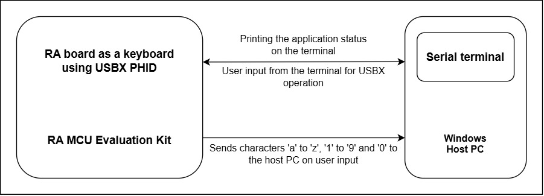
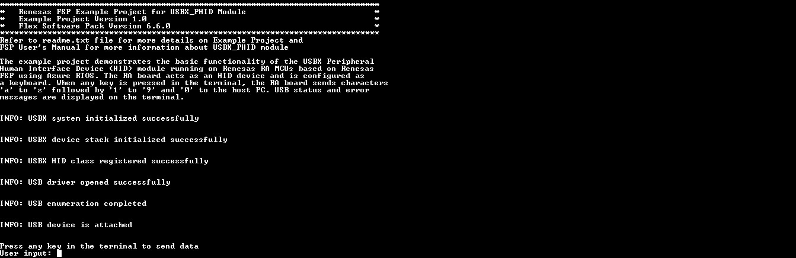
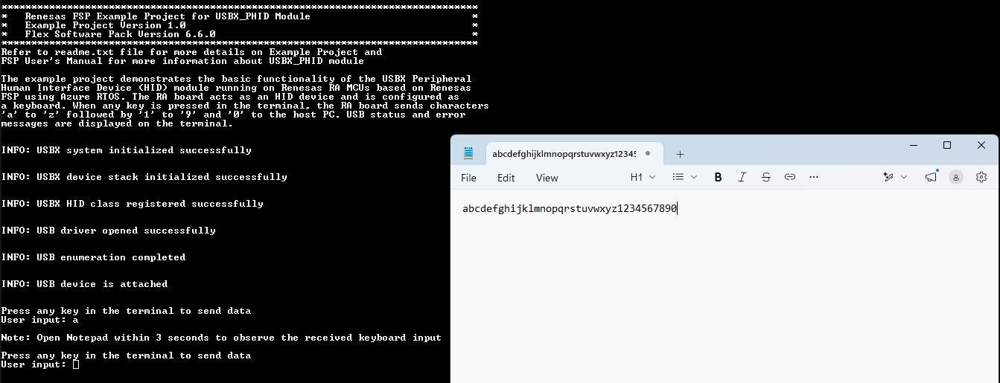
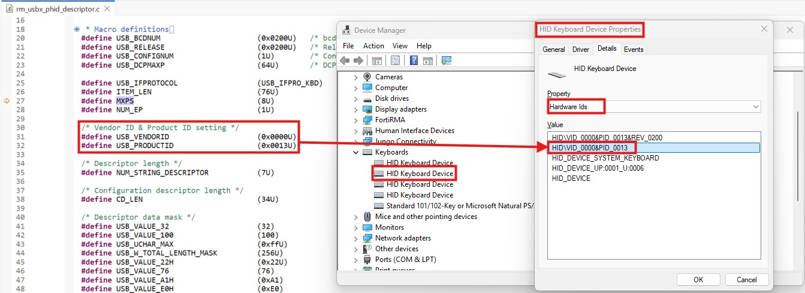

# Introduction #
The example project demonstrates the basic functionality of the USBX Peripheral Human Interface Device (HID) module running on Renesas RA MCUs based on Renesas FSP using Azure RTOS. The RA board acts as an HID device and is configured as a keyboard. When any key is pressed in the terminal, the RA board sends characters 'a' to 'z' followed by '1' to '9' and '0' to the host PC. USB status and error messages are displayed on the terminal.

Please refer to the [Example Project Usage Guide](https://github.com/renesas/ra-fsp-examples/blob/master/example_projects/Example%20Project%20Usage%20Guide.pdf) for general information on example projects and [readme.txt](./readme.txt) for specifics of operation.

## Required Resources ##
To build and run the USBX PHID example project, the following resources are needed.

### Software ###
* Renesas Flexible Software Package (FSP): Version 6.6.0
* e2 studio: Version 2026-07
* Terminal Console Application: Tera Term or a similar application
* LLVM Embedded Toolchain for ARM: Version 22.1.0

Refer to the software required section in [Example Project Usage Guide](https://github.com/renesas/ra-fsp-examples/blob/master/example_projects/Example%20Project%20Usage%20Guide.pdf) and [Special Topics](#special-topics) for more information on the USBX PHID setup.

### Hardware ###
* Supported RA boards: EK-RA4M2, EK-RA4M3, EK-RA6M1, EK-RA6M2, EK-RA6M3, EK-RA6M4, EK-RA6M5, EK-RA4E2, EK-RA6E2, EK-RA8M1, EK-RA8D1, MCK-RA8T1, EK-RA4L1, EK-RA8E2, EK-RA8P1, MCK-RA8T2, EK-RA8D2, EK-RA8M2.
    * 1 x Renesas RA board.
    * 1 x USB cable for programming and debugging (USB cable type varies by board model).
    * 1 x USB cable for USB communication between the RA board and the host PC (USB cable type varies by board model).
    * 1 x Host PC with at least 2 available USB ports (1 for debugging and 1 for the COM port).

### Hardware Connections ###
* Connect the RA board USB debug port to the host PC using the appropriate USB cable for EP programming and debugging.

* For EK-RA4M2, EK-RA4M3, EK-RA6M3, EK-RA6M4, EK-RA6M5, EK-RA8M1, EK-RA8D1 (Full-Speed):
    * Jumper J12: Connect pins 2-3.
    * Connect jumper J15 pins.
    * Connect the USB Full-Speed port (J11) of the RA board to the host PC using the appropriate USB cable.

* For EK-RA6M1, EK-RA6M2, EK-RA4E2, EK-RA6E2 (Full-Speed):
    * Connect the USB Full-Speed port (J11) of the RA board to the host PC using the appropriate USB cable.

* For MCK-RA8T1 (Full-Speed):
    * Jumper JP9: Connect pins 2-3.
    * Connect jumper JP10 pins.
    * Connect the USB Full-Speed port (CN14) of the RA board to the host PC using the appropriate USB cable.

* For EK-RA4L1 (Full-Speed):
    * Turn ON S4-4 to select USB device mode.
    * Set J17 jumper to pins 2-3 and set J7 jumper to use P407 for USBFS VBUS.
    * Connect the USB Full-Speed port (J11) of the RA board to the host PC using the appropriate USB cable.

* For EK-RA8E2, EK-RA8P1, EK-RA8D2, EK-RA8M2 (Full-Speed):
    * Note: For EK-RA8M2, the user must place jumper J6 on pins 2-3, J8 on pins 1-2, J9 on pins 2-3, and J29 on pins 1-2, 3-4, 5-6, 7-8 to use the on-board debug functionality.
    * Connect the USB Full-Speed port (J11) of the RA board to the host PC using the appropriate USB cable.

* For MCK-RA8T2 (Full-Speed):
    * Jumper JP6: Connect pins 2-3.
    * Connect jumper JP7 pins.
    * Connect the USB Full-Speed port (CN18) of the RA board to the host PC using the appropriate USB cable.

## Related Collateral References ##
The following documents can be referred to for enhancing your understanding of the operation of this example project:
* [FSP User Manual on GitHub](https://renesas.github.io/fsp/).
* [FSP Known Issues](https://github.com/renesas/fsp/issues).

# Project Notes #

## System Level Block Diagram ##
 High level block diagram
 

## FSP Modules Used ##
List of all the various modules that are used in this example project. Refer to the FSP User Manual for further details on each module listed below.

| Module Name | Usage | Searchable Keyword |
|-------------|-----------------------------------------------|-----------------------------------------------|
| USBX PHID | USBX PHID is used to send character data from the device to the host machine over the USB HID interface. | rm_usbx_port |
| USB Basic Driver | USB driver is required for hardware configuration on RA MCU. | r_usb_basic |

## Module Configuration Notes ##
This section describes FSP Configurator properties which are important or different from those selected by default.

**Note: The configuration shown in this document is based on the original target board (e.g., EK-RA8P1). Some settings may differ on other supported boards due to hardware differences.**

**Common Configuration Properties**
|   Module Property Path and Identifier   |   Default Value   |   Used Value   |   Reason   |
| :-------------------------------------: | :---------------: | :------------: | :--------: |
| configuration.xml > Stacks > Threads > USBX PHID Thread > Properties > Settings > Property > Common > Timer > Timer Ticks Per Second | 100 | 1000 | Sets the timer tick frequency to 1000 ticks per second, where one tick equals one millisecond. |
| configuration.xml > Stacks > Threads > USBX PHID Thread > Properties > Settings > Property > Thread > Priority | 1 | 21 | USBX PHID thread priority is lowered to allow other USB operations to run at a higher priority. |
| configuration.xml > Stacks > Threads > Terminal Thread > Properties > Settings > Property > Thread > Priority | 1 | 22 | Terminal thread priority is lowered to allow USBX PHID data processing to run at a higher priority. |

Refer to [User Callback Handlers](#user-callback-handlers) section for user callbacks.

## API Usage ##
The table below lists the APIs used at the application layer by this example project.

| API Name | Usage |
|----------|-------|
| ux_system_initialize | This API is used to initialize the USBX system. |
| ux_system_uninitialize | This API is used to uninitialize the USBX system. |
| ux_device_stack_initialize | This API is used to initialize the USBX device stack. |
| ux_device_stack_uninitialize | This API is used to uninitialize the USBX device stack. |
| ux_device_stack_class_register | This API is used to register the USB device class. |
| ux_device_stack_class_unregister | This API is used to unregister the USB device class. |
| ux_device_class_hid_event_set | This API is used to set an HID event. |
| R_USB_Open | This API is used to open the USB basic driver. |
| R_USB_Close | This API is used to close the USB basic driver. |

Refer to [USBX Device HID Class Considerations](https://docs.microsoft.com/en-us/azure/rtos/usbx/usbx-device-stack-5#usb-device-hid-class) for more details on the APIs used.

## Verifying Operation ##
1. Import, build, and debug the example project (EP).
2. Set up the hardware connections properly as mentioned in the [Hardware Connections](#hardware-connections) section.
3. Open a serial terminal application (e.g., Tera Term) to view output logs and configure the settings as shown below:

    * To make sure the received data shows properly, the user needs to set:
        * [Setup] -> [Terminal...] -> [New-line] -> Select [Receive: CR] & [Transmit: CR].

    * To echo back characters typed in Tera Term, the user needs to enable it through:
        * [Setup] -> [Terminal...] -> Check [Local echo].

    * The configuration parameters of the serial port on the serial terminal application:
        * Port: The port is provided by the J-Link On-Board.
        * Speed: 115200
        * Data: 8 bit
        * Parity: none
        * Stop bits: 1 bit
        * Flow control: none

4. Debug or flash the EP to the RA board.

The images below show the output on the serial terminal:

 
The device is enumerated under **Device Manager** > **Keyboards**. The user can update the **Vendor ID and Product ID** in the descriptor file.

### Special Topics 
#### Developing Descriptor
1. Refer to the **Descriptors** section in [USBX Porting Layer (rm_usbx_port)](https://renesas.github.io/fsp/group___u_s_b_x.html) for information on developing the descriptor. Use the template file for the required USB combination from the path specified in the documentation, copy it to the source folder, and remove the **.template** file extension.

#### User Callback Handlers
1. **usbx_status_callback()** handles USB attach and remove events.
2. **ux_hid_device_instance_activate()** and **ux_hid_device_instance_deactivate()** handle device stack enumeration events.

#### USBX PHID Example Project Limitations
1. Only supported for USB Full-Speed.
2. This example project does not support OUT transfers (host to device).
3. The USBX PHID USB Full-Speed example project does not work on PCs with CrowdStrike software installed.
