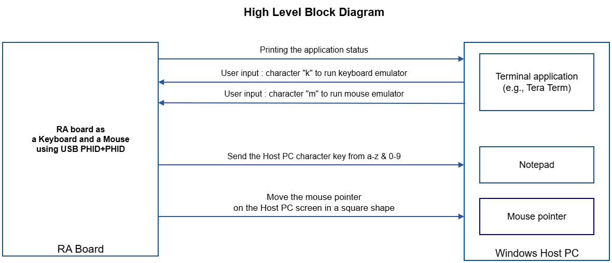
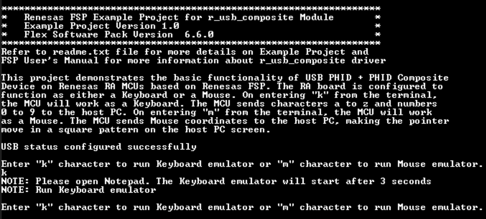
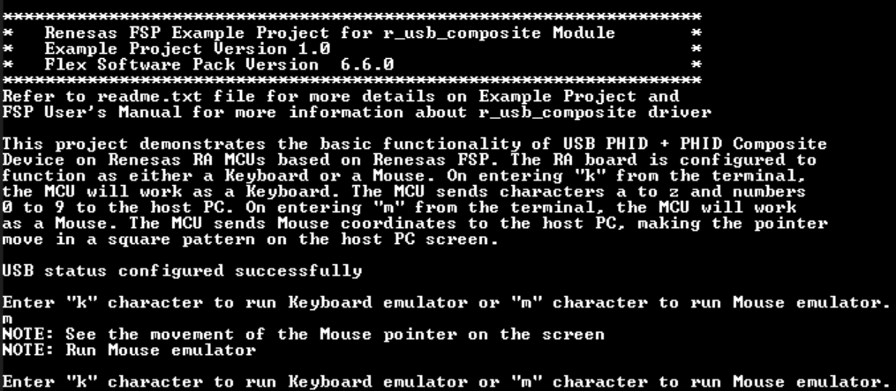
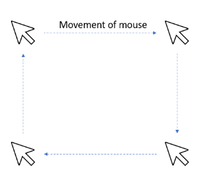

# Introduction #
This project demonstrates the basic functionality of USB PHID + PHID Composite Device on Renesas RA MCUs based on Renesas FSP. The RA board is configured to function as either a Keyboard or a Mouse. On entering "k" from the terminal, the MCU will work as a Keyboard. The MCU sends characters a to z and numbers 0 to 9 to the host PC. On entering "m" from the terminal, the MCU will work as a Mouse. The MCU sends Mouse coordinates to the host PC, making the pointer move in a square pattern on the host PC screen.

## Required Resources ##
To build and run the USB PHID + PHID Composite Device example project, the following resources are needed.

### Software ###
Refer to software described in [Example Project Usage Guide](https://github.com/renesas/ra-fsp-examples/blob/master/example_projects/Example%20Project%20Usage%20Guide.pdf)

### Hardware ###
* Supported RA boards: EK-RA2L2, EK-RA4L1, EK-RA6M2, EK-RA8D1, EK-RA8D2, EK-RA8E2, EK-RA8M1, EK-RA8M2, EK-RA8P1, MCK-RA8T1, MCK-RA8T2.
* 1 x Renesas RA board.
* 2 x USB cable for programming and debugging (USB cable type varies by board model).
* 1 x Host PC with at least 2 USB ports (1 for debug and 1 for COM port).

### Hardware Connections ###
* USB cable for programming and debugging (USB cable type varies by board model).
* For EK-RA6M2:
    * Connect the RA board Full Speed port (J9) to the host PC using the appropriate USB cable for EP programming.

* For EK-RA8M1, EK-RA8D1:
    * Jumper J12: Connect pins 2-3.
    * Connect the jumper J15 pins.
    * Connect the RA board Full Speed port (J11) to the host PC using the appropriate USB cable for EP programming.

* For MCK-RA8T1:
    * Jumper JP9: Connect pins 2-3.
    * Connect the jumper JP10 pins.
    * Connect the RA board Full Speed port (CN14) to the host PC using the appropriate USB cable for EP programming.

* For EK-RA4L1:
    * Turn ON S4-4 to select USB device mode.
    * Set J17 jumper to pins 2-3, Set J7 jumper to use P407 for USBFS VBUS.
    * Connect the RA board Full Speed port (J11) to the host PC using the appropriate USB cable for EP programming.

* For EK-RA8E2, EK-RA8P1, EK-RA8M2, EK-RA8D2:
    * For EK-RA8M2: The user must place jumper J6 on pins 2-3, J8 on pins 1-2, J9 on pins 2-3, and J29 on pins 1-2, 3-4, 5-6, 7-8 to use the on-board debug functionality.
    * Connect the RA board Full Speed port (J11) to the host PC using the appropriate USB cable for EP programming.

* For EK-RA2L2:
    * Connect the RA board Full Speed port (J11) to the host PC using the appropriate USB cable for EP programming.

* For MCK-RA8T2:
    * Jumper JP6: Connect pins 2-3.
    * Connect Jumper JP7 pins.
    * Connect the RA board Full Speed port (CN18) to the host PC using the appropriate USB cable for EP programming.

## Related Collateral References ##
The following documents can be referred to for enhancing your understanding of the operation of this example project:
* [FSP User Manual on GitHub](https://renesas.github.io/fsp/)
* [FSP Known Issues](https://github.com/renesas/fsp/issues)

# Project Notes #
## System Level Block Diagram ##
 High level block diagram

## FSP Modules Used ##
List all the various modules that are used in this example project. Refer to the FSP User Manual for further details on each module listed below.

| Module Name | Usage | Searchable Keyword  |
|-------------|-----------------------------------------------|-----------------------------------------------|
|USB Composite | USB composite device works as a USB Peripheral by combining two peripheral device classes and r_usb_basic module. | r_usb_composite |
|USB PHID | The r_usb_phid module combines with the r_usb_basic module to provide a USB Peripheral Human Interface Device Class (PHID) driver. | r_usb_phid |
|USB basic | The r_usb_basic module operates in combination with the device class drivers provided by Renesas to form a complete USB stack. | r_usb_basic |

## Module Configuration Notes ##
This section describes FSP Configurator properties which are important or different from those selected by default.

**Note: The configuration shown in this document is based on the original target board (e.g., EK-RA8P1). Some settings may differ on other supported boards due to hardware differences.**

**Common Configuration Properties**
|   Module Property Path and Identifier   |   Default Value   |   Used Value   |   Reason   |
| :-------------------------------------: | :---------------: | :------------: | :--------: |
| configuration.xml > Stacks > Phid Thread > Properties > Settings > Property > Common > General > Max Priorities | 5 | 15 | Match with maximum interrupt priority in USB Basic. |
| configuration.xml > Stacks > Phid Thread > Properties > Settings > Property > Thread > Memory Allocation > Support Dynamic Allocation | Disabled | Enabled | RTOS objects can be created using RAM that is automatically allocated from the FreeRTOS heap. |
| configuration.xml > Stacks > Phid Thread > Properties > Settings > Property > Thread > Memory Allocation > Total Heap Size | 0 | 10000 | This is changed because Dynamic Allocation support is enabled, so application makes use of amount of RAM available in the FreeRTOS heap. |
| configuration.xml > Stacks > Phid Thread > Properties > Settings > Property > Thread > Stack size (bytes) | 1024 | 2048 | This is changed to handle its worst-case function call nesting and local variable usage. |
| configuration.xml > Stacks > Phid Thread > Properties > Settings > Property > Thread > Priority | 1 | 5 | This is changed to set thread priority. |

The table below lists the FSP provided API used at the application layer by this example project.

| API Name    | Usage                                                                          |
|-------------|--------------------------------------------------------------------------------|
| R_USB_Open | This API is used to open the USB basic driver. |
| R_USB_PeriControlDataGet | This API is used to receive data from the host when receiving the USB_STATUS_REQUEST or USB_SET_REPORT event. |
| R_USB_PeriControlDataSet | This API is used to perform USB transfer to the Keyboard or Mouse when receiving the USB_GET_REPORT_DESCRIPTOR, or USB_GET_HID_DESCRIPTOR event. |
| R_USB_PeriControlStatusSet | This API is used to set the response to the setup packet. |
| R_USB_Write | This API is used to write data to the host when receiving USB_STATUS_REQUEST_COMPLETE or USB_STATUS_WRITE_COMPLETE event. |
| R_USB_Close | This API is used to close the USB basic driver. |

## Verifying Operation ##
* Import, build, and debug the EP (see section Starting Development of [FSP User Manual](https://renesas.github.io/fsp/)).  
* Before running the example project, make sure [Hardware Connections](#hardware-connections) are completed.  
* After running the EP, open a serial terminal application (e.g., Tera Term) to view output log, configure the settings as shown below:
    * To make sure the received data shows properly, the user needs to set:
        * [Setup] -> [Terminal...] -> [New-line] -> Select [Receive: CR] & [Transmit: CR].
    
    * To echo back characters typed in Tera Term, the user needs to enable it through:
        * [Setup] -> [Terminal...] -> Check [Local echo].
    
    * The configuration parameters of the serial port on the serial terminal application:
        * Port: The port is provided by the J-Link On-Board.
        * Speed: 115200
        * Data: 8 bit
        * Parity: none
        * Stop bits: 1 bit
        * Flow control: none

Choose whether to use the RA board as a Keyboard or Mouse.

* Keyboard:
In the serial terminal, enter k

Open Notepad on the PC, lowercase characters a - z, and numbers 0 - 9 will be shown on the Notepad.

* Mouse:
In the serial terminal, enter m

  

The Mouse will move on the host PC's screen, as shown below.

