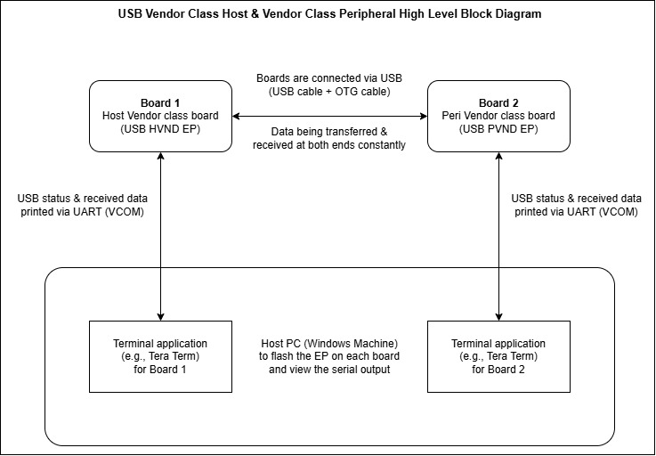
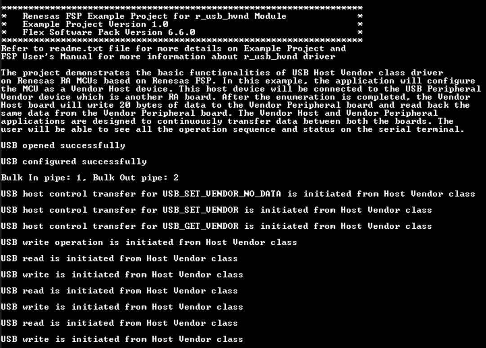

# Introduction #
The project demonstrates the basic functionalities of USB Host Vendor class driver on Renesas RA MCUs based on Renesas FSP. In this example, the application will configure the MCU as a Vendor Host device. This host device will be connected to the USB Peripheral Vendor device which is another RA board. After the enumeration is completed, the Vendor Host board will write 20 bytes of data to the Vendor Peripheral board and read back the same data from the Vendor Peripheral board. The Vendor Host and Vendor Peripheral applications are designed to continuously transfer data between both the boards. The user will be able to see all the operation sequence and status on the serial terminal.

Please refer to the [Example Project Usage Guide](https://github.com/renesas/ra-fsp-examples/blob/master/example_projects/Example%20Project%20Usage%20Guide.pdf) for general information on example projects and [readme.txt](./readme.txt) for specifics of operation.

## Required Resources ##
To build and run the USB Host Vendor example project, the following resources are needed.

### Software ###
Refer to software described in [Example Project Usage Guide](https://github.com/renesas/ra-fsp-examples/blob/master/example_projects/Example%20Project%20Usage%20Guide.pdf)

### Hardware ###
* Supported RA boards: EK-RA4M2, EK-RA4M3, EK-RA6M3, EK-RA6M3G, EK-RA6M4, EK-RA6M5, EK-RA8D1, EK-RA8M1, MCK-RA8T1, EK-RA4L1, EK-RA8E2, EK-RA8P1, EK-RA8M2, EK-RA8D2, MCK-RA8T2.
* 2 x Renesas RA boards.
  * 1 x RA board running the USB HVND example project (Board 1).
  * 1 x RA board running the USB PVND example project (Board 2).
* 3 x USB cables (USB cable type varies by board model).
  * 2 x USB cables for programming and debugging.
  * 1 x USB cable for USB communication between Board 1 and Board 2.
* 1 x OTG cable used with the USB communication cable between Board 1 and Board 2 (OTG cable type varies by board model).

### Hardware Connections: ###
* Connect the USB debug ports of Board 1 and Board 2 to the host PC using the appropriate USB cables for EP programming and debugging.
* Connect Board 1, running the USB HVND example project, to Board 2, running the USB PVND example project, using the appropriate OTG cable and USB communication cable.
* The jumper and switch settings below are for Board 1 (USB HVND), the host board.

* For EK-RA4M2, EK-RA4M3, EK-RA6M4, EK-RA6M5, EK-RA8D1, EK-RA8M1 (Full-Speed):
  * Jumper J12: Connect pins 1-2.
  * Remove jumper J15 pins.
  * Connect the Full-Speed port (J11) of Board 1 to Board 2 using the appropriate OTG cable.

* For MCK-RA8T1 (Full-Speed):
  * Jumper JP9: Connect pins 1-2.
  * Remove jumper JP10 pins.
  * Connect the Full-Speed port (CN14) of Board 1 to Board 2 using the appropriate OTG cable.

* For EK-RA4L1 (Full-Speed):
  * Turn OFF S4-4 to select USB host mode.
  * Set J17 jumper to pins 2-3, set J7 jumper to use P407 for USBFS VBUS.
  * Connect the Full-Speed port (J11) of Board 1 to Board 2 using the appropriate OTG cable.

* For EK-RA8E2, EK-RA8P1, EK-RA8M2, EK-RA8D2 (Full-Speed):
  * For EK-RA8M2: The user must place jumper J6 on pins 2-3, J8 on pins 1-2, J9 on pins 2-3, and J29 on pins 1-2, 3-4, 5-6, 7-8 to use the on-board debug functionality.
  * Connect the Full-Speed port (J11) of Board 1 to Board 2 using the appropriate OTG cable.

* For MCK-RA8T2 (Full-Speed):
  * Jumper JP6: Connect pins 1-2.
  * Remove jumper JP7 pins.
  * Connect the Full-Speed port (CN18) of Board 1 to Board 2 using the appropriate OTG cable.

* For EK-RA6M3, EK-RA6M3G (High-Speed):
  * Jumper J7: Connect pins 1-2.
  * Remove jumper J17 pins.
  * Connect the High-Speed port (J6) of Board 1 to Board 2 using the appropriate OTG cable.

* For EK-RA8P1, EK-RA8M2, EK-RA8D2 (High-Speed):
  * For EK-RA8M2: The user must place jumper J6 on pins 2-3, J8 on pins 1-2, J9 on pins 2-3, and J29 on pins 1-2, 3-4, 5-6, 7-8 to use the on-board debug functionality.
  * Connect the High-Speed port (J7) of Board 1 to Board 2 using the appropriate OTG cable.

## Related Collateral References ##
The following documents can be referred to for enhancing your understanding of the operation of this example project:
- [FSP User Manual on GitHub](https://renesas.github.io/fsp/)
- [FSP Known Issues](https://github.com/renesas/fsp/issues)

# Project Notes #

## System Level Block Diagram ##
  
In the image, show an example of the two connected boards. For example, the Host is EK-RA6M3 Peripheral is EK-RA4M1.

## FSP Modules Used ##
List all the various modules that are used in this example project. Refer to the FSP User Manual for further details on each module listed below.

| Module Name | Usage  | Searchable Keyword (using New Stack > Search) |
|-------------|-----------------------------------------------|-----------------------------------------------|
| USB Host Vendor | USB Host Vendor class works by combining r_usb_basic module. | USB hvnd |

## Module Configuration Notes ##
This section describes FSP Configurator properties which are important or different from those selected by default.  
**Note: The configuration shown in this document is based on the original target board (e.g., EK-RA8P1). Some settings may differ on other supported boards due to hardware differences.**

|   Module Property Path and Identifier   |   Default Value   |   Used Value   |   Reason   |
| :-------------------------------------: | :---------------: | :------------: | :--------: |
| configuration.xml > Stacks > Threads > Host Thread > Properties > Settings > Property > Common> Memory Allocation > Support Dynamic Allocation | Disabled | Enabled | RTOS objects can be created using RAM that is automatically allocated from the FreeRTOS heap. |
| configuration.xml > Stacks > Threads > Host Thread > Properties > Settings > Property > Common > Memory Allocation > Total Heap Size | 0 | 20000 | This is changed because Dynamic Allocation support is enabled, so application makes use of amount of RAM available in the FreeRTOS heap. |
| configuration.xml > Stacks > Threads > Host Thread > Properties > Settings > Property > Thread > Stack size (bytes) | 1024 | 4096 | This is changed to handle its worst-case function call nesting and local variable usage. |
| configuration.xml > Stacks > Threads > Host Thread > Properties > Settings > Property > Thread > Memory Allocation | Static | Dynamic | This is changed to allocate memory for this object from a FreeRTOS heap. |
| configuration.xml > Stacks > Objects > g_queue Queue > Properties > Settings > Property > Object > Queue Length (Items) | 20 | 10 | Queue length is assigned. |
| configuration.xml > Stacks > Objects > g_queue Queue > Properties > Settings > Property > Object > Memory Allocation | Static | Dynamic | This is changed to allocate memory for this object from a FreeRTOS heap. |
| configuration.xml > Stacks > Threads > Host Thread > Host Thread Stacks > g_basic USB (r_usb_basic) > Properties > Settings > Property > Module g_basic USB (r_usb_basic) > USB Callback | NULL | usb_host_vendor_callback | As RTOS is used, so the callback function is set, and this callback function will notify the user about occurrence of USB events. |

**Configuration Properties if USB Speed as High Speed**
|   Module Property Path and Identifier   |   Default Value   |   Used Value   |   Reason   |
| :-------------------------------------: | :---------------: | :------------: | :--------: |
| configuration.xml > Stacks > Threads > Host Thread > Host Thread Stacks > g_basic USB (r_usb_basic) > Properties > Settings > Property > Module g_basic USB (r_usb_basic) > USB Speed | Full Speed | Hi Speed | USB Speed is configured as **Hi Speed**. |
| configuration.xml > Stacks > Threads > Host Thread > Host Thread Stacks > g_basic USB (r_usb_basic) > Properties > Settings > Property > Module g_basic USB (r_usb_basic) > USB Module Number | USB_IP0 Port | USB_IP1 Port | This property is used to specify USB module number to be used as per configured USB speed. |

**Configuration Properties if USB Speed as Full Speed**
|   Module Property Path and Identifier   |   Default Value   |   Used Value   |   Reason   |
| :-------------------------------------: | :---------------: | :------------: | :--------: |
| configuration.xml > Stacks > Threads > Host Thread > Host Thread Stacks > g_basic USB (r_usb_basic) > Properties > Settings > Property > Module g_basic USB (r_usb_basic) > USB Speed | Full Speed | Full Speed | USB Speed is configured as **Full Speed**. |
| configuration.xml > Stacks > Threads > Host Thread > Host Thread Stacks > g_basic USB (r_usb_basic) > Properties > Settings > Property > Module g_basic USB (r_usb_basic) > USB Module Number | USB_IP0 Port | USB_IP0 Port | This property is used to specify USB module number to be used as per configured USB speed. |

## API Usage ##
The table below lists the FSP provided API used at the application layer by this example project.

| API Name    | Usage                                                                          |
|-------------|--------------------------------------------------------------------------------|
| R_USB_PipeRead | This API is used to read data from peripheral, when USB Write complete event occur. |
| R_USB_PipeWrite | This API is used to write data back to peripheral, when USB READ complete event occur. |
| R_USB_HostControlTransfer | This API is used to request control transfer. |
| R_USB_Open | This API is used to open the USB basic driver. |
| R_USB_Close | This API is used to close the USB instance. |
| R_USB_UsedPipesGet | This API is used to get the selected pipe number. |
| R_USB_PipeInfoGet | This API is used to get the following pipe information. |

## Verifying Operation ##
* Import, build and download the EP (see section Starting Development of **FSP User Manual**). After running the EP, open a serial terminal application (e.g., Tera Term) to see the output.
* Before running the example project, make sure [Hardware Connections](#hardware-connections) are completed.
* To view output logs on a serial terminal application (e.g., Tera Term), configure the settings as follows:
    * To make sure the received data shows properly, the user needs to set:
      * [Setup] -> [Terminal...] -> [New-line] -> Select [Receive: CR] & [Transmit: CR].
    * To echo back characters typed in Tera Term, the user needs to enable it through:
      * [Setup] -> [Terminal...] -> Check [Local echo].
    * The configuration parameters of the serial port on the serial terminal application:
      * Port: The port is provided by the J-Link On-Board.
      * Speed: 115200
      * Data: 8 bit
      * Parity: none
      * Stop bits: 1 bit
      * Flow control: none

* The output on terminal application for USB HVND:  
 

## Special Topic ##
By default, the USB HVND example project runs in High-Speed mode if the RA board supports it, except for the EK-RA8D1 and EK-RA8M1.