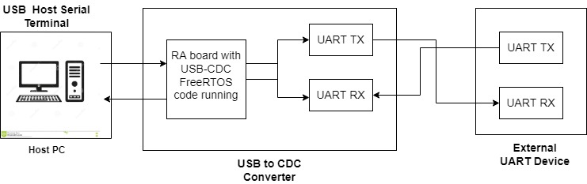
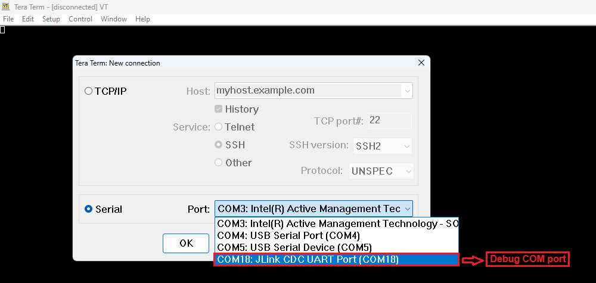
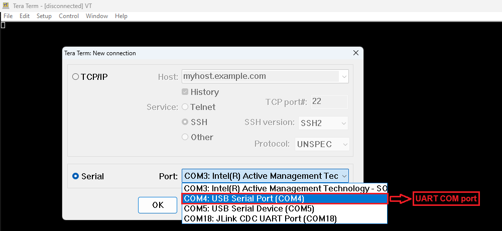
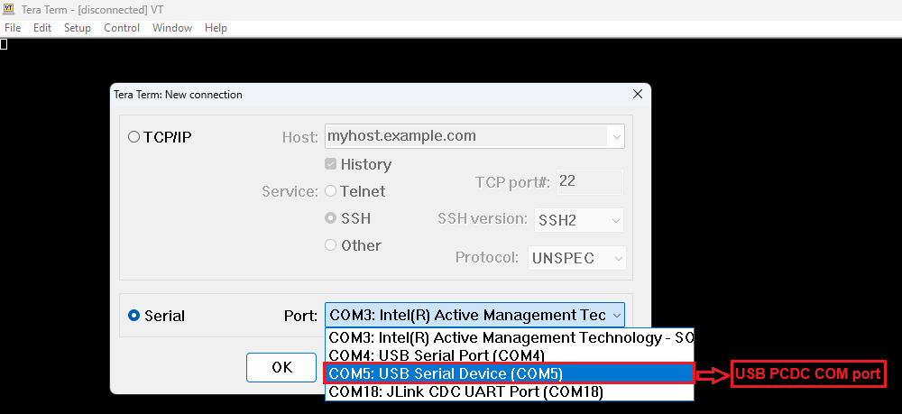
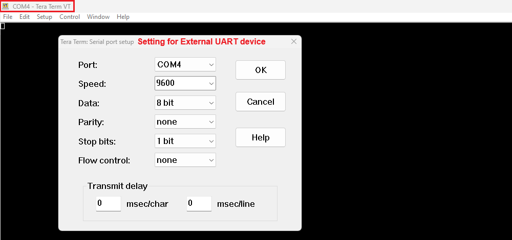
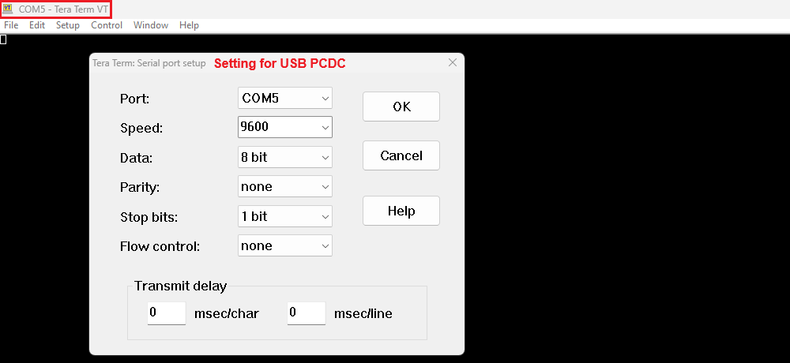
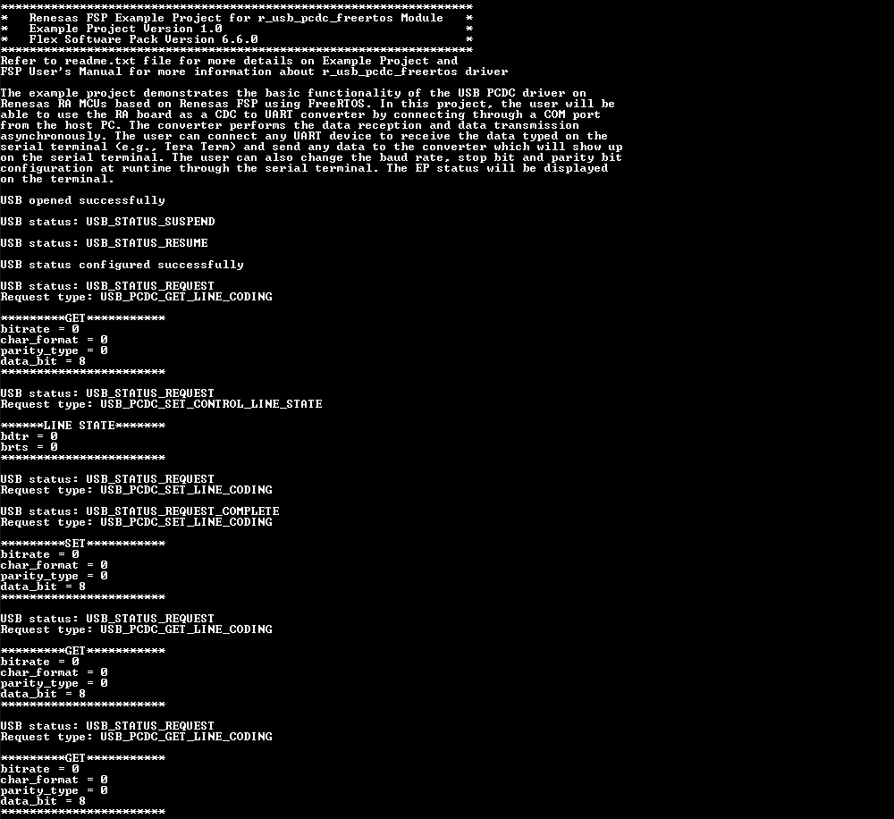
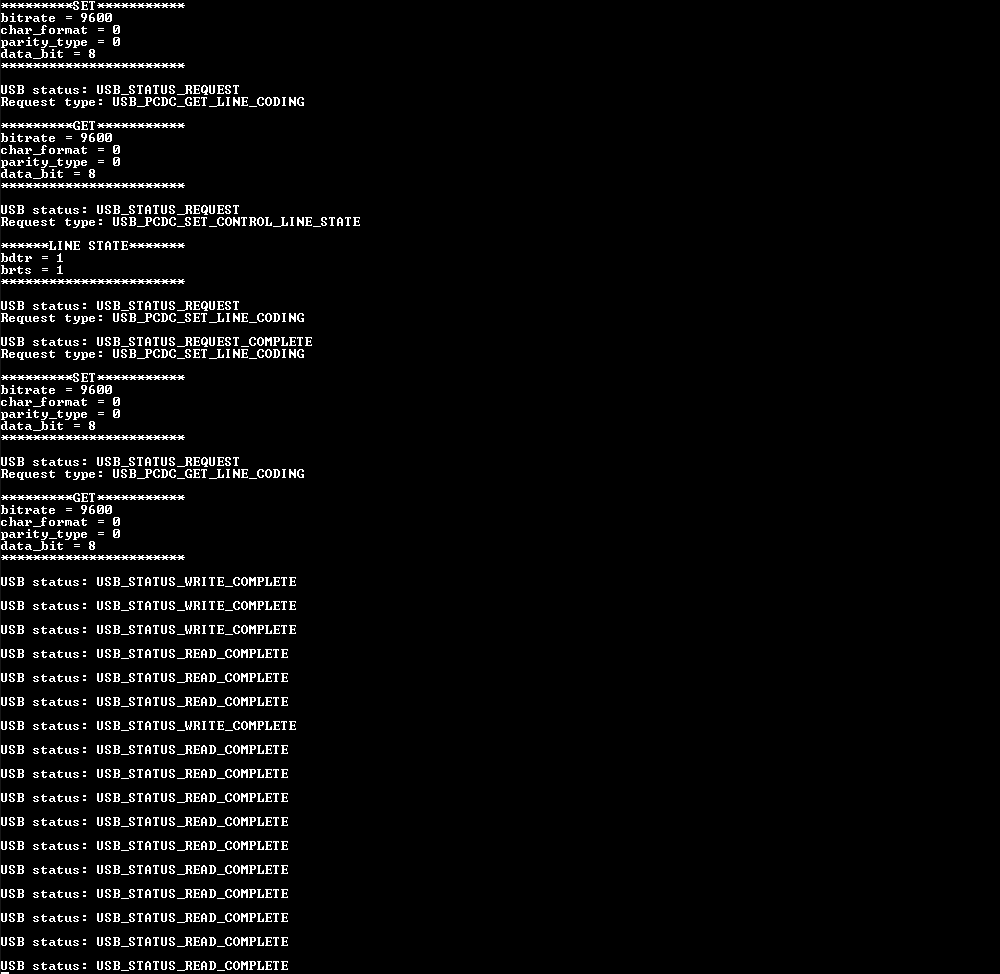
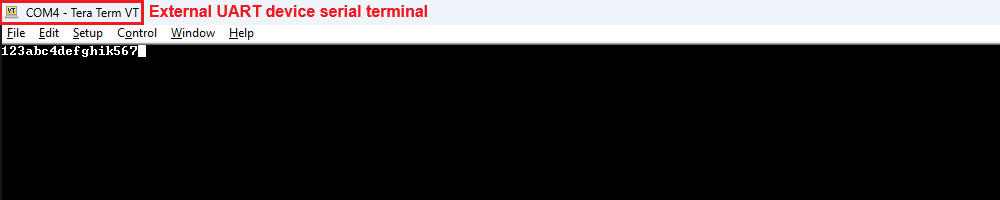
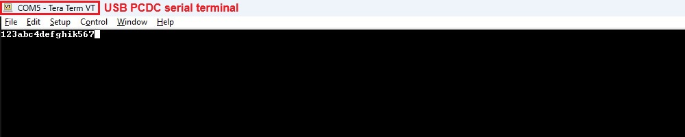

# Introduction #
The example project demonstrates the basic functionality of the USB PCDC driver on Renesas RA MCUs based on Renesas FSP using FreeRTOS. In this project, the user will be able to use the RA board as a CDC to UART converter by connecting through a COM port from the host PC. The converter performs the data reception and data transmission asynchronously. The user can connect any UART device to receive the data typed on the serial terminal (e.g., Tera Term) and send any data to the converter which will show up on the serial terminal. The user can also change the baud rate, stop bit and parity bit configuration at runtime through the serial terminal. The EP status will be displayed on the terminal.

Please refer to the [Example Project Usage Guide](https://github.com/renesas/ra-fsp-examples/blob/master/example_projects/Example%20Project%20Usage%20Guide.pdf) for general information on example projects and [readme.txt](./readme.txt) for specifics of operation.

## Required Resources ##
To build and run the usb_pcdc_with_freertos example project, the following resources are needed.

### Software ###
* Renesas Flexible Software Package (FSP): Version 6.6.0
* e2 studio: Version 2026-07
* LLVM Embedded Toolchain for ARM: Version 22.1.0
* Terminal Console Application: Tera Term or a similar application

Refer to software requirements mentioned in [Example Project Usage Guide](https://github.com/renesas/ra-fsp-examples/blob/master/example_projects/Example%20Project%20Usage%20Guide.pdf)

### Hardware ###
* Supported RA boards: EK-RA2A1, EK-RA2L2, EK-RA4M2, EK-RA6M3, EK-RA6M4, EK-RA8D1, EK-RA8M1, MCK-RA8T1, EK-RA4L1, EK-RA8E2, EK-RA8P1, MCK-RA8T2, EK-RA8M2, EK-RA8D2, EK-RA8P1 V2.
	* 1 x Renesas RA board.
	* 1 x Pmod USBUART (e.g., Pmod USBUART: https://digilent.com/shop/pmod-usbuart-usb-to-uart-interface/) is used as example external UART device to demonstrate the functionality of the converter.
	* 1 x USB cable for programming and debugging (USB cable type varies by board model).
	* 1 x USB cable for USB communication between the RA board and the host PC (USB cable type varies by board model).
	* 1 x Micro USB cable for connecting the Pmod USBUART to the host PC.
	* 1 x PC with at least 3 USB ports (1 for debug, 2 for COM port).
	* Some jumper wires.

### Hardware Connections ###
* Connect the RA board USB debug port to the host PC using the appropriate USB cable for EP programming and debugging.

* For EK-RA6M3:
	* USB PCDC (High-Speed):
		1. Jumper J7: connect pins 2-3.
		2. Connect Jumper J17 pins.
		3. Connect the USB High-Speed port (J6) of the RA board to the host PC using the appropriate USB cable.
	* USB PCDC (Full-Speed):
		1. Jumper J12: Connect pins 2-3.
		2. Connect Jumper J15 pins.
		3. Connect the USB Full-Speed port (J11) of the RA board to the host PC using the appropriate USB cable.
	* UART:
		1. TXD0 P411 to RX pin of external UART device.
		2. RXD0 P410 to TX pin of external UART device.
		3. When using flow control from Tera Term, the CTS_RST0 P413 should be connected to either RTS P103 or GND.
		4. Connect the Pmod USBUART Board (J1) to the host PC using a micro USB cable.

			For instructions on how to enable and disable flow control, refer to the FSP User's manual. 

* For EK-RA4M2:
	* USB PCDC (Full-Speed):
		1. Jumper J12: Connect pins 2-3.
		2. Connect jumper J15 pins.
		3. Connect the USB Full-Speed port (J11) of the RA board to the host PC using the appropriate USB cable.

	* UART:
		1. TXD9 P602 to RX pin of external UART device.
		2. RXD9 P601 to TX pin of external UART device.
		3. When using flow control from Tera Term, the CTS_RTS9 P603 a micro USB cable.
		4. Connect the Pmod USBUART Board (J1) to the host PC using a micro USB cable.

			For instructions on how to enable and disable flow control, refer to the FSP User's manual.

* For EK-RA6M4:
	* USB PCDC (Full-Speed):
		1. Jumper J12: Connect pins 2-3.
		2. Connect jumper J15 pins.
		3. Connect the USB Full-Speed port (J11) of the RA board to the host PC using the appropriate USB cable.

	* UART:
		1. TXD0 P101 to RX pin of external UART device.
		2. RXD0 P100 to TX pin of external UART device.
		3. When using flow control from Tera Term, the CTS0 P414 should be connected to P413.
		4. Connect the Pmod USBUART Board (J1) to the host PC using a micro USB cable.

			For instructions on how to enable and disable flow control, refer to the FSP User's manual.

* For EK-RA2A1:
	* USB PCDC (Full-Speed):
		1. Connect the USB Full-Speed port (J9) of the RA board to the host PC using the appropriate USB cable.

	* UART:
		1. TXD0 P302 to RX pin of external UART device.
		2. RXD0 P301 to TX pin of external UART device.
		3. When using flow control from Tera Term, the CTS_RTS0 P303 should be connected to GND.
		4. Connect the Pmod USBUART Board (J1) to the host PC using a micro USB cable.

			For instructions on how to enable and disable flow control, refer to the FSP User's manual. 

* For EK-RA8M1, EK-RA8D1:
	* Note: For EK-RA8D1, the user needs to turn OFF SW1-6 to use USBHS.
	* USB PCDC (Full-Speed):
		1. Jumper J12: Connect pins 2-3.
		2. Connect jumper J15 pins.
		3. Connect the USB Full-Speed port (J11) of the RA board to the host PC using the appropriate USB cable.
	* USB PCDC (High-Speed):
		1. Jumper J7: Connect pins 2-3.
		2. Connect jumper J17 pins.
		3. Connect the USB High-Speed port (J31) of the RA board to the host PC using the appropriate USB cable.
	* UART:
		1. TXD2 PA03 to RX pin of external UART device.
		2. RXD2 PA02 to TX pin of external UART device.
		3. When using flow control from Tera Term, the CTS_RTS2 PA05 should be connected to GND.
		4. Connect the Pmod USBUART Board (J1) to the host PC using a micro USB cable.

			For instructions on how to enable and disable flow control, refer to the FSP User's manual.

* For MCK-RA8T1:
	* USB PCDC (Full-Speed):
		1. Jumper JP9: Connect pins 2-3.
		2. Connect jumper JP10 pins.
		3. Connect the USB Full-Speed port (CN14) of the RA board to the host PC using the appropriate USB cable.
	* UART:
    	1. TXD0 P603 (CN3:31) to RX pin of external UART device.
    	2. RXD0 P602 (CN3:33) to TX pin of external UART device.
    	3. When using flow control from Tera Term, the CTS_RTS0 P604 should be connected to GND.
		4. Connect the Pmod USBUART Board (J1) to the host PC using a micro USB cable.
    
			For instructions on how to enable and disable flow control, refer to the FSP User's manual.

* For EK-RA4L1:
	* USB PCDC (Full-Speed):
		1. The user must turn ON S4-4 to select USB device mode.
		2. Set J17 jumper to pins 2-3, Set J7 jumper to use P407 for USBFS VBUS.
		3. Connect the USB Full-Speed port (J11) of the RA board to the host PC using the appropriate USB cable.

	* UART:
		1. TXD1 P115 (J2:35) to RX pin of external UART device.
		2. RXD1 P608 (J2:37) to TX pin of external UART device.
		3. When using flow control from Tera Term, the CTS_RTS1 P402 (J2:48) should be connected to GND.
		4. Connect the Pmod USBUART Board (J1) to the host PC using a micro USB cable.
    
			For instructions on how to enable and disable flow control, refer to the FSP User's manual.

* For EK-RA8E2:
	* USB PCDC (Full-Speed):
		1. Connect the USB Full-Speed port (J11) of the RA board to the host PC using the appropriate USB cable.
	* UART:
		1. TXD1 P400 (J2:2) to RX pin of external UART device.
		2. RXD1 P401 (J2:3) to TX pin of external UART device.
		3. When using flow control from Tera Term, the CTS_RTS1 P403 (J2:5) should be connected to GND.
		4. Connect the Pmod USBUART Board (J1) to the host PC using a micro USB cable.

			For instructions on how to enable and disable flow control, refer to the FSP User's manual.

* For MCK-RA8T2:
	* USB PCDC (Full-Speed):
		1. Jumper JP6: Connect pins 2-3.
		2. Connect jumper JP7 pins.
		3. Connect the USB Full-Speed port (CN18) of the RA board to the host PC using the appropriate USB cable.

	* UART:
		1. TXD0 P603 (CN1:33) to RX pin of external UART device.
		2. RXD0 P602 (CN1:31) to TX pin of external UART device.
		3. When using flow control from Tera Term, the CTS_RTS0 P604 (CN1:27) should be connected to GND.
		4. Connect the Pmod USBUART Board (J1) to the host PC using a micro USB cable.

			For instructions on how to enable and disable flow control, refer to the FSP User's manual.

* For EK-RA8M2: 
	* The user must place jumper J6 on pins 2-3, J8 on pins 1-2, J9 on pins 2-3,and J29 on pins 1-2, 3-4, 5-6, 7-8 to use the on-board debug functionality.
	* USB PCDC (High-Speed): Default USB speed mode
		1. Connect the USB High-Speed port (J7) of the RA board to the host PC using the appropriate USB cable.
	* USB PCDC (Full-Speed):
		1. Connect the USB Full-Speed port (J11) of the RA board to the host PC using the appropriate USB cable.
	* UART:
		1. TXD0 P603 (J37:3) to RX pin of external UART device.
		2. RXD0 P602 (J3:40) to TX pin of external UART device.
		3. When using flow control from Tera Term, the CTS_RTS0 P604 (J37:5) should be connected to GND.
		4. Connect the Pmod USBUART Board (J1) to the host PC using a micro USB cable.

			For instructions on how to enable and disable flow control, refer to the FSP User's manual.

* For EK-RA8P1, EK-RA8D2: 
	* USB PCDC (High-Speed): Default USB speed mode
		1. Connect the USB High-Speed port (J7) of the RA board to the host PC using the appropriate USB cable.
	* USB PCDC (Full-Speed):
		1. Connect the USB Full-Speed port (J11) of the RA board to the host PC using the appropriate USB cable.
	* UART:
		1. TXD0 P603 (J4:4) to RX pin of external UART device.
		2. RXD0 P602 (J4:8) to TX pin of external UART device.
		3. When using flow control from Tera Term, the CTS_RTS0 P604 (J4:6) should be connected to GND.
		4. Connect the Pmod USBUART Board (J1) to the host PC using a micro USB cable.

			For instructions on how to enable and disable flow control, refer to the FSP User's manual.

* For EK-RA2L2:
	* USB PCDC (Full-Speed):
		1. Connect the USB Full-Speed port (J11) of the RA board to the host PC using the appropriate USB cable.

	* UART:
		1. TXD2 P302 (J2:23) to RX pin of external UART device.
		2. RXD2 P301 (J2:24) to TX pin of external UART device.
		3. When using flow control from Tera Term, the CTS_RTS2 P110 (J2:28) should be connected to GND.
		4. Connect the Pmod USBUART Board (J1) to the host PC via a micro USB cable.

			For instructions on how to enable and disable flow control, refer to the FSP User's manual.

* For EK-RA8P1 V2:
	* The user must set the configuration switches (SW6) as below to use the on-board debug functionality.

		| SW6-1 | SW6-2 | SW6-3 | SW6-4 | SW6-5 | SW6-6 | SW6-7 | SW6-8 | SW6-9 | SW6-10 |
		|:-----:|:-----:|:-----:|:-----:|:-----:|:-----:|:-----:|:-----:|:-----:|:------:|
		|  OFF  |  OFF  |  OFF  |  OFF  |  ON   |  OFF  |  ON   |  ON   |  ON   |   ON   |

	* USB PCDC (High-Speed): Default USB speed mode
		1. Connect the USB High-Speed port (J7) of the RA board to the host PC using the appropriate USB cable.
	* USB PCDC (Full-Speed):
		1. Connect the USB Full-Speed port (J11) of the RA board to the host PC using the appropriate USB cable.
	* UART:
		1. TXD0 P603 (J3:25) to RX pin of external UART device.
		2. RXD0 P602 (J17:11) to TX pin of external UART device.
		3. When using flow control from Tera Term, the CTS_RTS0 P604 (J17:13) should be connected to GND.
		4. Connect the Pmod USBUART Board (J1) to the host PC using a micro USB cable.

			For instructions on how to enable and disable flow control, refer to the FSP User's manual.

## Related Collateral References ##
The following documents can be referred to for enhancing your understanding of the operation of this example project:
* [FSP User Manual on GitHub](https://renesas.github.io/fsp/)
* [FSP Known Issues](https://github.com/renesas/fsp/issues)

# Project Notes #

## System Level Block Diagram ##

## FSP Modules Used ##
List all the various modules that are used in this example project. Refer to the FSP User Manual for further details on each module listed below.

**Note: The configuration shown in this document is based on the original target board (e.g., EK-RA8P1). Some settings may differ on other supported boards due to hardware differences.**

| Module Name | Usage  | Searchable Keyword (using New Stack > Search) |
|-------------|-----------------------------------------------|-----------------------------------------------|
| USB PCDC | USB Peripheral Communications Device Class (PCDC) driver transfers data to and from USB host, responds to CDC class requests.| pcdc |
| UART | SCI_UART module supports data reception and transmission, bitrate modulation, baud rate change, and flow control. | uart |

## Module Configuration Notes ##
This section describes FSP Configurator properties that are important or different from those selected by default. 

**Common Configuration Properties**
|   Module Property Path and Identifier   |   Default Value   |   Used Value   |   Reason   |
| :-------------------------------------: | :---------------: | :------------: | :--------: |
| configuration.xml > BSP > Properties > Settings > Property > RA Common > Heap size (bytes) | 0 | 0x400 | Change heap size to accommodate functions usage in the EP and avoid any runtime errors. |
| configuration.xml > Stacks > Threads > PCDC Thread > PCDC Thread Stacks > g_basic USB (r_usb_basic) > Properties > Settings > Property > Common > DMA/DTC Support | DMA Disabled | DMA Enabled | Enable DMA support for the module. |
| configuration.xml > Stacks > Threads > PCDC Thread > PCDC Thread Stacks > g_basic USB (r_usb_basic) > Properties > Settings > Property > Module g_basic USB (r_usb_basic) > USB Callback | NULL | usb_pcdc_callback | Defined user callback for sending events. |

**By default, High-Speed USB is enabled in the project configuration for MCUs that support High-Speed operation. For MCUs that support only Full-Speed USB, Full-Speed USB is enabled by default. To switch from High-Speed to Full-Speed USB, refer to the instructions as shown below:**

| #  | Board | High-Speed | Full-Spped |
|----|-------|------------|------------|
| 1  | EK-RA2A1    | ✗ | ✓ |
| 2  | EK-RA2L2    | ✗ | ✓ |
| 3  | EK-RA4L1    | ✗ | ✓ |
| 4  | EK-RA4M2    | ✗ | ✓ |
| 5  | EK-RA6M3    | ✓ | ✓ |
| 6  | EK-RA6M4    | ✗ | ✓ |
| 7  | EK-RA8D1    | ✓ | ✓ |
| 8  | EK-RA8D2    | ✓ | ✓ |
| 9  | EK-RA8E2    | ✗ | ✓ |
| 10 | EK-RA8M1    | ✓ | ✓ |
| 11 | EK-RA8M2    | ✓ | ✓ | 
| 12 | EK-RA8P1    | ✓ | ✓ | 
| 13 | MCK-RA8T1   | ✗ | ✓ | 
| 14 | MCK-RA8T2   | ✗ | ✓ | 
| 15 | EK-RA8P1 V2 | ✓ | ✓ |

Legend: ✓ = Supported, ✗ = Not Supported

**Configuration Properties if USB Speed as High-Speed**
|   Module Property Path and Identifier   |   Default Value   |   Used Value   |   Reason   |
| :-------------------------------------: | :---------------: | :------------: | :--------: |
| configuration.xml > Stacks > Threads > PCDC Thread > PCDC Thread Stacks > g_basic USB (r_usb_basic) > Properties > Settings > Property > Module g_basic USB (r_usb_basic) > USB Speed | Full Speed | Hi Speed | USB Speed is configured as **Hi Speed**. |
| configuration.xml > Stacks > Threads > PCDC Thread > PCDC Thread Stacks > g_basic USB (r_usb_basic) > Properties > Settings > Property > Module g_basic USB (r_usb_basic) > USB Module Number | USB_IP0 Port | USB_IP1 Port | This property is used to specify USB module number to be used as per configured USB speed. |
| configuration.xml > Stacks > Threads > PCDC Thread > PCDC Thread Stacks > g_transfer0 Transfer (r_dmac) > Properties > Settings > Property > Module g_transfer0 Transfer (r_dmac) > Transfer Size | 2 Bytes | 4 Bytes | The transfer size of DMA for **High-Speed** requires **4 Bytes**. |
| configuration.xml > Stacks > Threads > PCDC Thread > PCDC Thread Stacks > g_transfer0 Transfer (r_dmac) > Properties > Settings > Property > Module g_transfer0 Transfer (r_dmac) > Activation Source | No ELC Trigger | USBHS FIFO 1 (DMA Transfer request 1) | This is an event trigger for DMA transfer 0 instance for destination pointer address. |
| configuration.xml > Stacks > Threads > PCDC Thread > PCDC Thread Stacks > g_transfer1 Transfer (r_dmac) > Properties > Settings > Property > Module g_transfer1 Transfer (r_dmac) > Transfer Size | 2 Bytes | 4 Bytes | The transfer size of DMA for **High-Speed** requires **4 Bytes**. |
| configuration.xml > Stacks > Threads > PCDC Thread > PCDC Thread Stacks > g_transfer1 Transfer (r_dmac) > Properties > Settings > Property > Module g_transfer1 Transfer (r_dmac) > Activation Source | No ELC Trigger | USBHS FIFO 0 (DMA Transfer request 0) | This is an event trigger for DMA transfer 1 instance for source pointer address. |

**Configuration Properties if USB Speed as Full-Speed**  
The following settings should be adjusted after resetting all module values to their default settings.

|   Module Property Path and Identifier   |   Default Value   |   Used Value   |   Reason   |
| :-------------------------------------: | :---------------: | :------------: | :--------: |
| configuration.xml > Stacks > Threads > PCDC Thread > PCDC Thread Stacks > g_basic USB (r_usb_basic) > Properties > Settings > Property > Module g_basic USB (r_usb_basic) > USB Speed | Full Speed | Full Speed | USB Speed is configured as **Full-Speed**. |
| configuration.xml > Stacks > Threads > PCDC Thread > PCDC Thread Stacks > g_basic USB (r_usb_basic) > Properties > Settings > Property > Module g_basic USB (r_usb_basic) > USB Module Number | USB_IP0 Port | USB_IP0 Port | This property is used to specify USB module number to be used as per configured USB speed. |
| configuration.xml > Stacks > Threads > PCDC Thread > PCDC Thread Stacks > g_transfer0 Transfer (r_dmac) > Properties > Settings > Property > Module g_transfer0 Transfer (r_dmac) > Transfer Size | 2 Bytes | 2 Bytes |The transfer size of DMA for **Full-Speed** requires **2 Bytes**. |
| configuration.xml > Stacks > Threads > PCDC Thread > PCDC Thread Stacks > g_transfer0 Transfer (r_dmac) > Properties > Settings > Property > Module g_transfer0 Transfer (r_dmac) > Activation Source | No ELC Trigger | USBFS FIFO 1 (DMA/DTC Transfer request 1) | This is an event trigger for DMA transfer 0 instance for destination pointer address. |
| configuration.xml > Stacks > Threads > PCDC Thread > PCDC Thread Stacks > g_transfer1 Transfer (r_dmac) > Properties > Settings > Property > Module g_transfer1 Transfer (r_dmac) > Transfer Size | 2 Bytes | 2 Bytes |The transfer size of DMA for **Full-Speed** requires **2 Bytes**. |
| configuration.xml > Stacks > Threads > PCDC Thread > PCDC Thread Stacks > g_transfer1 Transfer (r_dmac) > Properties > Settings > Property > Module g_transfer1 Transfer (r_dmac) > Activation Source | No ELC Trigger | USBFS FIFO 0 (DMA/DTC Transfer request 0) | This is an event trigger for DMA transfer 1 instance for source pointer address. |

## API Usage ##
The table below lists the USB basic APIs used at the application layer by this example project.

| API Name    | Usage                                                                          |
|-------------|--------------------------------------------------------------------------------|
| R_USB_Open | This API is used to open USB instance. |
| R_USB_Read | This API is used to read data. |
| R_USB_Write | This API is used to write data. |
| R_USB_PeriControlDataGet | This API is used to receive data sent by control transfer. |
| R_USB_PeriControlDataSet | This API is used to set class request. |
| R_USB_PeriControlStatusSet | This API is used to set the USB status. |
| R_USB_Close | This API is used to stop USB module and terminate power. |
| R_SCI_B_UART_Open | This API is used to open UART module. |
| R_SCI_B_UART_BaudCalculate | This API is used to calculate Baud rate register settings. |
| R_SCI_B_UART_Write | This API is used to write data to UART TX pin. |
| R_SCI_B_UART_Close | This API is used to close the UART driver and any lower-level transfer drivers, if used. |

## Verifying Operation ##
* Import, build, and debug the example project (EP). Refer to the section Starting Development of **FSP User Manual**.
* Set up hardware as mentioned in the [Hardware Connections](#hardware-connections) section.
* Run the EP and then open a serial terminal application (e.g., Tera Term) to view output logs, configure the settings as shown below:
	* To make sure the received data shows properly, the user needs to set:
		* [Setup] -> [Terminal...] -> [New-line] -> Select [Receive: CR] & [Transmit: CR].

	* To echo back characters typed in Tera Term, the user needs to enable it through:
		* [Setup] -> [Terminal...] -> Check [Local echo].

	* The configuration parameters of the serial port on the serial terminal application:
		* Port: The port is provided by the J-Link On-Board.
		* Speed: 115200
		* Data: 8 bit
		* Parity: none
		* Stop bits: 1 bit
		* Flow control: none

* Open two serial terminals (e.g., Tera Term) on the host PC and connect to two COM ports as shown below: One COM port for USB PCDC and another COM port for external UART device.

* Configure speed, data, parity, stop bits settings on the serial terminal for external UART device:

* Configure speed, data, parity, stop bits settings on the serial terminal for USB PCDC based on the settings of the external UART device connected to converter. Note that only CTS/RTS flow control is tested with Tera Term.

* Enable "Local echo" in the serial terminal if you would like to view the data sent by the serial terminal.
* Send data using serial terminal to external UART device.
* View the data received from the external UART device via the converter through the serial terminal.
* The status messages will be displayed in the debug serial terminal as shown below:

* The sent and received data in the serial terminals can be observed as shown below:
	

### Special Topics 
**Developing Descriptor**
* A USB device provides information about itself in data structures called USB descriptors.
* The host obtains descriptors from an attached device by sending various standard control requests to the default endpoint. Those requests specify the type of descriptor to retrieve. In response to such requests, the device sends descriptors that include information about the device, its configurations, interfaces and the related endpoints.

* Refer to the **Descriptor** section in FSP User manual (https://renesas.github.io/fsp/group___u_s_b___p_c_d_c.html) for developing the descriptor.
