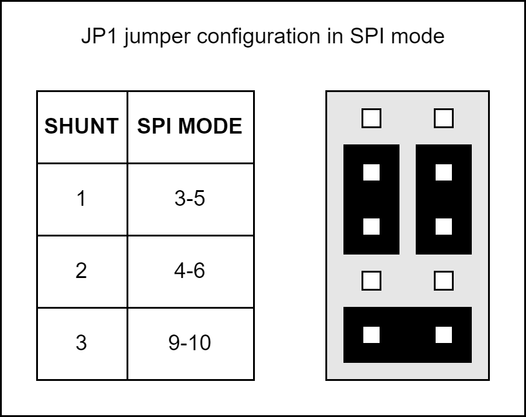
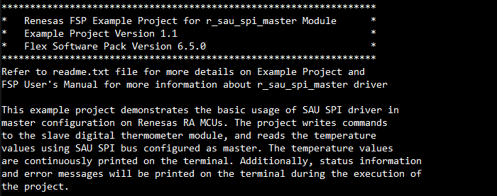
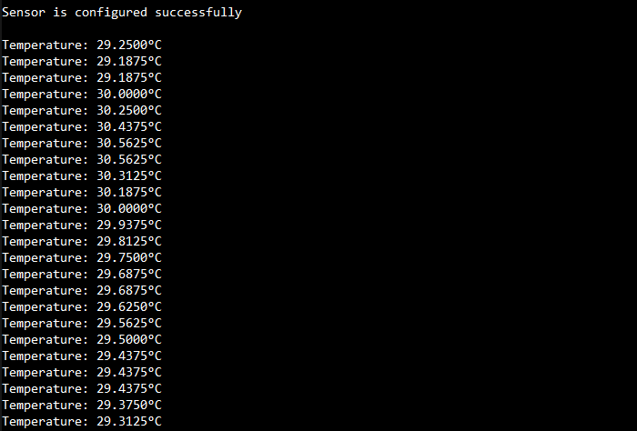

# Introduction #
This example project demonstrates the basic usage of SAU SPI driver in master configuration on Renesas RA MCUs. The project writes commands to the slave digital thermometer module, and reads the temperature values using SAU SPI bus configured as master. The temperature values are continuously printed on the terminal. Additionally, status information and error messages will be printed on the terminal during the execution of the project.

**Note:**
* In addition to communicating with the digital thermometer module, the example project can also communicate with the sau_spi_slave EP. For more information, please refer to the document of the sau_spi_slave EP.

Please refer to the [Example Project Usage Guide](https://github.com/renesas/ra-fsp-examples/blob/master/example_projects/Example%20Project%20Usage%20Guide.pdf) for general information on example projects and [readme.txt](./readme.txt) for specifics of operation.

## Required Resources ## 
To build and run the SAU SPI Master example project, the following resources are needed.

### Software ###
* Renesas Flexible Software Package (FSP): Version 6.5.0
* e2 studio: Version 2026-04.2
* LLVM Embedded Toolchain for ARM: Version 21.1.1
* Terminal Console Application: Tera Term or a similar application

### Hardware ###
Supported RA boards: FPB-RA0E1, FPB-RA0E2, FPB-RA0L1, FPB-RA0E3.
* 1 x Renesas RA board.
* 1 x USB cable for programming and debugging (USB cable type varies by board model).
* 1 x Digital thermometer module (PMOD MAX31723PMB1).
  * Link product: [PMOD MAX31723PMB1](https://www.mouser.com/ProductDetail/Analog-Devices-Maxim-Integrated/MAX31723PMB1?qs=UmMSjoC1xtH8e742i4OoUA%3D%3D).
  * Manufacturer Product Number: MAX31723PMB1#.
* 1 x Host PC.

**Select SPI communication protocol on the PMOD MAX31723PMB1 by configuring the following jumper configurations on JP1:**

### Hardware Connections ###
* Connect the RA board USB debug port to the host PC using the appropriate USB cable for EP programming and debugging.

* For PMOD MAX31723PMB1:
  * Select SPI communication protocol on the PMOD by configuring the following jumper configurations on JP1:
    * Connect JP1-3 to JP1-5.
    * Connect JP1-4 to JP1-6.
    * Connect JP1-9 to JP1-10.

* For FPB-RA0E1:
  * Connect PMOD MAX31723PMB1 (J1) to the RA board via the PMOD1 Port. Please carefully align pin 1 on the Temperature sensor with pin 1 on the PMOD1.
  * The soldering bridge E4 must be closed.
  * Populate R10 with a resistor ranging from 0 to 150 ohms.

* For FPB-RA0E2:
  * Connect PMOD MAX31723PMB1 (J1) to the RA board via the PMOD1 Port. Please carefully align pin 1 on the Temperature sensor with pin 1 on the PMOD1.
  * The user must close E46, E47 to use J-Link OB VCOM for serial terminal (UART).

* For FPB-RA0L1:
  * Connect PMOD MAX31723PMB1 (J1) to the RA board via the PMOD1 Port (J19). Please carefully align pin 1 on the Temperature sensor with pin 1 on the PMOD1.
  * The user must place jumper J9 on pins 1-2 to use the on-board debug functionality.
  * The user must close E28, E29 to use J-Link OB VCOM for serial terminal (UART).

* For FPB-RA0E3:
  * The user must turn OFF S3 to use the on-board debug functionality.
  * Connect PMOD MAX31723PMB1 (J1) to the RA board as shown below:
    * Temperature sensor (J1:1) to P112 (J2:4).
    * Temperature sensor (J1:2) to P213 (J1:4).
    * Temperature sensor (J1:3) to P212 (J1:5).
    * Temperature sensor (J1:4) to P201 (J1:8).
    * Temperature sensor (J1:5) to GND  (J1:3).
    * Temperature sensor (J1:6) to VCC  (J1:6).

Refer to the software required section in [Example Project Usage Guide](https://github.com/renesas/ra-fsp-examples/blob/master/example_projects/Example%20Project%20Usage%20Guide.pdf) for basic information on setting up and using the above software.

## Related Collateral References ##
The following documents can be referred to for enhancing your understanding of the operation of this example project:
* [FSP User Manual on GitHub](https://renesas.github.io/fsp/)
* [FSP Known Issues](https://github.com/renesas/fsp/issues)

# Project Notes #

## System Level Block Diagram ##
High level block diagram of the system is as shown below:

## FSP Modules Used ##
List all the various modules that are used in this example project. Refer to the FSP User Manual for further details on each module listed below.

| Module Name | Usage | Searchable Keyword |
|-------------|-----------------------------------------------|-----------------------------------------------|
| SAU SPI | SAU SPI is used to communicate with the digital thermometer module. | r_sau_spi |
| I/O Port | I/O Port is used to drive SS_N pin of the digital thermometer module. | r_ioport |

## Module Configuration Notes ##
This section describes FSP Configurator properties which are important or different from those selected by default. 

**Configuration Properties for using SAU SPI**

|   Module Property Path and Identifier   |   Default Value   |   Used Value   |   Reason   |
|-----------------------------------------|-------------------|----------------|------------|
| configuration.xml > Stacks > g_sau_spi SPI (r_sau_spi) > Properties > Settings > Property > Common > Enable Single Channel | Disable | 00 | Enable single channel to reduce code size if only channel 00 is to be configured for SAU SPI. |
| configuration.xml > Stacks > g_sau_spi SPI (r_sau_spi) > Properties > Settings > Property > Common > DTC Support | Disabled | Enabled | Enable DTC Support. |
| configuration.xml > Stacks > g_sau_spi SPI (r_sau_spi) > Properties > Settings > Property > Module g_sau_spi SPI (r_sau_spi) > Channel | 00 | 00 | Use SAU SPI channel 00 to communicate with the digital thermometer module. |
| configuration.xml > Stacks > g_sau_spi SPI (r_sau_spi) > Properties > Settings > Property > Module g_sau_spi SPI (r_sau_spi) > Callback | sau_spi_callback | sau_spi_callback | A user callback function that is called from the SAU SPI interrupts when a transfer is completed or an error has occurred. |
| configuration.xml > Stacks > g_sau_spi SPI (r_sau_spi) > Properties > Settings > Property > Module g_sau_spi SPI (r_sau_spi) > Transmit End Interrupt Priority | Priority 2 | Priority 2 | Select the transmit end interrupt priority. |

**Configuration Properties for using GPIO**

|   Module Property Path and Identifier   |   Default Value   |   Used Value   |   Reason   |
|-----------------------------------------|-------------------|----------------|------------|
| configuration.xml > Pins > Pin Selection > Ports > P1 > P103 > Pin Configuration > Mode | Disable | Output mode (Initial Low) | Use P103 as output to drive SS_N pin of slave device during transfer process. |

## API Usage ##
The table below lists the FSP provided API used at the application layer by this example project.

| API Name    | Usage                                                                          |
|-------------|--------------------------------------------------------------------------------|
| R_SAU_SPI_Open | This API is used to initialize the SAU SPI module. |
| R_SAU_SPI_Write | This API is used to configure the digital thermometer module. |
| R_SAU_SPI_WriteRead | This API is used to write command to the digital thermometer module and read temperature values. |
| R_SAU_SPI_Close | This API is used to de-initialize the SAU SPI module. |
| R_IOPORT_PinWrite | This API is used to drive Slave Select Pin during transmission. |
| R_BSP_SoftwareDelay | This API is used to delay a specified period of time. |

## Verifying Operation ##
1. Import, generate and build the example project.
2. Before running the example project, make sure hardware connections are completed.
3. Flash or debug the example project.
4. Open the serial terminal application (e.g., Tera Term) to see the output.
  * To make sure the received data shows properly, the user needs to set:
    * [Setup] -> [Terminal...] -> [New-line] -> Select [Receive: CR] & [Transmit: CR].

  * To echo back characters typed in Tera Term, the user needs to enable it through:
    * [Setup] -> [Terminal...] -> Check [Local echo].

  * The configuration parameters of the serial port on the serial terminal application:
    * Port: The port is provided by the J-Link On-Board.
    * Speed: 115200
    * Data: 8 bit
    * Parity: none
    * Stop bits: 1 bit
    * Flow control: none

  * To show the degree Celsius symbol (°C), the user needs to select the "Consolas" font through:
    * [Setup] -> [Font...] -> [Font:]

The images below showcase the output on the terminal:

EP Information:

Operation log:

